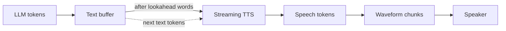

# How does a TTS model start speaking before the full sentence arrives?

> **Step 16: AI Infrastructure, Deployment, and System Design** · ⏱️ 17 min read · [Read original](https://outcomeschool.com/blog/streaming-tts)

## TL;DR
TTS models normally want the full sentence because pronunciation, prosody, and number reading depend on upcoming words. Streaming TTS trades off speed and naturalness by using a small lookahead, or by training models that read text and emit audio at the same time.

## Key Concepts
- **Prosody** — pitch, speed, pauses, stress; e.g. a question rises at the end.
- **Time to first audio** — end of the question to first sound heard.
- **Lookahead** — number of future words the model sees before speaking a word.
- **Incremental TTS (prefix-to-prefix)** — build the start of the audio from only the start of the text (Baidu, 2020).
- **Dual-streaming / bistreaming TTS** — models handling text in and audio out simultaneously.
- **Speech tokens** — small codes for slices of sound, later decoded into a waveform chunk by chunk.

## How It Works
**Why a TTS wants the future:** (1) "read" sounds like "reed" or "red" depending on later words; (2) "You are coming tomorrow?" vs a statement differ only by the final mark; (3) "Dr." (Doctor or Drive) and "2025" depend on context. Models are trained on full sentences, hence natural but slow to start.

**Five approaches**

| Approach | Speech starts | Naturalness |
|---|---|---|
| 1. Wait for full reply | After whole reply | Most natural |
| 2. Sentence by sentence | After first sentence | Natural |
| 3. Word by word | After first word | Broken, robotic |
| 4. Small lookahead | After first few words | Close to natural |
| 5. Bistreaming models | After a few text tokens | Natural, needs special model |

- **Approach 4:** with lookahead of 2, "I" is spoken only after "I read that" has been seen. Earlier audio is kept and continued smoothly. Wait depends on lookahead, not sentence length. Issue: the model was trained on full sentences, not half ones.
- **Approach 5, way 1 (CosyVoice 2, Alibaba):** training interleaves 5 text tokens with 15 speech tokens (25 speech tokens per second, so 15 is about 0.6 s). A filling token requests the next 5 text tokens.
- **Approach 5, way 2 (Kyutai Delayed Streams Modeling):** audio stream kept a fixed number of steps behind the text stream, trained that way from the start.

**Numbers (10 tokens per second, 14-token reply, 0.2 s TTS start):** full reply 1.6 s; lookahead of 2 words (3 tokens) 0.5 s; interleaving (5 tokens) 0.7 s.

**Fails when:** the key word is far ahead, the question mark comes last (earlier part spoken as a statement), verb-final languages like Hindi or Japanese, or numbers and abbreviations needing following words.

## Diagram

## Key Takeaways
- TTS wants future text for pronunciation, prosody, and number/abbreviation reading.
- Sentence chunking is simple and works with any TTS; word-by-word sounds robotic.
- A small lookahead decouples start time from sentence length.
- Bistreaming models (CosyVoice 2, Kyutai) are trained to speak from partial text, but need that special training.
- Bigger lookahead means better speech but a longer wait; choose per use case.
