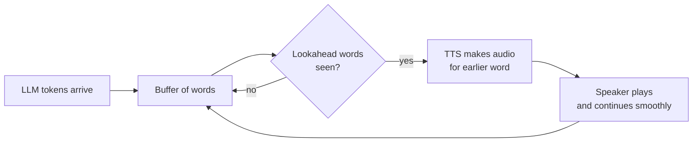
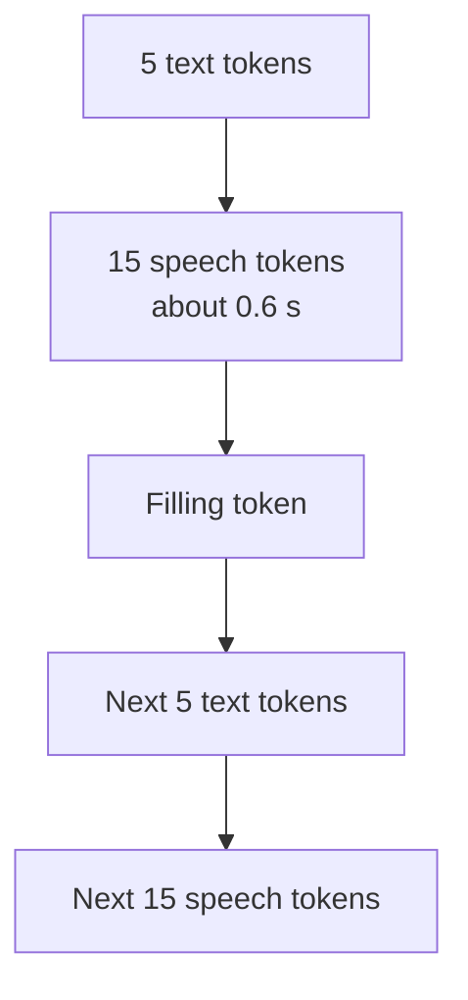

# How does a TTS model start speaking before the full sentence arrives?

> **Step 16: AI Infrastructure, Deployment, and System Design** · ⏱️ 17 min read · [Read original](https://outcomeschool.com/blog/streaming-tts)

## TL;DR
A streaming TTS model starts speaking by reading text as it arrives and staying only a few words behind it (a small lookahead), turning each piece into audio while the rest of the sentence is still being written. This gets the first sound out in a fraction of a second while keeping most of the naturalness of full-sentence TTS. Newer dual-streaming models are trained to read and speak at once.

## Key Concepts
- **TTS** — text in, spoken audio out. LLM streams tokens, so text reaches TTS a little at a time.
- **Time to first audio** — end of the question to the first sound heard.
- **Prosody** — rise/fall of voice: pitch, speed, pauses, stress.
- **Lookahead** — number of future words seen before speaking a word.
- **Incremental TTS / prefix-to-prefix** — create audio piece by piece from the beginning of the text.
- **Speech tokens** — small codes each representing a tiny slice of sound; a second part turns them into a waveform chunk by chunk.
- **Dual-streaming (bistreaming) TTS** — model takes text stream in and gives audio stream out at once.
- **Filling token** — CosyVoice 2's special token meaning "bring the next 5 text tokens".

## How It Works

### Why TTS wants the future (3 reasons)
Humans read aloud with eyes a few words ahead of the mouth.
1. **Pronunciation**: "I read books every day" (reed) vs "I read that book last year" (red); the answer is in later words.
2. **Prosody**: "You are coming tomorrow." vs "...tomorrow?" differ only in the last mark; voice rises only if the model sees the question mark.
3. **Numbers/short forms**: "Dr." = Doctor or Drive; "2025" = two thousand twenty-five or twenty twenty-five.

Most TTS models are trained on full sentences: natural, but slow to start.

### Approach comparison
| Approach | Speech starts | Naturalness |
|---|---|---|
| 1. Wait for full reply | After whole reply | Most natural |
| 2. Sentence by sentence | After first sentence | Natural |
| 3. Word by word | After first word | Broken, robotic |
| 4. Small lookahead | After first few words | Close to natural |
| 5. Dual-streaming models | After a few tokens | Natural |

### Approach 1: Full reply
LLM 3 s + TTS 1 s = about 4 s silence. Wait grows with reply length. Most natural.

### Approach 2: Sentence by sentence
Buffer tokens; when it ends with `.`, `?`, `!`, synthesize and play, clear buffer. (Real systems play in background and also split at commas for long sentences; naive rule splits wrongly at "Dr.".) Each sentence is complete so hints are intact. Still waits for the whole first sentence. Very common, simple, works with any TTS (see sentence-chunking blog).

### Approach 3: Word by word
Tiny time to first audio, but each word has no idea of the future: wrong "read", no question rise, "Dr." ambiguity, plus no smooth flow between words.

### Approach 4: Small lookahead
- Wait until a few words after the current one have been seen. Wait depends on lookahead, not sentence length (5 or 50 words, same).
- Baidu 2020 paper "Incremental Text-to-Speech Synthesis with Prefix-to-Prefix Framework": lookahead of 1–2 words gave speech close to full-sentence TTS (English and Chinese).
- Example with lookahead 2: "I read that" yields spoken "I"; "I read that book" yields "I read"; "read" is spoken only after "that book" seen. But the best hint ("last year") is 4 words away, so it may still guess.
- Earlier audio is kept and continued smoothly.
- Weakness: models were trained on full sentences, so half sentences are unfamiliar and can hurt quality.

### Approach 5: Read and speak at the same time
- **Way 1, interleaving (CosyVoice 2, Alibaba)**: training mixes 5 text tokens then 15 speech tokens, repeated. Model makes 25 speech tokens per second, so 15 tokens is about 0.6 s of speech. At inference only the next 5 text tokens are needed to produce 15 speech tokens; a filling token requests the next 5.
- **Way 2, fixed delay (Delayed Streams Modeling, Kyutai)**: text and audio on one clock, audio kept a fixed number of steps behind text, so audio always has a little future text. Same lookahead idea but trained with the delay.
- Pro: natural and fast. Con: needs a model trained this way.

### Walkthrough (10 tokens/s, TTS 0.2 s, 14-token reply, word = token)
| Approach | Calculation | First sound |
|---|---|---|
| 1 Full reply | 14/10 + 0.2 | 1.6 s |
| 2 Sentence (one sentence) | same as 1 | 1.6 s |
| 4 Lookahead 2 (3 tokens) | 3/10 + 0.2 | 0.5 s |
| 5 Interleave (5 tokens) | 5/10 + 0.2 | 0.7 s |

With 3 sentences, approach 1 gets slower; 4 and 5 start at the same time.

### Diagram: lookahead streaming

### Diagram: interleaved text and speech tokens

## Trade-offs & Pitfalls
Works well: live LLM token streams; hints close to the word; plain text with few numbers/short forms.
Struggles:
- Meaning depends on a far-ahead word (2–3 word lookahead can't see it).
- Question mark at the very end: earlier part already spoken as a statement.
- Hindi/Japanese verb-final sentences: tune depends on the final verb.
- "2025", "Dr.", "$5.50" need following words.
- Bigger lookahead = better speech but longer wait; smaller = faster start but more mistakes. Choose per use case.

## FAQ
- Time to first audio? → End of question to first sound; with lookahead depends only on lookahead.
- Prosody? → Pitch, speed, pauses, stress.
- Speech tokens? → Codes for slices of sound, decoded to waveform chunk by chunk.
- How many words of lookahead? → 1–2 in Baidu tests.
- Filling token? → CosyVoice 2 signal to bring in the next 5 text tokens.

## Key Takeaways
- TTS needs future words for pronunciation, prosody, and numbers.
- Waiting for the full reply is natural but slow; word by word is fast but robotic.
- A lookahead of a few words decouples the wait from sentence length.
- Dual-streaming models (CosyVoice 2 interleaving 5 text : 15 speech; Kyutai fixed delay) are trained for this.
- Speed vs quality is controlled by the lookahead size.
