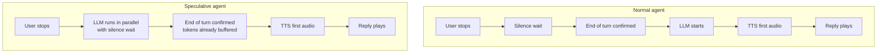
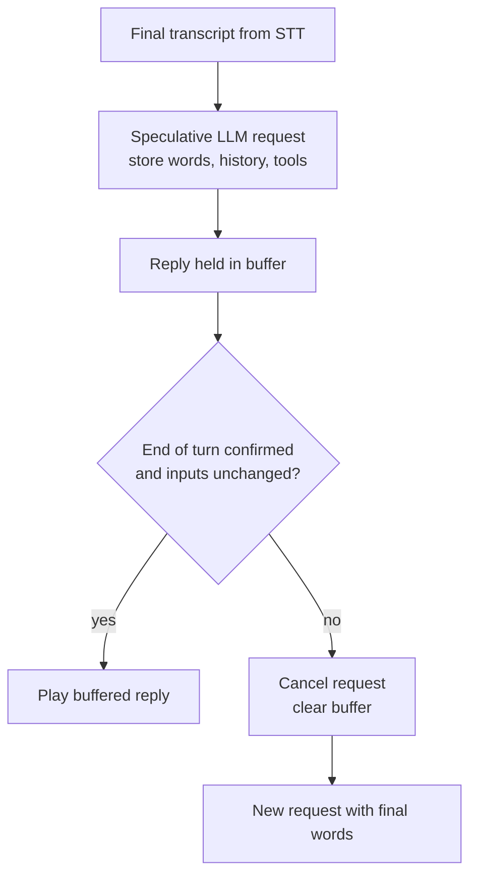

# How does speculative LLM generation start replying before the user finishes?

> **Step 16: AI Infrastructure, Deployment, and System Design** · ⏱️ 16 min read · [Read original](https://outcomeschool.com/blog/speculative-generation-in-voice-agents)

## TL;DR
The voice agent sends the user's latest final transcript to the LLM before end-of-turn is confirmed, keeps the reply hidden in a buffer, and plays it only if the final words match what the reply was built on. The LLM work overlaps with the silence wait, saving up to the LLM's first-token time per turn. Wrong guesses are cancelled and discarded, costing only wasted compute.

## Key Concepts
- **End-of-turn detection** — decides the user is done, using silence and words so far.
- **Interim (partial) transcript** — early, changing STT text; **final transcript** — STT confident about a piece.
- **Speculative LLM generation (preemptive generation)** — start LLM on a guess that current words are final; keep reply unplayed.
- **Buffer** — holding area for the hidden reply (text, optionally audio).
- **Speculative decoding** — different idea: small model guesses tokens to speed LLM itself.
- **Tool call** — LLM only recommends it; agent code runs it.

## How It Works

### Normal agent and where time goes
User speaks → STT → end-of-turn waits for silence → LLM → TTS → reply. LLM doesn't start until end-of-turn fires. User waits for: silence wait, then LLM first tokens, then TTS first audio, in sequence. The agent can't reply instantly because the user may just be breathing ("...and tomorrow?"). Human gaps are well under a second.

Idea: overlap silence wait and LLM time. Analogy: a tea shop owner starts boiling tea at "One cup of..."; if "coffee", the tea is wasted.

### Step by step (example "Book a table for two at 8 PM.")
1. User speaks; STT sends interim "Book a", "Book a table", "Book a table for two".
2. User stops; STT sends final transcript.
3. Agent immediately sends it to the LLM (speculative request) without waiting for end-of-turn.
4. LLM writes "Sure, let me check if a table for two is free at 8 PM." into the buffer; nothing played.
5. End-of-turn detector still in its silence wait.
6. It says "user is done"; first reply part already buffered.
7. Agent compares words used with final words; same, so plays the buffer at once.

### Guess right
Same answer, faster. Saving up to LLM first-token time. Example silence wait 500 ms, LLM 400 ms: normal 500 + 400 = 900 ms before TTS starts; speculative TTS can start at 500 ms (saves 400). If LLM takes longer than the silence wait, saving equals the silence wait (only that overlaps).

### Guess wrong
User says "Book a table for two..." pauses; agent sends it; LLM writes "Sure, for what time?". User continues "...at 8 PM, near the window." Early reply is wrong. Agent: cancels the LLM request, discards buffer, then sends the new final transcript as a fresh speculative request. User never hears the wrong reply. Loss = only wasted LLM work.

### Detecting change
Store the exact words sent; compare with final turn words at confirmation. Same → use buffer; different → discard and re-request. Also compare conversation history and tool list; if either changed, discard. Never play a speculative reply before end-of-turn is confirmed.

### Preparing the voice early too
Send the first speculative sentence to TTS and buffer audio as well. Reply plays almost the instant the turn is confirmed. If words differ, discard both text and audio. Costs more waste when wrong, so many setups run only the LLM early by default, TTS early only when the extra speed is worth it.

### Diagram: normal vs speculative

### Diagram: accept or discard

## Trade-offs & Pitfalls
- Every wrong guess is paid but unused: e.g. 3 pauses in a long sentence can mean 4 requests for one turn, only the last used. Applies to LLM tokens and TTS.
- Extra load on LLM servers can slow replies for everyone at scale.
- Keep waste low: start only on final transcripts, not every interim transcript (they change constantly).
- Works well: short clear sentences (booking, ordering, simple questions), support calls where speed matters, tolerable extra cost.
- Works poorly: long sentences with many pauses (stories, dictation) where guesses keep failing; very expensive LLM requests.
- A speculative request must only prepare a reply, never act in the real world. Hold tool calls (e.g. placing an order) until the turn is confirmed. See slow-tool-calls blog for which tools are safe to start early.

## FAQ
- vs speculative decoding? → Decoding speeds token generation; this overlaps LLM with silence wait.
- Savings? → Up to LLM first-token time, capped by silence wait.
- Start on every interim? → No, final transcripts only.
- Tool call in speculative? → No, run after confirmation.
- Preemptive generation? → Another framework name for the same thing.

## Key Takeaways
- Normal agent serializes silence wait, LLM, TTS; speculation overlaps the first two.
- Reply stays in a buffer until end-of-turn confirms and words match.
- On mismatch: cancel, flush, re-request; user never hears the wrong reply.
- Saving is bounded by min(LLM first-token time, silence wait).
- Cost is wasted tokens and load; trigger on final transcripts only.
- Never run side-effect tools speculatively.
