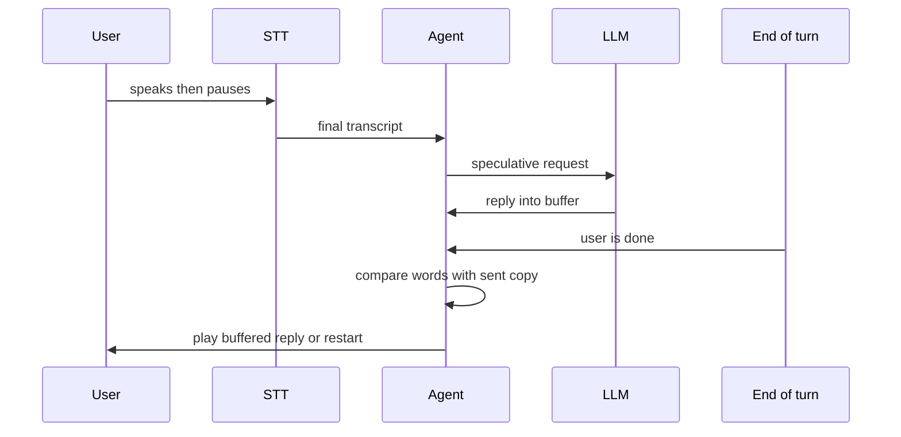

# How does speculative LLM generation start replying before the user finishes?

> **Step 16: AI Infrastructure, Deployment, and System Design** · ⏱️ 16 min read · [Read original](https://outcomeschool.com/blog/speculative-generation-in-voice-agents)

## TL;DR
A normal voice agent waits for end-of-turn detection before calling the LLM, so silence wait and LLM time add up. Speculative generation sends the transcript to the LLM early and buffers the reply unplayed, overlapping the two waits; if the guess was wrong, the buffer is discarded.

## Key Concepts
- **End-of-turn detection** — decides the user is done, using silence and words so far.
- **Interim vs final transcript** — partial STT text vs confident text for a piece of speech.
- **Speculative request** — LLM call made before the turn is confirmed (also called preemptive generation).
- **Buffer** — holding area for the unplayed reply.
- **Speculative decoding** — a different idea: a small model guesses tokens to speed up the LLM itself.

## How It Works
**Normal flow:** STT, then wait for end-of-turn, then LLM, then TTS. User waits for silence wait + LLM first tokens + TTS first audio.

**Speculative flow (example "Book a table for two at 8 PM."):**
1. STT streams interim text, then a final transcript.
2. Agent sends the final transcript to the LLM immediately, without waiting for end-of-turn.
3. LLM reply goes into a buffer, nothing is played.
4. When end-of-turn confirms, compare the words sent with the final words.
5. Same: play from the buffer. Different: cancel the request, discard the buffer, send a fresh request.

**Numbers:** silence wait 500 ms, LLM first tokens 400 ms. Normal: 900 ms before TTS starts. Speculative: 500 ms. Saving is capped by the silence wait.

**Wrong guess:** user says "Book a table for two..." and pauses; LLM replies "for what time?"; user continues "...at 8 PM, near the window". The agent cancels, clears the buffer, and starts fresh. The user never hears the wrong reply.

**Validity check:** compare not only words but also conversation history and tool list; any change invalidates the reply.

**Preparing the voice early:** also send the first sentence to TTS and buffer audio. Faster start but more waste when wrong, so many setups only run the LLM early.

**Cost:** wrong guesses are paid-for unused requests (three pauses can mean four requests for one turn) and extra server load. Mitigate by starting only on final transcripts, not every interim.

**When to use:** short, clear utterances, latency-sensitive support calls. Poor for long sentences with many pauses or very expensive LLM calls.

**Safety:** a speculative request only prepares a reply; hold tool calls until the turn is confirmed.

## Diagram

## Key Takeaways
- It overlaps LLM work with the end-of-turn silence wait, hiding up to the silence wait in latency.
- Correctness is preserved because the early reply is never played until the words match.
- On mismatch, cancel the request and discard the buffer; cost is wasted work, not wrong output.
- Trigger on final transcripts only to limit waste.
- Never execute real-world tool actions during the speculative step.
