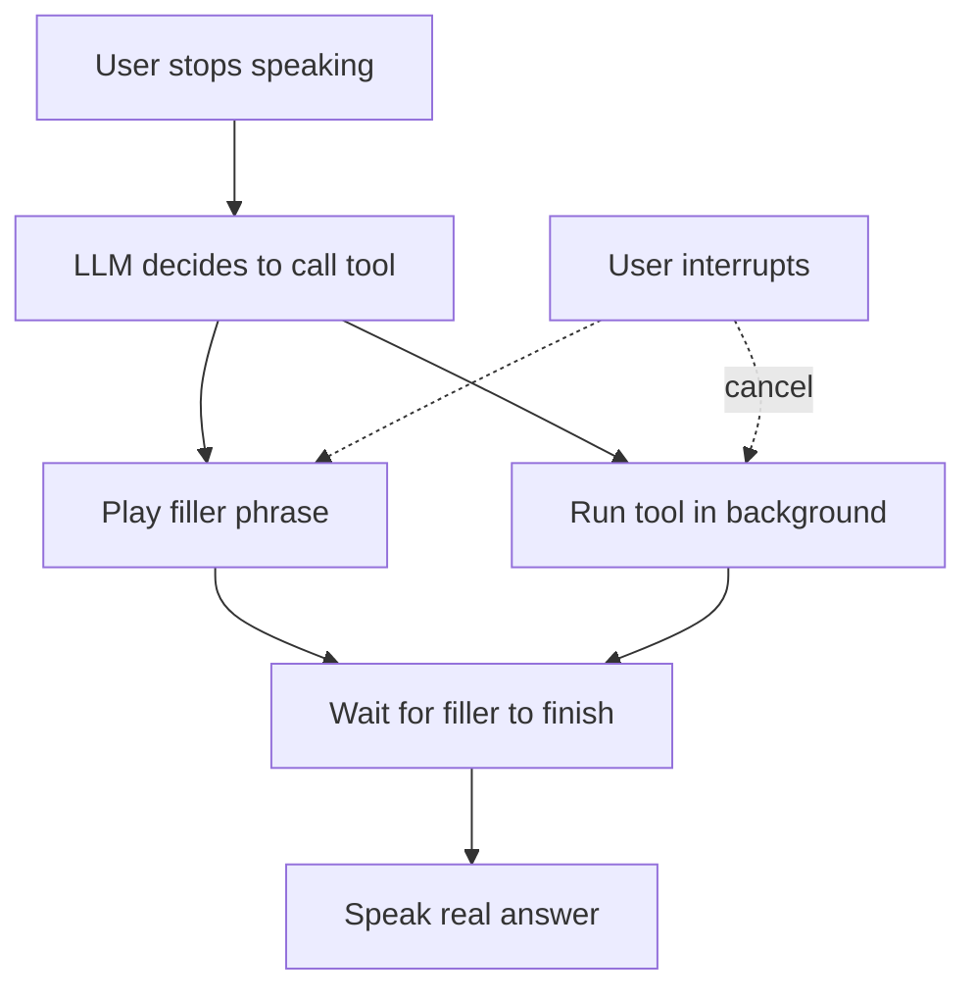

# How do filler phrases hide latency in a voice agent?

> **Step 16: AI Infrastructure, Deployment, and System Design** · ⏱️ 16 min read · [Read original](https://outcomeschool.com/blog/filler-phrases-in-voice-agents)

## TL;DR
A filler phrase is a short natural line ("Let me check that for you.") the agent speaks while the real answer is still being prepared. It does not make the work faster; it cuts perceived latency by filling the wait with speech instead of silence.

## Key Concepts
- **Filler phrase** — short line spoken during preparation of the real answer.
- **Actual vs perceived latency** — time until the real answer vs time until the user hears something.
- **Preamble** — a filler line the LLM itself writes before a tool call.
- **Barge-in handling** — treating the filler like any agent speech on interruption.

## How It Works
**Problem:** for "What is the status of my order 4521?" a tool call takes about 2 s; the user hears silence and thinks the call dropped, then talks over the agent.

**Hiding the wait (example):** without filler, silence until 3000 ms. With filler, the agent speaks at about 800 ms; the phrase lasts about 2 s (to about 2800 ms) while the tool runs, and the answer starts at 3000 ms, leaving a gap of only about 200 ms.

**When to say it**
- *Trigger 1:* when a slow tool call starts, run `speak(filler)` and the tool concurrently, then await the filler before returning so it is not cut off. Skip for fast tools.
- *Trigger 2:* timer, e.g. if no first part of the answer within 1000 ms, play a filler (use `asyncio.shield` so the timeout does not cancel the answer). Too short a limit adds needless fillers; too long leaves silence.
- Use both: tool trigger plus timer as safety net. Never use one for every reply ("Hi" then "One moment" sounds strange).

**Sources of filler audio**

| Option | Speed to start | Specific to question | Control |
|---|---|---|---|
| Pre-recorded audio | Fastest | No | Full |
| TTS from fixed list | Fast | No | Full |
| LLM-generated (preamble) | Slower | Yes | Partial |

Pre-recorded audio must match the agent's voice. Rotate phrases, never repeat the same twice in a row.

**Memory:** add the played filler to history as an assistant message, otherwise the LLM may repeat it. Mostly needed for options 1 and 2.

**Interruption:** stop the filler, cancel the now-wrong tool call, keep only the heard part in history, listen again.

**Hurts when:** replies are fast, fillers are overused, they make wrong promises ("Let me book that" then failure; prefer "check"), or waits are very long (add a further update).

## Diagram

## Key Takeaways
- Fillers reduce perceived latency, not actual latency.
- Overlap the filler speech with the tool call so the remaining silence shrinks.
- Trigger on slow tools and on a timeout, not on every reply.
- Record fillers in conversation history and handle interruptions cleanly.
- Use neutral wording and still reduce real latency with streaming and faster tools.
