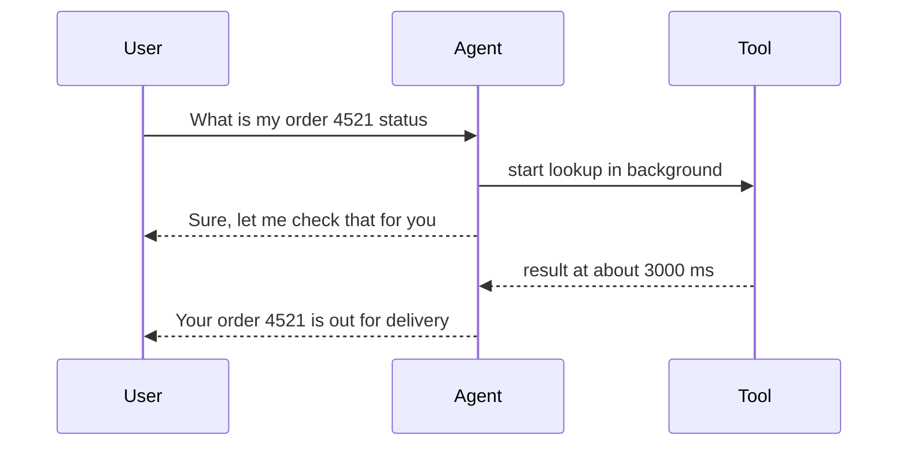
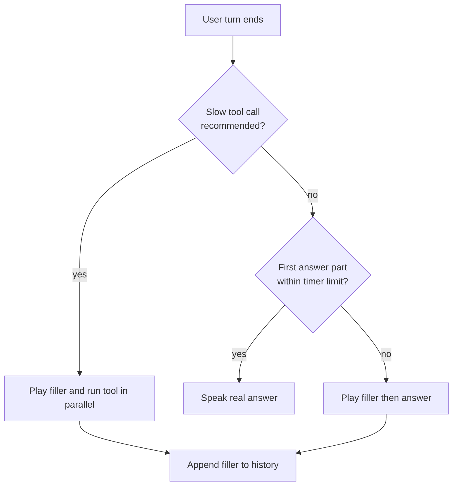

# How do filler phrases hide latency in a voice agent?

> **Step 16: AI Infrastructure, Deployment, and System Design** · ⏱️ 16 min read · [Read original](https://outcomeschool.com/blog/filler-phrases-in-voice-agents)

## TL;DR
A filler phrase ("Let me check that for you") is a short natural line spoken while the agent is still working on the real answer (usually a slow tool call). It doesn't speed the work; it cuts perceived latency by filling the silence, and its speaking time overlaps with the tool call. Trigger it on slow tool calls or a timer, rotate phrases, and add it to conversation history.

## Key Concepts
- **Latency** — wait between the user stopping and the agent starting (human gap is about 200 ms).
- **Actual latency** — time until the real answer is ready (unchanged by filler).
- **Perceived latency** — time until the user hears something showing the agent is working (filler cuts it).
- **Filler phrase** — "Let me check that for you", "One moment, please", "Sure, let me pull up your order".
- **Preamble** — short line the LLM itself says before a tool call.
- **Tool call** — LLM recommends tool and input; agent code runs it (can take 1–2+ s).

## How It Works

### The problem
Question "What is the status of my order number 4521?" → STT → LLM decides to look up → tool runs (about 2 s) → LLM writes reply → TTS. User hears nothing, wonders "Did it hear me? Has the call dropped? Should I repeat?", says "Hello?" just as the agent speaks, and they talk over each other. The tool needs its time, so change what the user hears. A human agent says "Sure, let me check" before typing.

### Timeline effect
- Without filler: silence until 3000 ms, then "Your order 4521 is out for delivery."
- With filler: at 800 ms "Sure, let me check that for you." (800 ms covers end-of-turn check, STT and LLM deciding to look up) while the tool runs in background; real answer still at 3000 ms.
- The filler takes about 2 s to say (about 800 to 2800 ms), overlapping the tool call, leaving only about 200 ms of silence.

### When to say one (not every reply)
"Hi" → "One moment, please" → "Hello" sounds strange; quick replies don't need it.
- **Trigger 1: tool call starts.** When the LLM recommends a slow tool (e.g. get_order_status), start speaking the filler as a separate task and run the tool concurrently; await the filler before returning the result so the answer doesn't cut it off. Only for known-slow tools (not 100 ms ones).
```python
async def on_tool_call(name, args):
    filler = asyncio.create_task(speak("Let me check that for you."))
    result = await run_tool(name, args)
    await filler
    return result
```
- **Trigger 2: timer.** Start when the user stops; if the first part of the real answer isn't there within e.g. 1000 ms, play a filler. Use `asyncio.wait_for(asyncio.shield(answer_task), timeout=1.0)`; shield prevents the timeout from cancelling the real answer. In real systems the answer streams and the timer waits only for the first part. Too short a limit says fillers on fast replies; too long and silence already happened.
- Use both: tool-start trigger plus timer as safety net.

### Ways to produce the phrase
| Option | Speed to start | Specific to question | Control |
|---|---|---|---|
| Pre-recorded audio | Fastest | No | Full |
| TTS from fixed list | Fast | No | Full |
| Generated by LLM (preamble) | Slower | Yes | Partial |

- Pre-recorded: no TTS step, but always the same and must use the agent's voice.
- TTS list: easy to change, voice matches, small TTS delay.
- LLM preamble: instruct "Before calling a tool, tell the user in one short sentence what you are about to do", describe the action, vary wording, skip for direct answers/quick tools. Fits question ("Sure, let me look up order 4521 for you") but waits for LLM and TTS and may ignore the instruction.
- Keep several phrases and never repeat the same one twice in a row, or it sounds like a machine.

### Conversation memory
If a pre-recorded filler isn't added to history, the LLM doesn't know it spoke and may repeat "Let me check that for you" twice. Append `{"role": "assistant", "content": "Let me check that for you."}`. Mainly needed for pre-recorded and TTS-list options (an LLM preamble is already in its own output).

### Interruption during a filler
Stop the filler immediately; cancel the in-flight tool call if the request is now wrong (user: "Actually, it's order 4522"); keep only the heard part in history; listen and restart.

### Diagram: filler timeline


### Diagram: when to use a filler


## Trade-offs & Pitfalls
Helps: tool calls (order lookup, booking, balance), long thinking steps, phone calls where silence suggests a dropped call.
Hurts:
- Fast replies: filler only delays the real answer.
- Overuse: "One moment" every turn makes the agent sound slow.
- Wrong promises: "Let me book that" then booking fails; use neutral "Let me check that for you".
- Very long waits (e.g. 10 s): one filler isn't enough; add another update like "This is taking a little longer than usual, thank you for waiting."
- Not a replacement for real speed: still use streaming, faster models, faster tools; filler covers only the unavoidable wait. Speculative generation is another way to cut the wait.

## FAQ
- Faster answer? → No, only perceived latency drops.
- Preamble? → LLM's own short line before a tool call.
- Why rotate phrases? → Repetition sounds robotic.
- Very long tool? → Add follow-up updates.
- Promise a specific action? → No, stay neutral.

## Key Takeaways
- Filler hides the wait, it doesn't remove it: perceived vs actual latency.
- Overlap filler speech with the tool call.
- Trigger on slow tool calls and/or a timer; not for fast replies.
- Pre-recorded is fastest, LLM preamble is most specific.
- Add the filler to history to avoid repeats; rotate phrases.
- On interruption, stop, cancel stale tool calls, and keep only what was heard.
