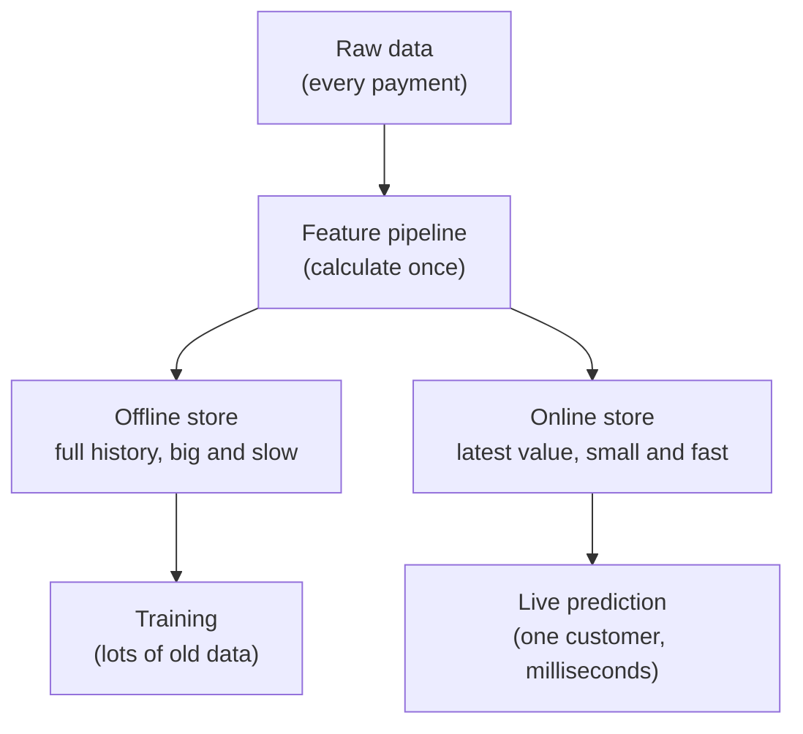
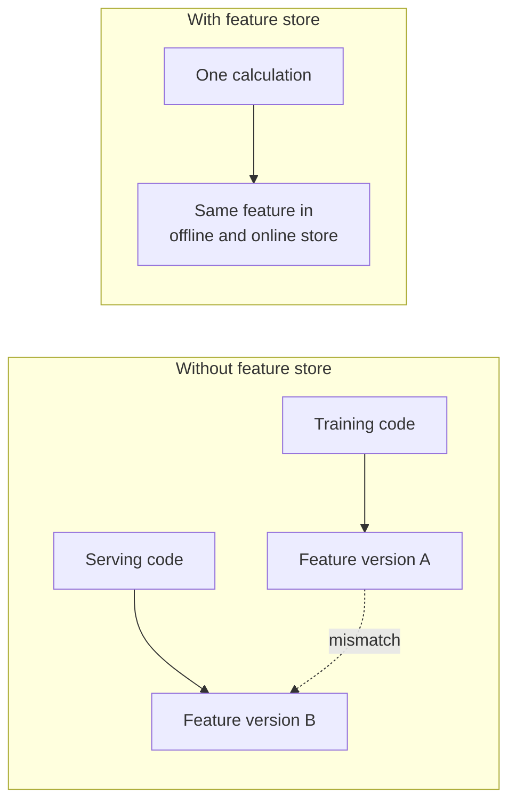

# How does a feature store work?

> **Step 16: AI Infrastructure, Deployment, and System Design** · ⏱️ 15 min read · [Read original](https://outcomeschool.com/blog/feature-store)

## TL;DR
A feature store is a central, special database for features: it stores, manages and serves cleaned, ready-to-use features for ML, both for training and for live predictions. A feature is calculated once and written to an offline store (full history, for training) and an online store (latest value, for fast serving). This removes duplicate work, inconsistent definitions and training-serving skew.

## Key Concepts
- **Feature** — a single piece of information fed to a model (e.g. payments in the last hour, total spend in 7 days, card country, average spend per payment in 30 days). Its subject can be a customer, product, payment, etc.
- **Feature store** — central place that stores, manages and serves features; sits between raw data and the model. Unlike a normal database (raw data), it holds cleaned features and serves two very different consumers.
- **Feature pipeline** — series of steps that turns raw data into clean features (e.g. group payments by customer and sum).
- **Offline store** — large history of feature values over time; built for size, used for training.
- **Online store** — only the latest value per feature; built for speed (milliseconds), used for live predictions.
- **Training-serving skew** — a feature is computed one way in training and another way in live serving, so predictions go wrong.
- **Point-in-time correctness** — training uses each feature value exactly as it was at that past moment.
- **Data leakage** — future information leaking into training.

## How It Works

### Problem before feature stores
Three teams (fraud, recommendations, churn) all need "total spent in last 30 days" and each writes its own code.
1. Wasted effort: same feature built three times.
2. Different answers: Team A counts only completed payments, Team B also counts refunds.
3. Hidden bug: training-serving skew.

A feature store builds a feature once, stores it in one place, and every team and model reuses the exact same feature.

### Three stages
1. **Create** - feature pipeline calculates features from raw data (unprocessed info, e.g. every payment).
2. **Store** - features saved, organized and labeled so any team can find and reuse them.
3. **Serve** - give features to whoever asks, in two situations with opposite needs:
   - Training: millions of past values at once, can take its time.
   - Live prediction: one customer, right now, decision in milliseconds (little data, extremely fast).

One store handles both by having two parts.

### Offline vs online store
| Point | Offline store | Online store |
|---|---|---|
| Keeps | Full history of features | Only latest feature value |
| Built for | Large size | High speed |
| Speed | Slower, minutes | Very fast, milliseconds |
| Used for | Training | Live predictions |
| Amount of data | Very large | Small per request |

The same single feature calculation feeds both stores, so the numbers match.

### Training-serving skew
- Without a feature store, training features are prepared with one language/tools (large data system), then re-prepared for the fast live system with different code.
- Even a tiny difference breaks things: e.g. "average spend" rounded to two decimals in training but not in serving. The model learned on rounded numbers but gets unrounded ones.
- It is silent: code does not crash, predictions are just wrong, so nobody notices for a long time.
- Fix: calculate each feature once with one piece of code and place the result in both stores. This removes the most common cause of skew and is a main reason feature stores exist.

### End-to-end example (discount model)
Feature: orders in the last 30 days.
1. Calculate: one calculation counts orders per customer; Riya has 12.
2. Store: 12 goes into the offline store (her history) and the online store (her latest value).
3. Train: pull millions of past values from the offline store; model learns many-orders customers respond to discounts.
4. Serve: Riya opens the app; the online store instantly returns 12; the model decides to show a discount. One calculation, no mismatch.

### Point-in-time correctness
Training a fraud model on Riya's payment on 1st January needs her "total spent in last 30 days" as of 1st January, not the 1st March value (the future did not exist yet). Using the March value is data leakage: the model looks great in training and fails in the real world. The offline store keeps timestamped history of every feature, so asking for 1st January returns that day's value and nothing from the future.

## Diagram(s)

### Feature store flow

### Skew vs single calculation

## Trade-offs & Pitfalls
- Skew is silent: no crash, just wrong predictions.
- Leakage from using future values gives deceptively good training results.
- Not always needed: for a small project with one model and one person, simple files or a normal database are enough; a feature store is extra effort with little benefit.
- Use one when:
  - many teams or models reuse the same features;
  - fast live predictions are needed (online store);
  - training on large history with point-in-time correctness (offline store);
  - you want to avoid training-serving skew.
- In short, use it when ML work is large, shared, and needs both speed and consistency.

## FAQ
- Same as a normal database? → No. A normal database keeps raw data; a feature store keeps cleaned features and serves training (lots of old data) and live prediction (one customer's features now).
- What is a feature pipeline? → The series of steps turning raw data into features, e.g. group payments by customer and sum to get 30-day spend.
- Why does the online store keep only the latest value? → It is built for speed; live prediction needs little data but must be extremely fast. History lives in the offline store.
- Why is skew hard to notice? → Code runs without crashing; the model quietly gives wrong predictions, and even a small difference like rounding can cause it.

## Key Takeaways
- A feature store builds a feature once and shares it across teams and models.
- Raw data goes through a feature pipeline, is stored, then served to training and live prediction.
- Offline store: full history, big and slow, for training. Online store: latest value, small and fast, for serving.
- One calculation feeding both stores prevents training-serving skew.
- Point-in-time correctness (timestamped history) prevents data leakage.
- Skip it for small single-model projects; adopt it as work grows shared and needs speed and consistency.
