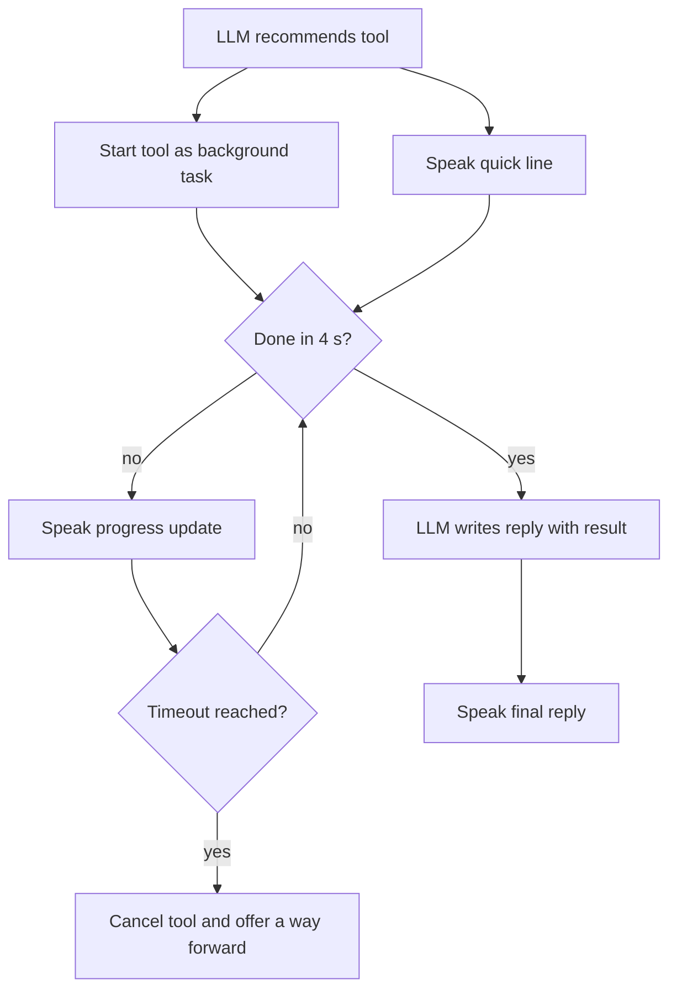

# How does a voice agent hide the delay of a slow tool call?

> **Step 16: AI Infrastructure, Deployment, and System Design** · ⏱️ 17 min read · [Read original](https://outcomeschool.com/blog/slow-tool-calls-in-voice-agents)

## TL;DR
On a voice call there is no spinner, so a slow tool call (2 to 10+ seconds) becomes silence, which makes users say "Hello?" and break the conversation. Voice agents hide the delay with spoken cover, background execution, early starts, and faster tools, and fail gracefully on timeout.

## Key Concepts
- **Tool call** — the LLM recommends a tool and input; the agent code runs it and returns the result to the LLM.
- **Progress update** — a line spoken at fixed times during a long wait.
- **Speculative execution** — starting a tool before the user finishes, because it is very likely needed.
- **Timeout** — the limit after which the agent stops waiting and tells the user honestly.

## How It Works
Example: "Is my flight AI 101 to Delhi on time?" The tool delay (about 3 s) stacks on top of normal STT, LLM, TTS time. The real problem is the silence, not the delay.

| Technique | Idea | Notes |
|---|---|---|
| 1. Speak a short line right away | Either the LLM writes a short line with the tool call (fits the request, slightly later) or the agent plays a ready-made line (fastest, rotate lines) | Skip for tools that return quickly |
| 2. Progress updates | Timer-driven lines, e.g. at 0 s, 4 s, 8 s, each different; stop if the tool finishes; optional soft typing sound; or say "usually takes about 10 seconds" up front | Handles long waits |
| 3. Background execution | Run the tool as a separate task and keep talking ("While I do that, should I text you the confirmation?"), then fold in the result when it arrives | Most natural but hardest; LLM must not invent a result that has not arrived |
| 4. Start the tool early | Use partial STT text; once "check my flight AI 101" is heard, start the flight lookup while the user still speaks | Only for safe, read-only tools; never booking, payments, or cancellations |
| 5. Make the tool faster | Cache results, preload account data at call start, run independent tools in parallel | Less to hide |

**Timeout:** do not go silent or say "Error". Say what happened and offer a next step ("Can I send you the status by text?" or "Keep trying, or help with something else?").

**Combined code idea:** start the tool as a task, speak a random quick line, then loop `asyncio.wait({task}, timeout=4)` speaking a progress line each time it is not done; after the last wait cancel the task and return None, and the caller speaks an honest fallback.

## Diagram

## Key Takeaways
- The problem on voice is silence, so fill it with useful speech.
- Match the technique to the wait: short line for 2 to 3 s, progress updates for longer, background execution for very long.
- Start tools early only when running them for nothing does no harm.
- Cut real latency too: caching, preloading, parallel tools.
- Always include a timeout with an honest message and a clear next step.
