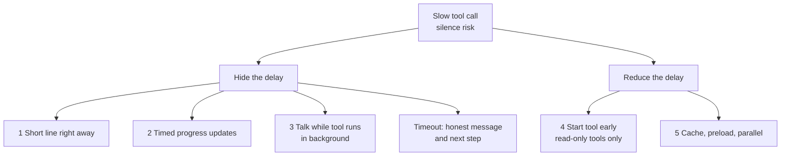
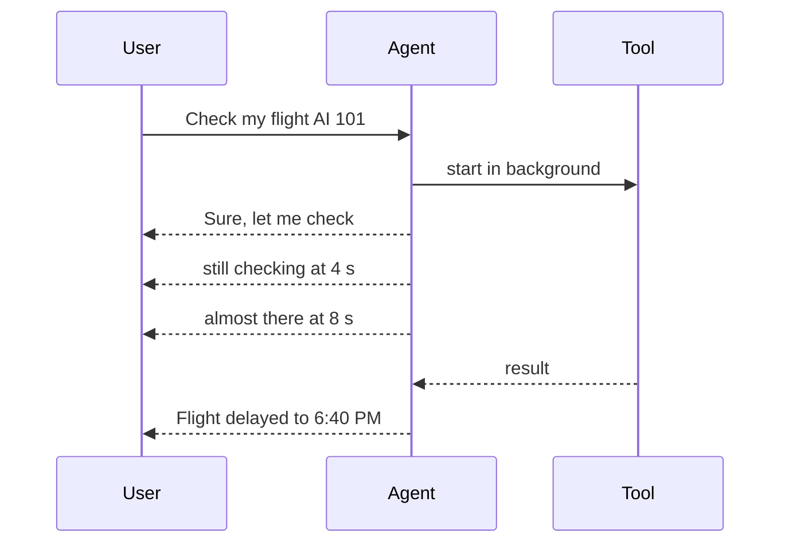

# How does a voice agent hide the delay of a slow tool call?

> **Step 16: AI Infrastructure, Deployment, and System Design** · ⏱️ 17 min read · [Read original](https://outcomeschool.com/blog/slow-tool-calls-in-voice-agents)

## TL;DR
A slow tool call hurts a voice agent because there is no spinner, only silence, which makes users think the call dropped. The agent never lets the line go silent: it speaks a short line, gives timed progress updates, keeps chatting while the tool runs in the background, starts the tool early, and speeds the tool up. If the tool times out it says so honestly with a way forward.

## Key Concepts
- **Tool call** — agent code outside the LLM (DB lookup, service call). The LLM only recommends the tool and input; the agent runs it and returns the result to the LLM.
- **Progress update** — short line at fixed points during a long wait.
- **Speculative execution** — start a tool before being fully sure it's needed, because it is very likely needed.
- **Timeout** — time limit after which the agent stops waiting.
- Target: good voice agents aim to reply in about 1 second.

## How It Works

### The problem
"Can you check if my flight AI 101 to Delhi is on time?" Tool (airline system) takes 2–10 s on top of the STT/LLM/TTS delay. On chat there's a spinner; on voice there's silence. After 2–3 s users think "Did the call drop? Did it hear me?", say "Hello?" or repeat, and the agent gets confused. The issue is the silence, not the delay.

Flow: LLM recommends `check_flight_status(flight="AI 101")` → agent runs tool (3 s) → result `{status: delayed, new_time: 6:40 PM}` → LLM writes reply → TTS.

### Technique 1: Short line right away
Like a help desk person saying "Sure, let me check that for you".
- **Way 1, LLM writes it**: instruct "Before you call any tool, first say one short sentence." Fits the request ("let me check your flight") but arrives a bit later (LLM + TTS).
- **Way 2, ready-made line**: pre-generated audio ("One moment, please.", "Let me look that up.") played instantly on tool recommendation. Fastest but repetitive; rotate several.
- Skip it for tools that return in a fraction of a second (otherwise "One moment" immediately followed by the answer sounds odd). See filler-phrases blog.

### Technique 2: Progress updates for long waits
One line leaves e.g. 8 s of silence. Use a timer:
| Time since tool started | Agent says |
|---|---|
| 0 s | "Sure, let me check your flight." |
| 4 s | "I am still checking, it is taking a moment." |
| 8 s | "Almost there, thanks for waiting." |

Each line differs. If the tool finishes at 5 s, stop the timer and give the answer (later lines never spoken). Optionally a soft background sound like gentle typing (like hold music, quiet and simple). If a tool is always slow, say upfront "This usually takes about 10 seconds"; known duration feels shorter.

### Technique 3: Keep talking while the tool runs in background
Example: "Book a table for two at 8 PM." → "Sure, I am booking your table now." → booking starts (10 s) → "While I do that, should I text you the confirmation?" → "Yes" → ... → "Your table for two at 8 PM is booked. The text is on its way."
- Start the tool as a separate task so the LLM keeps replying.
- When the result arrives, add it to the conversation; the LLM tells the user after the current sentence.
- Some real-time voice model APIs support talking while a tool call awaits.
- Pro: most natural. Con: harder; track running tools; LLM must not invent a pending result (say it's still waiting).

### Technique 4: Start the tool early (shrink the delay)
STT gives partial text while the user speaks ("Can you check my flight AI 101... I think it leaves around six..."). By "check my flight AI 101" the tool and input are known. Start it early; if the final sentence needs a different tool, discard the result. Only for read-only, harmless tools (flight status). Never for booking, sending money, cancelling: user may say "book a ticket... oh no, wait, do not book it".

### Technique 5: Make the tool faster
- Cache results (e.g. store timings).
- Preload data at call start (account details).
- Run independent tools in parallel (flight status and destination weather).

### Tool too slow: timeout
Do not go silent or say "Error". Be honest with a next step: "The airline system is not responding right now. Can I send you the status by text message as soon as I get it?" or "This is taking longer than usual. Would you like me to keep trying, or can I help you with something else?"

### Combined code
```python
async def run_tool_with_cover(tool, args, speak):
    task = asyncio.create_task(tool(**args))          # don't block
    await speak(random.choice(QUICK_LINES))             # T1
    for line in PROGRESS_LINES:                         # T2
        done, _ = await asyncio.wait({task}, timeout=4)
        if done: return task.result()
        await speak(line)
    done, _ = await asyncio.wait({task}, timeout=4)     # timeout
    if done: return task.result()
    task.cancel(); return None
```
Caller: if `None`, speak "The airline system is not responding right now. Would you like me to try again?"; else give result to LLM and speak its reply. Quick tool = one line + answer; slow = updates; too slow = honest message.

### Diagram: techniques


### Diagram: progress-update timeline


## Trade-offs & Pitfalls
- Hiding techniques don't make the tool faster; only early start, caching, preload, parallelism do.
- Speculative start on write/side-effect tools is unsafe.
- Background mode: complexity, risk of hallucinated results.
- Same repeated lines sound robotic; filler before fast tools sounds odd.

## FAQ
- Short line before every tool? → No, skip for fast tools.
- Does speaking speed up the tool? → No; use early start, cache, preload, parallel.
- Safe to start early? → Read-only tools only.
- User asks before result arrives? → Say it is still waiting; never fabricate.
- Why vary progress lines? → Repetition sounds robotic.

## Key Takeaways
- The problem is silence, not delay itself.
- Short line, then progress updates, with different wording each time.
- Background execution keeps the conversation alive but needs state tracking.
- Speculative execution is for read-only tools only.
- Reduce the delay with cache, preload and parallel tools.
- Always set a timeout with an honest fallback.
