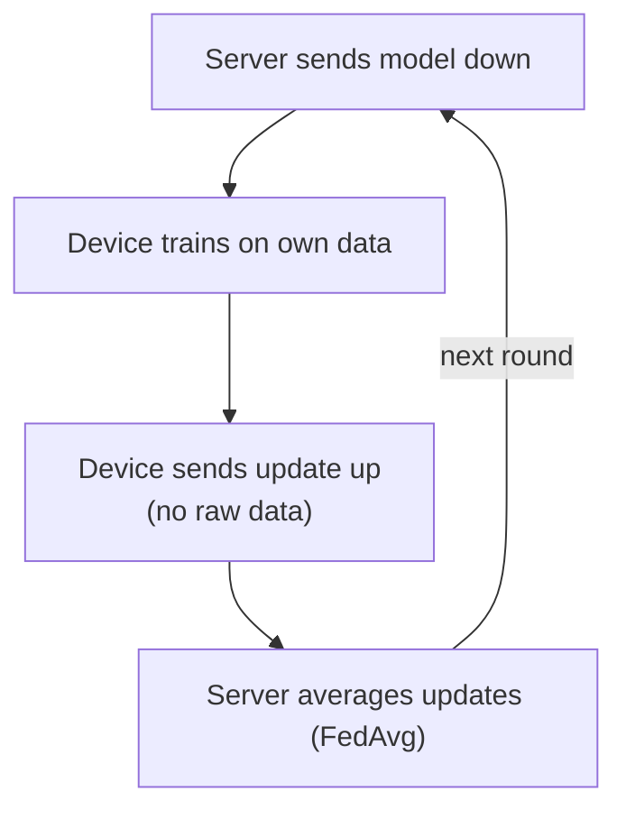
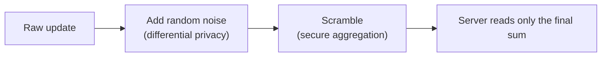

# How does Federated Learning train without raw data?

> **Step 16: AI Infrastructure, Deployment, and System Design** · ⏱️ 13 min read · [Read original](https://outcomeschool.com/blog/federated-learning)

## TL;DR
Federated learning trains one shared model by sending the model to the devices that hold the data. Each device trains locally and sends back only weight updates, which the server averages (FedAvg). Raw data never leaves the device; secure aggregation and differential privacy further protect the updates.

## Key Concepts
- **Federated learning** — train one shared model by sending the learning to the data, not the data to one place. Federation = separate members, one shared goal.
- **Weights** — numbers in which a model stores what it learns.
- **Update** — the change in weights after local training; the only thing sent back.
- **Round** — one cycle: send model, train locally, send update, average.
- **FedAvg (Federated Averaging)** — averages device updates into one improved model.
- **Secure aggregation** — updates are scrambled so the server reads only the final sum.
- **Differential privacy** — each device adds a little random noise to its update.
- Analogy: students do homework at home and return only answers; the teacher never sees the notebooks.

## How It Works
### Problem and naive fix
- Keyboard next-word model needs real typed sentences, which are deeply private (addresses, secret messages, chats).
- Standard approach: all phones send raw data to one big server. Risk: if hacked or misused, every private message is exposed.
- Naive fix: anonymize by removing names. Fails: text like "My new home is at 5th street near the blue temple" still identifies a person; raw data still travels and can leak.

### One round
1. Server sends the current shared model to chosen devices (all start identical).
2. Each device trains on its own private data, on the device.
3. Each device sends back only the update (how much weights changed).
4. Server averages updates into an improved model; next round starts from it.

Repeat many rounds until the model is good.

### Numeric walkthrough (one weight)
Start weight 10 sent to three phones.

| Phone | New weight | Update |
|---|---|---|
| A | 12 | +2 |
| B | 16 | +6 |
| C | 7 | -3 |

Server sees only three numbers, no text. Average update = (2 + 6 + (-3)) / 3 = 5/3 = 1.67; new shared weight = 10 + 1.67 = 11.67. It carries learning from all three phones.

### Averaging in code
```python
def federated_round(global_weight, device_updates):
    total = sum(device_updates)
    average_update = total / len(device_updates)
    return global_weight + average_update

print(federated_round(10, [2, 6, -3]))  # 11.666666666666666
```
Notes:
- Real models have millions of weights; each is averaged the same way, all at once.
- Real FedAvg weights devices by data size (1000 sentences counts more than 10); the plain average is a simplification.
- Related: distributed training averages gradients across data-center machines.

### Keeping updates private
Updates themselves can leak hints about the data.
- **Secure aggregation** — analogy: three friends add secret random numbers to learn their average salary; the random numbers cancel in the sum, no salary revealed.
- **Differential privacy** — noise small enough that the average stays near correct, big enough that tracing any one person's data is very hard.
- Pipeline: raw update, add noise, scramble, server reads only the sum.

### Where it is used
- Hospitals or banks training a shared model without sharing sensitive records.
- Phone keyboard next-word prediction.
- Complying with strict privacy laws, since sensitive data is not collected centrally.

FAQ:
- Is anonymizing enough? No; content can identify people and raw data still leaves the device.
- Do devices count equally? Real FedAvg weights by data amount.
- Secure aggregation vs differential privacy? Scrambling so only the sum is readable versus adding noise to each update.

## Diagram(s)
### Federated round loop


### Update privacy pipeline


## Trade-offs & Pitfalls
- Anonymization does not protect privacy; keep raw data on device.
- Updates can leak hints about the data, so add secure aggregation and differential privacy.
- Noise must be small enough not to wreck the average.
- Plain averaging ignores data size; real FedAvg weights by it.

## Key Takeaways
- Send the model to the data, not data to the model.
- Only weight updates leave the device, never raw data.
- A round: send down, train locally, send update, average; repeat.
- FedAvg averages updates (weighted by data amount in practice); example 10 + 1.67 = 11.67.
- Anonymizing names is not real privacy protection.
- Secure aggregation hides individual updates; differential privacy adds noise.
- Used for keyboards, hospitals, banks, and privacy-law compliance.
