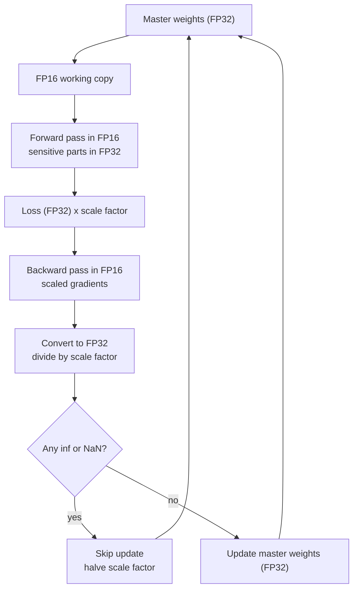
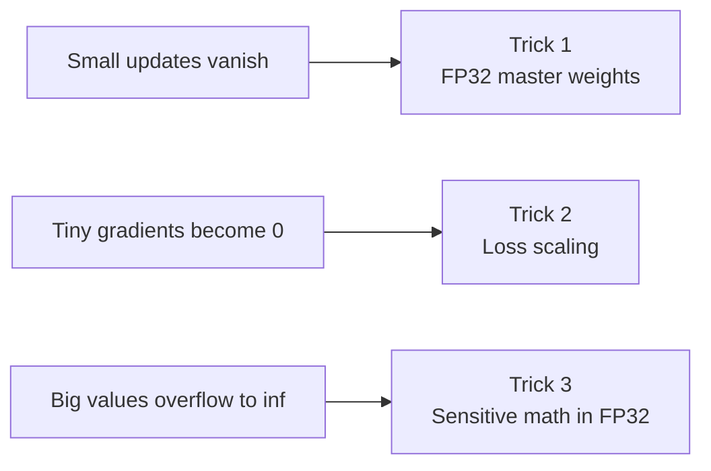

# How does Mixed Precision Training work?

> **Step 16: AI Infrastructure, Deployment, and System Design** · ⏱️ 16 min read · [Read original](https://outcomeschool.com/blog/mixed-precision-training)

## TL;DR
Mixed Precision Training does most math in 16-bit numbers for speed and lower memory, while keeping a few critical things in 32-bit for accuracy. Pure FP16 breaks training (lost updates, zero gradients, overflow), and three tricks fix it: an FP32 master copy of weights, loss scaling, and FP32 for sensitive math. The result is usually faster training at the same accuracy as full FP32.

## Key Concepts
- **Floating point** — number stored as sign + exponent (range) + mantissa (detail).
- **Precision** — how exact a number is (3.1415927 high, 3.14 low).
- **FP32** — 32 bits (4 bytes), full/single precision.
- **FP16** — 16 bits (2 bytes), half precision.
- **BF16** — Brain Floating Point 16 (Google Brain); 16 bits, split differently from FP16.
- **Overflow / underflow** — too big becomes inf / too tiny becomes 0.
- **Master weights** — exact FP32 copy of the weights.
- **Loss scaling** — multiply loss by a scale factor before backward so tiny gradients fit FP16.
- **Dynamic loss scaling** — scale factor adjusts automatically.
- **AMP** — PyTorch Automatic Mixed Precision.
- **Tensor Cores** — NVIDIA units that do 16-bit matrix math much faster than 32-bit.

## How It Works

### Number formats
More mantissa boxes give more exact numbers; more exponent boxes give bigger and tinier numbers. With fixed bits you cannot have both. (Blog uses powers of 10 for intuition; computers use powers of 2.)

| Format | Sign | Exponent (range) | Mantissa (detail) |
|---|---|---|---|
| FP32 | 1 | 8 | 23 |
| FP16 | 1 | 5 | 10 |
| BF16 | 1 | 8 | 7 |

- FP16: decent detail but small range; max value 65,504; cannot store very tiny numbers.
- BF16: FP32's range, less detail.
- NumPy demo: FP32 keeps pi as 3.1415927; FP16 gives about 3.14 (stored 3.140625); `float16(70000)` is `inf` (overflow); `float16(0.00000001)` is 0.0 (underflow).

### Why smaller numbers
- Half the memory (2 vs 4 bytes): bigger model or batch on the same GPU.
- Faster data movement from GPU memory to math units.
- Faster math via Tensor Cores.

### Training step and the problems with pure FP16
Step: input, model (weights), prediction, loss (how wrong), gradients (direction and size of change per weight), update.

$$
w_{new} = w_{old} - \text{learning rate} \times \text{gradient}
$$

1. **Small updates disappear** — gap after 1.0 in FP16 is about 0.001, so 1.0 + 0.0001 stays 1.0 (FP32 gives 1.0001). Repeated, the model stops learning. Analogy: adding single rice grains to a scale showing whole grams.
2. **Tiny gradients become zero** — underflow means "do not change this weight", losing learning signal.
3. **Big values become infinity** — sums above 65,504 overflow and training breaks.

Pure FP16 is fast but broken; pure FP32 is correct but slow.

### Mixed Precision Training
Mix of 16-bit where safe and fast, 32-bit where accuracy is needed. Popularized by the 2017 "Mixed Precision Training" paper (NVIDIA and Baidu): three tricks reach the same accuracy as FP32.

### Trick 1: FP32 master weights (fixes problem 1)
- Master copy in FP32 (exact); working copy in FP16 used for forward and backward passes.
- Update always applied to the FP32 master, so 0.0001 is not lost; then a fresh FP16 copy is made.
- Extra weight memory is minor: activations (saved in-between forward results) dominate memory and are stored in 16-bit, so total memory usually still falls.

### Trick 2: Loss scaling (fixes problem 2)
- Multiply loss by a scale factor (e.g. 1024) before backward; all gradients scale too, moving into FP16 range. Then divide gradients by the factor in FP32 before the update.
- Example: true gradient 0.00000001 becomes 0 in FP16 without scaling. With scaling: x1024 gives 0.00001024, stored about 0.00001025, divided by 1024 in FP32 gives about 0.00000001. Analogy: zoom into an insect, then divide by zoom.
- Too large a factor makes gradients overflow, so use **dynamic loss scaling**:
  - Start with a big factor.
  - After each step check for inf or NaN.
  - If found: skip the update, halve the factor.
  - If many steps are clean: double it again.

### Trick 3: Sensitive math in FP32 (fixes problem 3)
In FP32: running totals of big matrix multiplications (multiply in 16-bit, accumulate in FP32; Tensor Cores support this), sums and averages over many numbers (softmax, normalization layers), and the loss calculation. Everything else (big matmuls) stays 16-bit.

### Full step
1. FP32 master weights, make FP16 copy.
2. Forward pass in FP16 (sensitive parts FP32).
3. Loss (FP32) times scale factor.
4. Backward in FP16 gives scaled gradients.
5. Convert to FP32, divide by scale factor.
6. inf or NaN? Yes: skip update, reduce scale. No: update FP32 master weights.

### PyTorch AMP
```python
scaler = torch.amp.GradScaler("cuda")
for inputs, targets in data_loader:
    optimizer.zero_grad()
    with torch.autocast(device_type="cuda", dtype=torch.float16):
        outputs = model(inputs)
        loss = loss_fn(outputs, targets)
    scaler.scale(loss).backward()
    scaler.step(optimizer)
    scaler.update()
```
- Model weights stay FP32 (master weights, Trick 1).
- `autocast`: matmuls in FP16, softmax and loss in FP32 (Trick 3).
- `scaler.scale(loss).backward()`: scales loss (Trick 2).
- `scaler.step`: unscales gradients, checks inf/NaN, updates only if fine on FP32 weights.
- `scaler.update()`: raises or lowers the scale factor.

BF16 version: `autocast(dtype=torch.bfloat16)` then plain `loss.backward()` and `optimizer.step()`, with no GradScaler.

### FP16 vs BF16
BF16 has FP32's range (8 exponent bits), so tiny gradients do not underflow and big values rarely overflow, so no loss scaling is usually needed. It has less detail, so FP32 master weights are still kept.

| Point | FP16 | BF16 |
|---|---|---|
| Total bits | 16 | 16 |
| Exponent bits (range) | 5 | 8, same as FP32 |
| Mantissa bits (detail) | 10 | 7 |
| Biggest number | 65,504 | About same as FP32 |
| Underflow/overflow risk | High | Low |
| Needs loss scaling | Yes | Usually no |
| Needs FP32 master weights | Yes | Yes |
| GPU support | Most modern NVIDIA GPUs | Newer GPUs: A100, H100, Google TPUs |

BF16 trades detail for range, and for training range usually matters more.

### FAQ
- Accuracy loss? Usually no; the 2017 paper matched FP32 accuracy.
- Always saves memory? In most cases yes (activations in 16-bit outweigh the extra master copy).
- inf or NaN gradient? Update skipped, scale halved (GradScaler does it automatically).
- FP32 master weights with BF16? Yes, because BF16 has only 7 mantissa bits and small updates would be lost.

## Diagram(s)

### One mixed precision training step


### Problems and the tricks that fix them


## Trade-offs & Pitfalls
- Pure FP16 fails: lost updates, underflowed gradients, overflow.
- FP32 master copy costs extra weight memory (usually outweighed by 16-bit activations).
- Too large a loss scale overflows gradients; dynamic scaling skips those steps.
- FP16 needs loss scaling; BF16 does not but has less detail.
- BF16 needs newer hardware (A100, H100, TPUs); older GPUs must use FP16 with loss scaling.

## Key Takeaways
- Mixed precision = 16-bit for speed and memory, 32-bit for accuracy-critical parts.
- FP16: 5 exponent, 10 mantissa bits, max 65,504; BF16: 8 exponent, 7 mantissa, FP32 range.
- Trick 1: FP32 master weights keep tiny updates.
- Trick 2: loss scaling (dynamic) rescues tiny gradients; skip and halve on inf/NaN.
- Trick 3: sums, softmax, normalization and loss stay in FP32.
- PyTorch AMP = `autocast` + `GradScaler` does all three automatically.
- Prefer BF16 if hardware supports it (simpler, stable); else FP16 with loss scaling.
- 2017 NVIDIA and Baidu paper showed no accuracy loss versus FP32.
