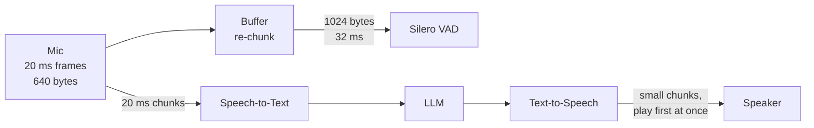

# What are audio frames and chunk sizes in a real-time voice pipeline?

> **Step 16: AI Infrastructure, Deployment, and System Design** · ⏱️ 16 min read · [Read original](https://outcomeschool.com/blog/audio-frames-and-chunk-sizes)

## TL;DR
An audio frame is a small fixed slice of sound (usually 10 or 20 ms); chunk size is how much audio one pipeline stage hands to the next at once. Small chunks cut buffering delay but add per-chunk overhead, and each component wants its own size, so buffers re-chunk between them. Real-time voice agents pick small chunks and accept some overhead.

## Key Concepts
- **Sample** — one number: wave height at one instant.
- **Sample rate** — samples per second. 8 kHz = phone calls; 16 kHz = many speech recognition models; 24/48 kHz = many voice generation models and video calling apps.
- **16-bit PCM** — plain uncompressed samples, 2 bytes each. 1 s at 16 kHz = 16,000 samples = 32,000 bytes.
- **Audio frame** — small group of samples covering a fixed short time (10 or 20 ms). 1 s of speech = 50 frames of 20 ms.
- **Chunk size** — audio moved from one stage to the next in one step; one frame or many frames joined.
- **Buffering delay** — wait of the first sample in a chunk until the chunk fills; added at every collecting step.
- **Packet / header** — network piece plus routing/order info; IP + UDP + RTP headers together are about 40 bytes per packet.
- **Buffer / re-chunking** — waiting area that takes audio in one size and gives it out in another.
- **Codec** — compresses audio before sending, decompresses after.
- **VAD** — small model telling whether a person is speaking.

## How It Works

### Frame size calculation
- Samples per frame = sample rate x frame length (s).
- Bytes per frame = samples per frame x bytes per sample x channels.
- Example: 16 kHz, 16-bit, mono, 20 ms → 320 samples → 640 bytes.

| Sample rate | Frame | Samples | Bytes (16-bit) |
|---|---|---|---|
| 8 kHz | 20 ms | 160 | 320 |
| 16 kHz | 10 ms | 160 | 320 |
| 16 kHz | 20 ms | 320 | 640 |
| 24 kHz | 20 ms | 480 | 960 |
| 48 kHz | 20 ms | 960 | 1920 |

```python
def frame_size(sample_rate, frame_ms, bytes_per_sample=2, channels=1):
    samples = int(sample_rate * frame_ms / 1000)
    return samples, samples * bytes_per_sample * channels
```

- A frame is defined by **time**, not sample count. Bugs come from mixing ms, samples and bytes: 320 bytes of 8 kHz audio (20 ms) read as 16 kHz is treated as 10 ms, so the voice plays twice as fast and high-pitched.

### Pipeline and chunking
Microphone → Speech-to-Text → LLM → Text-to-Speech → Speaker. At every arrow, chunk size decides the piece size. With 20 ms mic frames: send each frame (20 ms chunk), collect 5 (100 ms), or collect 50 (1 s). Same sound, very different feel.

### Chunk size vs delay
Bigger chunk = longer wait for the first sample. Delay accumulates at 3 collecting points (mic capture, send to STT, play TTS reply):

| Chunk | Buffering delay (3 steps) |
|---|---|
| 20 ms | up to 60 ms |
| 100 ms | up to 300 ms |
| 500 ms | up to 1500 ms |

People reply within a few hundred ms, so waiting for chunks to fill wastes budget before any real work (see the latency-budget blog).

### Cost of very small chunks
Why not 1 ms? Every chunk has fixed cost. At about 24,000 bits/s compressed voice:
- 20 ms packets: 50 packets/s, about 60 bytes voice + 40 bytes header.
- 10 ms packets: 100 packets/s, about 30 bytes voice + 40 bytes header — header bigger than the voice.
- In code too: more function calls, messages and model work per chunk. Models also need some context (1 ms cannot tell speaking from breathing).
- Trade-off: small = less delay, more overhead; big = less overhead, more delay. Many systems use 10–20 ms network frames.

### Different parts want different sizes
- **Opus** (WebRTC codec): frames 2.5–60 ms (newer library up to 120 ms); 20 ms common default for voice.
- **WebRTC VAD**: only 10, 20 or 30 ms frames.
- **Silero VAD**: 512 samples at 16 kHz or 256 at 8 kHz (both 32 ms).
- **Phone networks**: 20 ms at 8 kHz = 160 samples.
- Mismatch: mic gives 20 ms, Silero wants 32 ms → use a buffer.

```python
class Rechunker:
    def __init__(self, chunk_bytes):
        self.chunk_bytes = chunk_bytes
        self.buffer = b""
    def add(self, frame):
        self.buffer += frame
        chunks = []
        while len(self.buffer) >= self.chunk_bytes:
            chunks.append(self.buffer[:self.chunk_bytes])
            self.buffer = self.buffer[self.chunk_bytes:]
        return chunks
```

Walkthrough (640-byte frames in, 1024-byte chunks out; Silero at 16 kHz = 512 x 2):
1. Frame 1: buffer 640, nothing out.
2. Frame 2: buffer 1280, one chunk out, 256 stay.
3. Frame 3: buffer 896, nothing out.
4. Frame 4: buffer 1536, one chunk out, 512 stay.

No sound is lost, only regrouped. Each buffer adds delay, so minimise re-chunking steps.

### Picking chunk size
1. Follow what each component accepts, exactly (otherwise rejected or wrong results).
2. Keep the way **in** (user → STT) small; 20 ms is a safe start.
3. Way **out**: start playing the first small TTS chunk as soon as ready, not after the full reply.
4. Interruptions: big chunks already on the device keep playing until cleared; small outgoing chunks let the agent stop faster.

## Diagram(s)

### Frames, chunks and re-chunking


## Trade-offs & Pitfalls
- Small chunks: low delay, more headers/calls/model work; large chunks: the reverse.
- Mixing ms, samples and bytes or mismatched sample rates gives wrong playback speed.
- Every buffer adds delay; avoid unnecessary re-chunking.
- Big outgoing chunks slow barge-in stop.

## Key Takeaways
- A frame is a fixed time slice (10/20 ms); chunk size is how much moves per step.
- Bytes per frame = rate x seconds x bytes/sample x channels (16 kHz, 20 ms, 16-bit mono = 640 bytes).
- Define frames by time, never by sample count alone.
- Buffering delay grows with chunk size and adds up per stage (500 ms chunks → up to 1.5 s over 3 steps).
- Tiny chunks waste bandwidth: at 10 ms the 40-byte header exceeds the voice payload.
- Re-chunk with a buffer when components disagree (20 ms vs Silero 32 ms); no audio is lost.
- Use small chunks in, stream TTS out early, keep outgoing chunks small for fast interruption.
