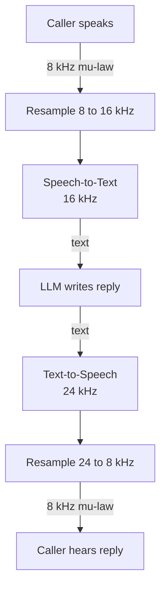

# Why do sample rates like 8 kHz, 16 kHz, and 24 kHz matter for voice agents?

> **Step 16: AI Infrastructure, Deployment, and System Design** · ⏱️ 17 min read · [Read original](https://outcomeschool.com/blog/sample-rates-for-voice-agents)

## TL;DR
The sample rate decides how much voice detail is kept, and each part of a voice agent expects a specific rate: 8 kHz for phone calls, 16 kHz into speech recognition, 24 kHz out of text-to-speech. Mixing them up makes the agent mishear, sound wrong, or break. Choose the right rate per component and resample between them.

## Key Concepts
- **Sample** — one number: wave height at a fixed moment. The computer keeps only these points; the speaker reconnects them into a wave.
- **Sample rate** — samples per second (Hz; kHz = thousand). Like photos per second of a flying ball: more = more fast movement caught.
- **Frequency** — how fast a wave goes up and down. Low = deep body of voice and vowels (a, o, u); high = hissing sounds (s, f, sh, th) and crispness.
- **Nyquist frequency** — highest frequency a rate captures = half the rate (needs at least 2 samples per up-and-down cycle; Nyquist-Shannon theorem). Anything above is lost forever.
- **Narrowband / wideband** — 8 kHz phone audio / 16 kHz audio.
- **mu-law (A-law)** — squeezes each sample to 8 bits (1 byte).
- **Resampling** — converting between sample rates.
- **16-bit PCM** — raw format, 2 bytes per sample.

## How It Works

### What each rate keeps
| Rate | Keeps up to | Used in voice agent | Sound |
|---|---|---|---|
| 8 kHz | 4 kHz | Phone calls in and out | Thin, "s"/"f" hard to tell |
| 16 kHz | 8 kHz | Input to speech recognition (STT/ASR) | Clear enough for words |
| 24 kHz | 12 kHz | Output of TTS | Natural, crisp, pleasant |

Human ear hears up to about 20 kHz; CDs use 44.1 kHz.

### 8 kHz: phone calls
- Phone network aims at understandable speech with minimal capacity; keeps about 300–3,400 Hz, so voice sounds thin.
- Calls usually arrive at 8 kHz (e.g. Twilio Media Streams: 8 kHz mu-law).
- Much of "s"/"f" lives above 4 kHz → "sixty" vs "fifty" confusion, spelled names/emails, numbers and addresses misheard; the STT gets less information and makes more mistakes.
- Cannot be fixed on our side; the detail is lost before audio reaches us.

### 16 kHz: speech recognition
- Keeps up to 8 kHz, holds almost everything needed to understand speech; "s", "f", "sh" come through.
- Higher adds little for word recognition but more data and processing. Whisper expects 16 kHz; other rates must be converted first.
- A model trained on clear 16 kHz can struggle with 8 kHz phone audio; some services offer phone-tuned models.

### 24 kHz: voice output
- TTS goal is sounding human (high frequencies, breathiness, crisp "s"). 24 kHz keeps up to 12 kHz, natural with reasonable size; e.g. OpenAI Realtime API raw format is 16-bit at 24 kHz. Some TTS goes to 44.1/48 kHz; 24 kHz is a common quality/speed balance.
- On a phone call the 24 kHz voice is converted down to 8 kHz, so the caller hears phone quality regardless.

### Flow through a phone voice agent
Caller → 8 kHz mu-law → resample to 16 kHz → STT (16 kHz) → LLM text → TTS (24 kHz) → resample to 8 kHz mu-law → caller.
- Upsampling 8 → 16 kHz does **not** restore lost high frequencies; it only fills gaps between samples (right format, phone quality).
- Browser/mobile mics record at 48 or 44.1 kHz, converted down to 16 kHz for STT, keeping much more detail than phone audio.

### When rates do not match
Raw audio is just numbers; it does not say how many make a second.
- 24 kHz TTS audio labelled 16 kHz: plays 16,000 samples/s, so 1 s takes 1.5 s; slow, deep voice.
- 16 kHz labelled 24 kHz: 1.5x faster, high-pitched, squeaky.
- 8 kHz phone audio told to STT as 16 kHz: heard as double speed; text wrong or empty.
- Badly done conversion: crackly or robotic sound.

### Sample rate and data size
Data per second = sample rate x bytes per sample (mono, 16-bit PCM).

| Rate | Samples/s | Data/s |
|---|---|---|
| 8 kHz | 8,000 | 16,000 bytes |
| 16 kHz | 16,000 | 32,000 bytes |
| 24 kHz | 24,000 | 48,000 bytes |

24 kHz is 3x the size of 8 kHz. mu-law/A-law uses 1 byte per sample → 8,000 bytes/s. Audio streams both ways for the whole call, often for many calls, so more data means more network and processing and added delay. Trade-off: higher rate = more detail; lower rate = less data and processing.

### Picking the rate
Choose per component, not one for the whole agent:
- Use the rate each model expects (STT 16 kHz; treat TTS output as 24 kHz).
- Do not convert down then up without reason; going down loses detail permanently.
- Phone: accept 8 kHz, use an STT that handles phone audio, and make the agent confirm numbers, names and emails.
- Web/mobile: capture high, convert to 16 kHz for STT.
- Always pass the correct sample rate with the audio so nothing guesses.

## Diagram(s)

### Sample rates through a phone voice agent

## Trade-offs & Pitfalls
- Detail above the Nyquist limit is irrecoverable; upsampling cannot restore it.
- Mislabelled sample rates change speed and pitch or break STT.
- Repeated down/up conversion degrades audio; poor resamplers add crackle.
- Higher rates cost bandwidth and compute, adding latency.
- Phone limits (8 kHz) hurt accuracy on digits, names, and emails; confirm important details.

## Key Takeaways
- A sample rate captures frequencies only up to half its value (8 kHz → 4 kHz, 16 → 8, 24 → 12).
- 8 kHz = phone, 16 kHz = STT input (Whisper), 24 kHz = TTS output.
- Phone audio is thin because "s"/"f" energy above 4 kHz is cut; upsampling does not bring it back.
- Mismatched rates cause wrong speed/pitch (24 vs 16 kHz = 1.5x) or empty transcripts.
- Data per second = rate x bytes per sample (32 KB/s at 16 kHz 16-bit mono).
- Pick per component, avoid needless resampling, and always pass the rate with the audio.
