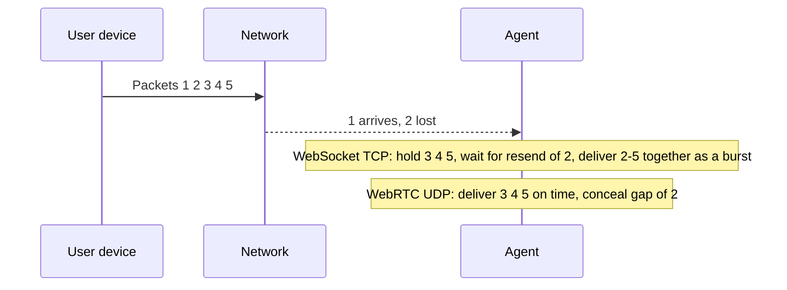
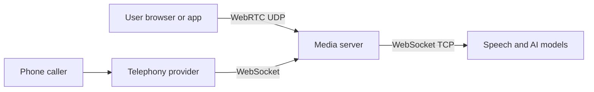

# How do WebRTC and WebSocket differ for voice AI agents?

> **Step 16: AI Infrastructure, Deployment, and System Design** · ⏱️ 16 min read · [Read original](https://outcomeschool.com/blog/webrtc-vs-websocket-for-voice-ai)

## TL;DR
Both carry live audio in both directions. WebSocket runs on TCP: every packet arrives in order, so a lost packet is resent and everything behind it waits. WebRTC sends audio over UDP, skips lost or late packets and conceals the gap, and adds echo cancellation, jitter buffering and network adaptation. Use WebRTC for user devices, WebSocket for server-to-server.

## Key Concepts
- **Voice AI agent** — listens, understands, replies in natural voice; the network must give low delay, steady flow, and both directions at once (user can interrupt).
- **TCP** — careful: every packet arrives, in order; lost packets are re-requested and later ones held back.
- **UDP** — fast: no waiting, no resend; receiver gets what arrives.
- **WebSocket** — one long-lived connection (starts as a web request, then upgraded) where either side pushes messages anytime; on TCP; `wss://` = secure.
- **WebRTC** — open standard for live audio/video/data with very low delay; built into browsers; a package, not one thing.
- **Signaling** — initial exchange of call description (audio format, network addresses); not defined by WebRTC, usually HTTP or WebSocket.
- **Opus** — codec that shrinks audio, good for speech with low delay.
- **Jitter buffer** — briefly holds packets to reorder and absorb uneven arrival; size adapts to network.
- **Head-of-line blocking** — one lost packet blocks all behind it.
- **Packet loss concealment** — WebRTC fills a short guessed sound from preceding audio.
- **STUN / TURN** — STUN reveals a device's public address; TURN relays audio when no direct path.
- **Data channel** — WebRTC side channel for text/events (e.g. "user started speaking", reply text).

## How It Works

### How audio travels
Device cuts voice into small pieces (e.g. 20 ms), each in a packet; 1 s speech ≈ 50 packets. Packets may be late, out of order, or lost. For a file download TCP is right; for live voice, audio arriving a second late is useless. WebSocket is built on TCP; WebRTC audio uses UDP.

### Voice agent over WebSocket
Mic → cut into chunks (20–100 ms) → send as WebSocket messages (often labelled as audio) → server agent; reply returns on the same socket. Our code does everything: reading mic, chunking, sending, playing replies in order, and timing/smooth playback.

```javascript
const socket = new WebSocket('wss://our-agent.example.com/voice')
function onAudioChunk(chunk) { socket.send(chunk) }
socket.onmessage = (event) => { playAudio(event.data) }
```

Works well on a good network; problems appear on a bad one.

### Voice agent over WebRTC
1. Signaling to agree on the call.
2. Mic → echo cancel + noise suppress → Opus encode → send encrypted over UDP → server.
3. Receiver uses jitter buffer. Browser does most of the work; timing/playback logic is built in.

### Lost packet example (packets 1–5, packet 2 lost)
- **WebSocket/TCP:** 1 delivered; 2 lost, TCP re-requests; 3, 4, 5 held back; 2 arrives after at least one more network trip; 2–5 delivered together. Audio freezes, then a burst of old audio; agent hears user late and vice versa. On weak mobile networks freezes accumulate and audio falls further behind.
- **WebRTC/UDP:** 1 delivered; 2 lost, nobody waits; 3, 4, 5 on time; concealment fills the gap. Missing 20 ms is rarely noticed. Trades tiny quality loss for steady live flow.

### Extra work WebRTC does
- **Echo cancellation** — mic would pick up agent's voice and treat it as interruption.
- **Noise suppression and gain control** — helps STT.
- **Congestion control** — watches loss and delay, lowers quality on bad network, raises it when better.
- **Forward error correction** — Opus puts info about the previous packet in each packet, so a lost one can be roughly rebuilt.
- **Path finding** — STUN/TURN for devices behind routers/firewalls.
- With WebSocket we can request mic echo cancellation/noise suppression, but timing, buffering, loss recovery and network adaptation are our job.
- Cost: many moving parts (signaling, STUN/TURN, encryption keys, media servers), harder to set up and debug; server needs a WebRTC library or media server.

### WebRTC vs WebSocket
| Point | WebSocket | WebRTC |
|---|---|---|
| Built on | TCP | UDP for audio |
| Lost packet | Resent, later packets wait | Skipped, gap filled |
| Delay on bad network | Grows with freezes and bursts | Stays low, small quality loss |
| Audio cleanup | Browser mic settings only | Echo cancellation, noise suppression |
| Timing/playback | Our job | Jitter buffer built in |
| Network adaptation | Our job | Congestion control built in |
| Setup | Simple, one connection | Signaling, STUN, TURN, media server |
| Best fit | Server to server, stable networks | Browsers and mobile apps |

### When to use which
- **WebRTC** — audio from user devices (weak Wi-Fi, train, crowded mobile); realtime voice APIs commonly recommend it for browser/mobile.
- **WebSocket** — server to server (data centers, rare loss; simplicity wins); realtime voice APIs commonly offer it for that.
- **WebSocket for telephony** — provider streams call audio to our server over WebSocket; phone network already carried the call, last hop is server to server.
- **WebSocket for prototypes**; move user-facing part to WebRTC later.
- **Common production setup:** WebRTC user ↔ media server, WebSocket server ↔ AI models.

## Diagram(s)

### Lost packet handling


### Typical production setup


## Trade-offs & Pitfalls
- WebSocket: head-of-line blocking on lossy networks; we must build timing, buffering, recovery, adaptation.
- WebRTC: tiny quality loss on bad networks; heavier infrastructure and harder debugging.
- Without echo cancellation the agent hears itself and thinks the user interrupts.

## Key Takeaways
- WebSocket = TCP, reliable and ordered; WebRTC audio = UDP, live and lossy by design.
- Head-of-line blocking makes WebSocket audio freeze then burst on a lossy network.
- WebRTC bundles Opus, echo cancel, noise suppression, jitter buffer, congestion control, FEC, STUN/TURN.
- WebRTC signaling is usually done over HTTP or WebSocket.
- User-facing browser/mobile → WebRTC; server-to-server, telephony, prototypes → WebSocket.
- Production often combines both.
