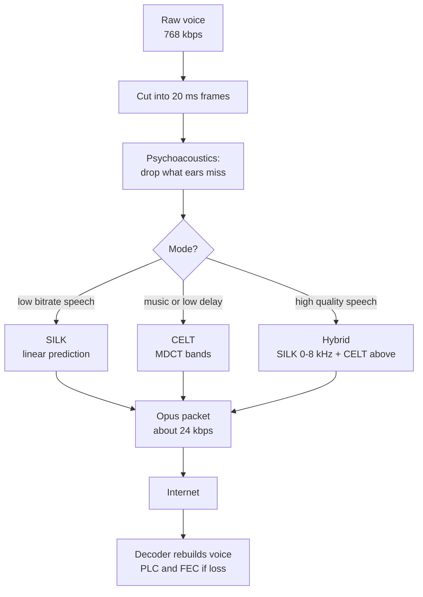

# How does the Opus codec compress voice for real-time calls?

> **Step 16: AI Infrastructure, Deployment, and System Design** · ⏱️ 16 min read · [Read original](https://outcomeschool.com/blog/opus-codec)

## TL;DR
Opus cuts voice into short frames (usually 20 ms), keeps only what ears can hear, and describes it with a small set of numbers using two engines: SILK for speech and CELT for music and full-range sound. This shrinks voice about 30x (768 kbps raw to about 24 kbps), with low delay, silence savings and loss recovery, which is why WebRTC and voice agents use it.

## Key Concepts
- **Sample** — one measurement of wave height; high quality = 48,000 samples/s at 16 bits.
- **Codec** — coder + decoder: compresses on sender side, rebuilds on receiver side.
- **Lossy** — rebuilt voice differs from the original; details ears will not notice are dropped.
- **Opus** — open, royalty-free codec for real-time internet audio; IETF RFC 6716 (2012); combines SILK (from Skype, speech) and CELT (from Xiph.Org, music/high quality, very low delay).
- **Bitrate** — bits sent per second; Opus works from 6 to 510 kbps (phone-quality voice to studio music).
- **Frame** — time slice of voice: 2.5, 5, 10, 20, 40 or 60 ms; 20 ms most common for calls.
- **Masking / psychoacoustics** — a loud sound hides a quieter one near in pitch; compressing by how humans hear.
- **Linear Prediction** — SILK's method: send how the voice was made, not the wave.
- **Residual** — small error between SILK's guess and the real wave.
- **MDCT** — transform CELT uses to turn a frame into frequencies and strengths.
- **DTX** — Discontinuous Transmission: tiny packets during silence.
- **PLC / FEC** — packet loss concealment / forward error correction.

## How It Works

### Why compression is needed
48,000 x 16 bits = 768,000 bps = 768 kbps per speaker per direction. Too heavy for slow, shared mobile networks; voice would arrive late, break up or not arrive. Opus brings it to about 24 kbps (about 32x smaller).

### Bandwidths
| Name | Range kept | Sampling rate |
|---|---|---|
| Narrowband | up to 4 kHz | 8 kHz |
| Mediumband | up to 6 kHz | 12 kHz |
| Wideband | up to 8 kHz | 16 kHz |
| Super-wideband | up to 12 kHz | 24 kHz |
| Fullband | up to 20 kHz | 48 kHz |

Higher = more natural but more data. Old phone call is near narrowband. RFC 7587 (Opus in live calls) suggests about 16–20 kbps for wideband voice and 28–40 kbps for fullband voice.

### Step 1: Frames
- Opus compresses and sends each frame as soon as ready; 1 s of speech = 50 frames of 20 ms.
- 20 ms at 48 kHz: 960 samples x 16 bits = 15,360 bits raw; at 24 kbps = 480 bits = 60 bytes per packet.
- Frame size sets minimum delay (encoder needs the full frame): 20 ms frame + 6.5 ms look-ahead = about 26.5 ms.
- Trade-off: smaller frames = lower delay but about 40 bytes of network headers per packet waste more data; larger frames save data but add delay. 20 ms is the balance.

### Step 2: Keep what ears hear
Ears hear some frequencies better (mid range, where speech lives), masking hides soft sounds near loud ones, and fine high-frequency detail is hard to notice. Opus spends more bits on clearly audible parts, fewer or zero on hidden ones (e.g. a soft hiss near a loud vowel). Both engines use psychoacoustics.

### Step 3: SILK (speech engine)
Speech is predictable: lungs → vocal cord buzz → throat, mouth, tongue, lips shape sounds. SILK sends a description of how the voice was made (Linear Prediction):
- **Predict next sample** from previous ones; send filter coefficients describing mouth/throat shape for the frame; the decoder guesses most of the wave itself.
- **Pitch prediction** — send the pitch so the decoder repeats the buzz pattern.
- **Residual** — send the small leftover error with very few bits.
- Example: samples 10, 12, 14, 16, rule "add 2" → guess 18; real is 19; send rule once plus error 1; decoder rebuilds 19. Small numbers need fewer bits.
- Carries clear speech at about 8–16 kbps; works only up to wideband (8 kHz); poor for music/full-range.

### Step 4: CELT (music engine)
- Uses MDCT to turn each frame into frequencies and strengths, grouped into bands (narrow at low frequencies, wide at high, matching ear resolution).
- Per band sends **energy** (loudness, always kept accurate) and **shape** (fine detail; more bits for important bands).
- Keeping energy correct keeps sound balanced and natural even at lower bitrates; CELT = Constrained Energy Lapped Transform.
- Works with frames down to 2.5 ms, giving very low delay.

### Step 5: Modes
| Mode | Engine | Best for |
|---|---|---|
| SILK-only | SILK | Speech at low bitrates |
| Hybrid | SILK + CELT | High-quality speech, medium bitrates |
| CELT-only | CELT | Music, full-range, very low delay |

Hybrid: SILK handles 0–8 kHz (meaning of speech), CELT handles above 8 kHz (clarity, naturalness); decoder adds them; works with 10 and 20 ms frames. Encoder switches frame by frame by bitrate and sound type, and can drop to lower bitrate/narrower bandwidth mid-call without dropping it.

### Silence: DTX
People are silent much of a call. With DTX on, Opus stops normal packets and sends one tiny packet about every 400 ms; receiver plays soft comfort noise so the call does not seem dropped.

### Lost packets
Cannot wait for resend in a live call.
- **PLC** — decoder guesses the missing 20 ms from earlier frames.
- **FEC** — in SILK/hybrid, a lower-quality copy of the previous frame rides in the current packet.
- **Deep learning** — Opus 1.5 (2024) added small neural nets for better concealment and DRED (Deep Redundancy), recovering up to 1 s of lost voice.

### Why for calls and voice agents
- Mandatory audio codec in WebRTC, so most browser calls use it.
- Low delay (about 26.5 ms at 20 ms frames), small size, good quality (helps STT), loss handling (PLC, FEC).
- STT usually needs raw samples (often 16 kHz): server decodes Opus before STT; TTS output is encoded to Opus before sending to the user.

## Diagram(s)

### Codec flow and engines

## Trade-offs & Pitfalls
- Lossy by design; quality traded for size.
- Frame size: small = low delay but header overhead; large = efficient but slower.
- SILK alone is limited to 8 kHz and unsuited for music; CELT-only suits music and low delay.
- STT models cannot take Opus directly; decoding step is required.

## Key Takeaways
- Raw 48 kHz 16-bit voice is 768 kbps; Opus voice is about 24 kbps (about 32x smaller).
- Opus = SILK (speech, linear prediction) + CELT (MDCT, energy and shape bands), switchable or hybrid per frame.
- 20 ms frames give about 26.5 ms delay (20 ms + 6.5 ms look-ahead) and 60-byte packets at 24 kbps.
- Psychoacoustic masking decides where bits are spent.
- DTX sends a tiny packet about every 400 ms in silence, with comfort noise.
- PLC, FEC and (Opus 1.5) DRED handle loss without retransmission.
- Bitrate range 6–510 kbps; 16–20 kbps wideband voice, 28–40 kbps fullband.
- WebRTC mandatory codec; decode to raw audio (about 16 kHz) before STT.
