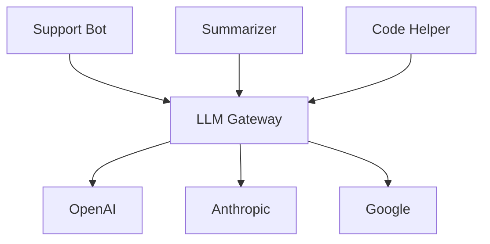
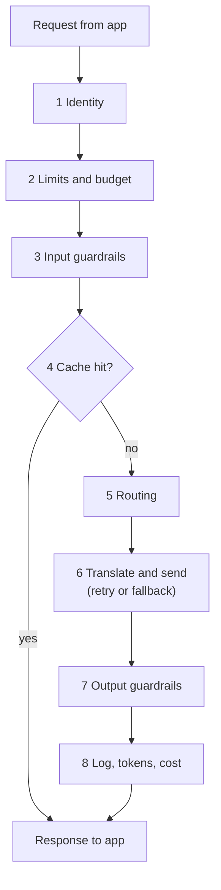

# How does an LLM Gateway work?

> **Step 16: AI Infrastructure, Deployment, and System Design** · ⏱️ 17 min read · [Read original](https://outcomeschool.com/blog/llm-gateway)

## TL;DR
An LLM Gateway is a single middle layer between apps and all LLM providers. Every request passes through it, so routing, keys, retries, fallback, caching, limits, guardrails, logging, and cost tracking are built once and shared by every app. It adds a small delay and one more system to run, so it pays off with many apps, teams, or providers.

## Key Concepts
- **LLM provider** — company running LLMs (OpenAI, Anthropic, Google), accessed by API with a key for identity and billing.
- **LLM Gateway** — one gate all LLM calls pass through; like a building reception that checks ID, logs entry, and sends visitors to the right floor. Examples: LiteLLM, Portkey.
- **Common API** — one standard request format (often OpenAI's); gateway translates to each provider and back. Analogy: an interpreter at an international meeting.
- **Virtual key** — per app or team key that works only with the gateway; real provider keys stay inside.
- **Routing** — choosing provider and model for a request.
- **Load balancing** — spreading requests across copies so none is overloaded.
- **Retry / fallback** — retry the same request after a short wait; fallback moves to a backup model from another provider.
- **Exact cache / semantic cache** — reuse answers for identical prompts / same-meaning prompts (via embeddings).
- **Rate limiting** — cap on requests or tokens per key per time window.
- **Guardrails** — safety checks on inputs and outputs.

## How It Works
### Problem without a gateway
Example: support chatbot, document summarizer, code helper, each calling OpenAI/Anthropic/Google directly. Issues:
- Different APIs, so separate code per provider per app.
- Keys copied into every app; one leak means rotating everywhere.
- No backup; a 10-minute OpenAI outage breaks every app using it.
- No cost control; a buggy looping app is discovered only on the bill.
- No single view of requests, latency, spend per team.
- Repeated work and mistakes: each team writes its own retries, logging, safety checks.

With a gateway, apps talk only to it; it talks to providers. Shared work is written once.

### Request journey (e.g. "Summarize this customer complaint")
1. Check identity.
2. Check limits and budget.
3. Check input guardrails.
4. Check cache; if found, return saved answer.
5. Pick provider and model (routing).
6. Translate and send; on failure retry or fall back.
7. Check output guardrails.
8. Log, count tokens, add cost; respond to app.

### One API for all providers
Providers differ in field names and response shape. App sends one standard format; gateway translates both ways. Switching provider means changing one gateway setting, no app code change.

### Authentication and virtual keys
App presents `vk-support-123`; gateway maps it to the Support team and uses the real OpenAI key. Benefits: a leaked virtual key is cancelled alone; know which team sent what; per-key permissions (e.g. only cheap models).

### Routing and load balancing
- Rule examples: simple questions to a small cheap model; hard coding questions to a big model; European users to a European server.
- Load balancing example: same gpt-4o from OpenAI directly and Azure OpenAI, 50% each; if one is slow or limited, the other takes more.

### Retries and fallback
Providers fail (busy, rate-limited, down). Gateway retries (errors are often temporary), then falls back to another provider's model. Example: OpenAI gpt-4o error, retry error, fall back to Claude, success; app never knows.
```python
def call_with_fallback(prompt, models):
    for model in models:
        for attempt in range(2):
            try:
                return call_provider(model, prompt)
            except ProviderError:
                wait_a_little()
    raise Exception("All models failed")
```
Real gateways also wait longer after each failure and stop using a repeatedly failing provider for a while.

### Caching
500 users ask "What are your office hours?": without cache, 500 paid calls; with cache, 1 call and 499 instant free hits.
- Exact: identical letter by letter.
- Semantic: same meaning ("When is your office open?"), compared by embedding closeness.
Caution: personal or time-sensitive questions, since old answers go wrong.

### Rate limiting and budgets
Tokens are the billing unit. Example rules: Summarizer 100 requests/minute; Code Helper 1 million tokens/day; Support USD 500/month. Over limit, the gateway returns an error without calling the provider, so a buggy loop cannot drain the budget overnight.

### Guardrails
- In: hide private data (phones, emails, card numbers) before leaving the company; block prompts that try to trick the model into harm.
- Out: block harmful or unsafe content; check expected format.
Same rules for every app; no team can forget them.

### Logging, monitoring, cost tracking
Record app/team, model, tokens in and out, latency, success or failure, cost (tokens times model price). Enables dashboards: which team spends most, which model is slowest, why cost doubled yesterday. One view of all LLM usage.

### LiteLLM example
Config:
```yaml
model_list:
  - model_name: smart-model
    litellm_params:
      model: openai/gpt-4o
      api_key: os.environ/OPENAI_API_KEY
  - model_name: backup-model
    litellm_params:
      model: anthropic/claude-sonnet-4-5
      api_key: os.environ/ANTHROPIC_API_KEY
litellm_settings:
  num_retries: 2
  fallbacks: [{ 'smart-model': ['backup-model'] }]
```
Run `litellm --config config.yaml` (server on port 4000 by default). App uses the normal OpenAI client with `base_url="http://localhost:4000"`, a virtual key, and `model="smart-model"`. If OpenAI fails, gateway retries then falls back to Claude; app code unchanged. Model names and settings change over time; check docs.

### Gateway vs direct
| Point | Direct | Gateway |
|---|---|---|
| API | Different code per provider | One common API |
| Keys | In every app | Only in gateway |
| Provider failure | App breaks | Retry and fallback |
| Repeated questions | Paid each time | Served from cache |
| Cost control | Monthly bill only | Limits and budgets per team |
| Safety checks | Each team's own | Same guardrails for all |
| Visibility | Scattered | One dashboard |
| Extra step | None | Small delay and one more system |

## Diagram(s)
### Gateway placement


### Request pipeline


## Trade-offs & Pitfalls
- Adds a small latency per request (cache hits can be instant and free).
- One more system to run; if it goes down, all LLM calls stop, so run more than one copy in production.
- Cached answers can go stale for personal or time-sensitive queries.
- Not needed for one small app, one provider, and low traffic; direct calls are simpler.

Need a gateway when: many apps or teams, multiple providers or freedom to switch, backup needed, cost control per team, uniform safety and privacy rules.

FAQ:
- Gateway down? All calls stop; run multiple copies.
- Latency? Small extra step, offset by cache hits.
- App code change? Minimal: point `base_url` at the gateway and use a virtual key.
- Exact vs semantic cache? Identical text versus same meaning via embeddings.

## Key Takeaways
- A gateway centralizes keys, routing, retries, caching, limits, guardrails, and logging in one layer.
- Apps use one common (often OpenAI-style) API; providers can be swapped by config.
- Virtual keys protect real keys and enable per-team control.
- Retry first, then fall back to another provider so provider failures are invisible to apps.
- Semantic caching reuses answers for same-meaning prompts, cutting cost and latency.
- Rate limits and budgets stop runaway spend.
- Cost = tokens times model price, logged per request for one dashboard.
- It is itself a single point of failure and adds latency; skip it for tiny single-provider apps.
