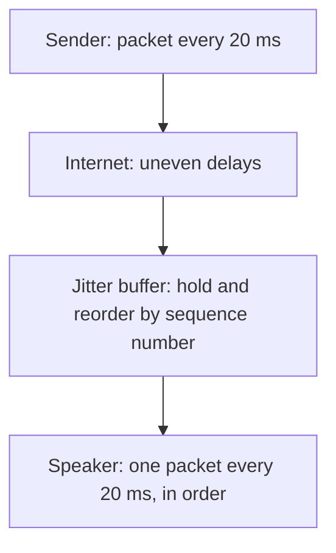
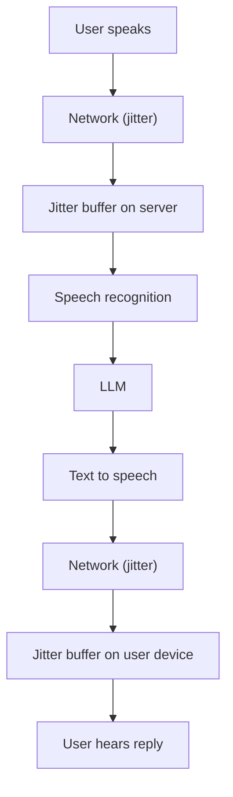

# How does a jitter buffer keep voice audio smooth over a bad network?

> **Step 16: AI Infrastructure, Deployment, and System Design** · ⏱️ 16 min read · [Read original](https://outcomeschool.com/blog/jitter-buffer)

## TL;DR
A jitter buffer is a small waiting area on the receiving side that holds incoming voice packets briefly, reorders them, and plays them at a steady pace. It turns uneven arrival into steady output, at the cost of deliberate delay. Real-time systems like WebRTC use an adaptive one, and a voice AI agent has one on each receiving side.

## Key Concepts
- **Packet** — about 20 ms of compressed audio plus a sequence number (order) and a timestamp (which moment of speech). 1 s of speech = 50 packets.
- **Jitter** — variation in packet travel time; packets sent at a steady pace do not arrive steadily.
- **Jitter buffer** — holds packets, restores order, releases them at a steady pace. Analogy: waiting 10 min at the movie-hall gate to collect friends, then entering in a neat line.
- **Buffer delay / depth** — how long the buffer waits.
- **Fixed vs adaptive** — constant depth vs depth that changes during the call.
- **NetEq** — adaptive jitter buffer inside WebRTC.
- **Packet Loss Concealment (PLC)** — fills a missing slot with a guess of the audio.
- **Opus in-band FEC** — a low-quality copy of an earlier packet carried inside the next packet.

## How It Works

### Why jitter breaks audio
Packets leave every 20 ms but travel through busy routers, queues, and different paths. Example:

| Packet | Sent | Travel | Arrives |
|---|---|---|---|
| 1 | 0 ms | 50 | 50 ms |
| 2 | 20 ms | 50 | 70 ms |
| 3 | 40 ms | 90 | 130 ms |
| 4 | 60 ms | 40 | 100 ms |
| 5 | 80 ms | 55 | 135 ms |

Packet 4 arrives before 3 (out of order); 3 and 5 arrive almost together. The average delay can be fine, the variation is the problem. A bad voice network has much jitter, packet loss, or both.

If played on arrival: packet 2 ends at 90 ms, packet 3 is missing so a gap or click is heard, packet 4 would play in the wrong order, and 3 and 5 arrive together with more audio than can be played. Result is choppy, robotic audio. The problem is unevenness, not slowness.

### Step by step (60 ms buffer, same 5 packets)
1. Packet 1 arrives at 50 ms, is stored, and scheduled for 50 + 60 = 110 ms.
2. Playback now runs on a steady clock using timestamps: slots at 110, 130, 150, 170, 190 ms.
3. Packet 2 (70 ms) is early for its 130 slot and waits.
4. Packet 4 (100 ms) arrives before 3; the sequence number puts it in 4th position (reordering).
5. Packet 3 (130 ms) is still in time for its 150 slot and goes into 3rd position.
6. Packet 5 (135 ms) is in time for its 190 slot.

The speaker gets 1 to 5 in order every 20 ms with no gaps. Cost: every packet plays 60 ms later than it could have.

### Smoothness vs delay
Packet 3 took 40 ms longer than packet 1, so 60 ms sufficed. With a 20 ms buffer, packet 1 plays at 70, packet 3's slot is 110, but it arrives at 130, which is too late.

| Buffer depth | Smoothness | Delay | Best for |
|---|---|---|---|
| Small (20-40 ms) | Glitches on a bad network | Low | Stable networks |
| Large (150-200 ms) | Very smooth | High | Very jittery networks |

- Too small: delayed packets miss their slot, are treated as missing, more glitches.
- Too large: smooth, but every word arrives late, so people talk over each other.
- Ideal: just large enough for the current jitter. Jitter keeps changing (Wi-Fi calm, then jittery).

### Fixed vs adaptive
| Feature | Fixed | Adaptive |
|---|---|---|
| Waiting time | Same for whole call | Changes during call |
| Worse network | More glitches | Grows buffer |
| Better network | Keeps extra delay | Shrinks buffer |
| Complexity | Simple, predictable | More complex |

Adaptive buffers resize gently, since pausing or dropping audio would itself be heard:
- **Adjust during silence** — make a pause slightly longer (grow) or shorter (shrink).
- **Time stretching** — play slightly slower (stored audio grows) or faster (shrinks) without changing pitch. NetEq compares stored audio with a target delay and speeds up or slows down in small amounts.

### Late or lost packets
- **Late** — its slot has passed, so it is discarded; to the listener it equals a lost packet.
- **Never arrives** — packet loss.

The speaker still needs 20 ms for that slot; silence is audible. PLC fills it with a guess, since voice changes little over tens of ms. One missing packet is often unnoticeable; many in a row fade out as a long guess sounds unnatural. Codec help: Opus in-band FEC carries a low-quality copy of a piece of audio in the following packet, so a lost packet can be roughly rebuilt if the next arrives. This works because the buffer often already holds the next packet before the lost slot plays. So the jitter buffer fixes timing and order, and PLC fills remaining holes.

### In a voice AI agent
A jitter buffer sits on each receiving side (WebRTC):
- User to agent: server buffers packets, then feeds speech recognition.
- Agent to user: device buffers packets, then plays.

It appears twice per turn, and each ms of waiting adds to the time from the user finishing a sentence to hearing the reply. It is a line item in the latency budget. Large buffer = clean but slow agent; small = fast but ASR hears broken audio and the voice is choppy on bad networks. Adaptive keeps it smooth on bad networks and fast on good ones.

## Diagram(s)

### Packet flow through the buffer

### Jitter buffer twice in a voice agent turn

## Trade-offs & Pitfalls
- Buffer adds delay on purpose; depth trades smoothness against latency.
- Fixed buffer cannot follow changing networks.
- Resizing naively causes silence or jumps; use silence adjustment or time stretching.
- A jitter buffer cannot recover a never-arriving packet; PLC or FEC is needed.
- In voice agents, delay is paid twice per turn.

## Key Takeaways
- Jitter is variation in travel time, and it breaks audio even when the average delay is fine.
- A jitter buffer holds, reorders (sequence number), and plays on a steady clock (timestamp).
- Playback time = arrival of first packet + buffer depth; later packets get slots 20 ms apart.
- Depth is smoothness vs delay: about 20-40 ms stable, 150-200 ms very jittery.
- Adaptive buffers (WebRTC NetEq) resize via silence or pitch-preserving time stretching.
- Late packets are discarded and count as lost; PLC and Opus in-band FEC cover them.
- Voice agents have two jitter buffers per turn, both counted in the latency budget.
