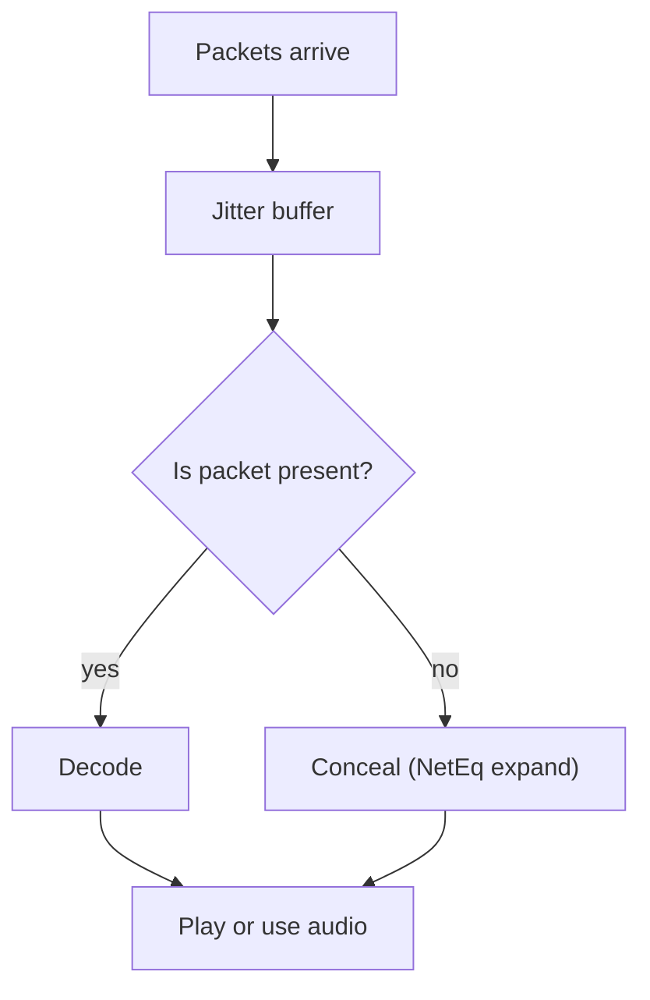
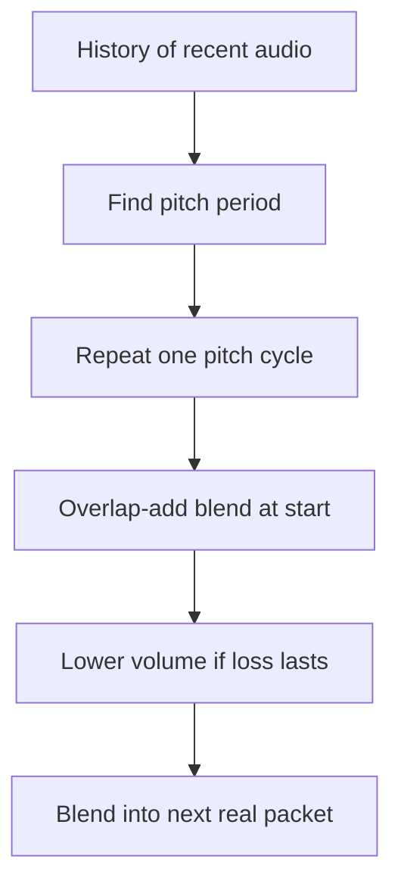

# How does packet loss concealment hide missing audio?

> **Step 16: AI Infrastructure, Deployment, and System Design** · ⏱️ 17 min read · [Read original](https://outcomeschool.com/blog/packet-loss-concealment)

## TL;DR
Packet loss concealment (PLC) fills a lost audio packet with a believable guess built from audio already received, so the listener hears no gap or click. Approaches evolved from silence, to repeating a packet, to repeating a pitch cycle, to codec-based and neural guesses. It hides loss but cannot recover lost words.

## Key Concepts
- **Packet loss** — audio packets (about 20 ms each, 50 per second) never reach the receiver. Voice calls do not wait for a resend because it would arrive too late.
- **Samples** — numbers describing the sound wave at tiny moments.
- **PLC** — creates a replacement for a lost packet from earlier audio; hides, does not restore.
- **Pitch period** — length of the repeating pattern in voiced sounds (vowels): about 8-10 ms for typical male voice, 4-6 ms for female.
- **Overlap-add** — blend where old audio fades out while the copy fades in.
- **Codec** — coder + decoder; compresses and decompresses audio.
- **Opus in-band FEC** — each speech packet carries a small low-quality copy of the previous packet.
- **Deep PLC / DRED** — neural features in Opus 1.5.

## How It Works

### Why a gap sounds bad
Sound is a wave stored as samples. If the wave is high when packet 2 ends and the next 20 ms are zeros, it jumps to zero in one step, heard as a click or pop. When packet 4 arrives, it jumps back: a second click. One lost packet therefore gives two clicks plus a hole in a word; frequent loss sounds broken and robotic. The ear is sensitive to jumps and forgiving of smooth sound, so the filler must join smoothly on both sides.

Analogy: a smudged word on a printed page can be guessed from the words before it.

### Approach 1: Play silence (zero insertion)
Easy to build, but causes clicks and an obvious hole.

### Approach 2: Repeat the last packet
Speech changes little in 20 ms, so replay packet 2. No hole, but the end of packet 2 and the start of the copy do not line up, leaving a small click. Several losses in a row repeat the same 20 ms, giving a buzzing, stuck robotic tone.

### Approach 3: Repeat one pitch cycle and fade out
Voice (a vowel like "aaa") repeats a small pattern.
1. Keep a short history of recent received audio.
2. Find the pitch period by checking how far back the wave looks like itself.
3. Copy exactly one pitch cycle from the end and repeat it to fill the gap. Example: 8 ms pitch means repeat it 2.5 times for 20 ms. Cycles join smoothly.
4. Overlap-add at the start of the gap, so no jump or click.
5. If loss continues, use a few more pitch cycles from history (less buzzy) and gradually lower volume until silence. A long steady tone sounds fake; a slow fade sounds natural.
6. When the next real packet arrives, blend guess into real audio.

This is the idea in Appendix I of G.711 (an old telephone audio format). Example: loss in the "e" of "hello": the receiver repeats the "e" pitch cycle for 20 ms and the listener hears a slightly longer "e". Limit: it only copies the past, so it cannot know the voice was about to change from "e" to "l"; long losses still sound wrong.

### Approach 4: Let the codec guess
G.711 sends samples nearly as-is. Modern codecs like Opus send a description of the sound (pitch, mouth and throat shape). The decoder can continue that description from the last good packet: same pitch and shape, slowly drifting and fading, then rebuild fresh audio. This is more natural than copying samples. Opus's decoder has this built in: the app tells it a packet is missing and it outputs concealed audio.

Opus in-band FEC: if packet 3 is lost but 4 arrives, the decoder uses the small copy of 3 inside 4. That is a rough version of real audio, not a guess; PLC is the fallback if the copy is also missing. Limit: guess still follows fixed engineer-written rules, and long gaps sound flat.

### Approach 5: Let a neural network guess
A network trained on many hours of speech with pieces removed on purpose learns how speech continues (vowel transitions, pitch rise and fall, word endings). It predicts the next piece and generates it, following the voice's natural movement rather than only repeating the past.

Opus 1.5 (March 2024) added **Deep PLC**, replacing hand-tuned rules with a neural network; like other new neural features it is off by default and the app must enable it. It also added **DRED** (Deep REDundancy): a neural, compact backup of many earlier packets inside each new packet, so even longer loss is recoverable once a later packet arrives.

### Comparison
| Approach | How it fills | Short loss | Long loss |
|---|---|---|---|
| Silence | Zeros | Clicks | Clear hole |
| Repeat last packet | Copy of last packet | Small click | Buzzing tone |
| Repeat pitch cycle | Pitch cycle with blend and fade | Smooth | Fades to quiet |
| Codec guess | Continues sound description | Smooth | Flat, fades |
| Neural network | Predicts next speech | Smooth | More natural |

### In a voice AI agent
Audio flows both ways, so PLC runs on whichever side receives. Packets go into the jitter buffer (reorders, holds briefly). When the next packet is missing at play time, the receiver conceals it itself or via the decoder. In WebRTC this lives in NetEq: **expand** creates replacement audio and **merge** blends it into real audio when it returns. On the server, ASR may mishear a word if audio has clicks and holes; a smooth concealed gap helps keep words right. Concealment only guesses: a wholly lost word with no backup cannot be recovered.

## Diagram(s)

### Receiver flow

### Pitch-cycle PLC (Approach 3)

## Trade-offs & Pitfalls
Works well when:
- Loss is short (1-2 packets, 20-40 ms).
- Lost audio is in a steady sound like a vowel.
- Losses are spread out, so real audio returns quickly.

Fails when:
- Many packets are lost in a row; the guess drifts and older methods fade to silence.
- The lost packet holds the start of a new sharp sound (the "t" in "top"); the past gives no hint.
- Audio is music or several people talking at once.

PLC is a backup for small, frequent losses, not a replacement for a good network.

## Key Takeaways
- PLC hides a gap using received audio; it cannot recover the exact lost audio.
- Voice calls do not retransmit, since a resend arrives too late.
- Zeros cause clicks because the wave jumps; the filler must join smoothly.
- Pitch-cycle repetition with overlap-add and fade-out (G.711 Appendix I) is the classic fix.
- Codecs like Opus continue a sound description; in-band FEC sends a real rough backup, with PLC as fallback.
- Opus 1.5 Deep PLC (neural, off by default) and DRED improve long-loss handling.
- PLC works for short losses in steady sounds and fails for long bursts and sharp onsets.
