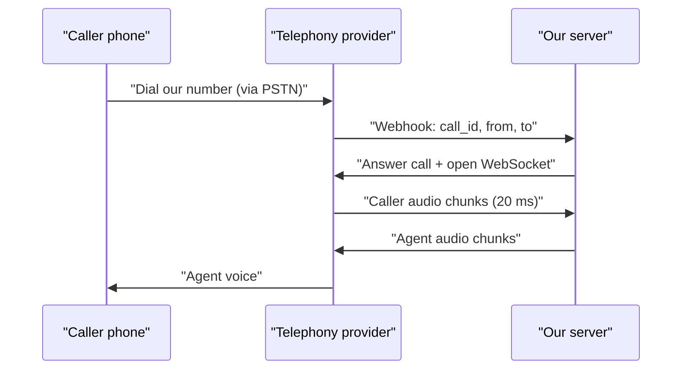
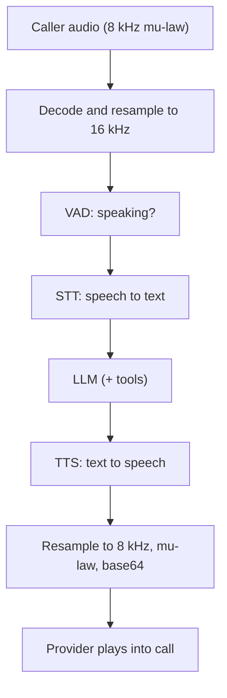

# How does a voice AI agent answer a phone call?

> **Step 16: AI Infrastructure, Deployment, and System Design** · ⏱️ 17 min read · [Read original](https://outcomeschool.com/blog/phone-calls-in-voice-agents)

## TL;DR
A telephony provider bridges the phone network (PSTN) to the internet. It receives the call, asks our server what to do via a webhook, then opens a WebSocket streaming the caller's voice as 20 ms chunks. Our server runs VAD, STT, LLM and TTS, and streams voice back into the same call. Both directions stay open for the whole call.

## Key Concepts
- **Voice AI agent (phone)** — picks up a real call, listens, understands, and replies in voice with no human on our side; replies often in around 1 second.
- **PSTN** — Public Switched Telephone Network, the traditional landline and mobile network; does not talk to the internet directly.
- **Telephony provider** — company that connects PSTN to the internet and gives us a phone number.
- **Webhook** — URL on our server the provider calls automatically on events like an incoming call.
- **SIP** — Session Initiation Protocol, standard to start, manage, end voice calls over the internet; alternative to a webhook.
- **WebSocket** — connection that stays open so both sides can send any time (letter vs open phone line).
- **Audio chunk / frame** — 20 ms of sound, 50 per second even during silence.
- **G.711 mu-law** — old phone format: 8 kHz, 1 byte per sample (A-law is similar).
- **VAD / STT / LLM / TTS** — speech detection / speech-to-text / reply generation / text-to-speech.
- **Barge-in** — caller speaks while agent is talking.

## How It Works

### Journey
Caller phone -> PSTN -> telephony provider -> our server (listen, think, speak) -> provider -> PSTN -> caller.

### Step 1: Caller dials
We buy a number from a telephony provider. The PSTN sees the number belongs to the provider and routes the call there.

### Step 2: Provider receives the call
Provider does not know what to do (play message, forward, connect agent), so it sends a request to our webhook with details, e.g. `{ "call_id": "CA123", "from": "+15551234567", "to": "+15559876543" }` (caller, dialed number, call ID). SIP is the other option: provider forwards the call to a SIP server on our side, which turns the call audio into a stream. The blog follows the webhook path.

### Step 3: Server decides
Webhook reply has two instructions: answer the call, and open a live audio connection (usually a WebSocket, e.g. `wss://example.com/call-audio`). The caller is now connected to the agent.

### Step 4: Caller's voice arrives
Provider streams voice live in 20 ms chunks. A 2-second sentence arrives as about 100 chunks while the caller is still talking.

Chunk math: 8,000 samples/s * 0.02 s = 160 samples = 160 bytes (8 kHz, mu-law 1 byte each).

Chunks are base64-encoded to travel in text messages:
`{ "event": "media", "call_id": "CA123", "payload": "fn5+fn5+..." }` (`event` = audio message, `call_id` = which call, `payload` = 20 ms audio). Provider also sends start and stop messages.

### Step 5: Listen, think, speak
Prep: base64 decode -> mu-law to normal audio values -> resample 8 kHz to 16 kHz (many STT models expect it). Resampling does not restore details lost in 8 kHz audio; it only fits the model's expected shape.

Pipeline: audio -> VAD -> STT -> LLM -> TTS.
- **VAD** — speech vs silence or noise per chunk; finds turn start and end.
- **STT** — streaming: partial text while talking, final text when done.
- **LLM** — sees text, history and system instructions ("You are a receptionist for a clinic"); if real data is needed (free slots) it recommends a tool and input, our code runs it and returns the result.
- **TTS** — reply text to voice.

Clinic example: caller asks for tomorrow's appointment; VAD sees start, then about 0.5 s silence = turn ended; STT gives text; LLM calls slots tool, finds 11 AM, replies "Sure, I have a slot at 11 AM. Does that work?"; TTS speaks it.

Latency: stages overlap. LLM streams its reply and TTS starts on the first finished sentence. Many agents speak first with a TTS greeting at connect.

### Step 6: Voice goes back
TTS output is often 16 or 24 kHz or higher, so reverse the prep: resample to 8 kHz -> mu-law encode (1 byte per sample) -> cut into chunks -> base64 -> send over the same WebSocket in a same-shaped `media` message. Provider plays chunks in order into the call. Loop repeats per turn.

### Handling interruptions (barge-in)
The provider queues (buffers) already-sent chunks, so stopping new chunks is not enough; the caller still hears the queue. Server keeps listening during agent speech. When VAD confirms real speech (not a short noise):
1. Stop LLM and TTS output.
2. Send a clear message, e.g. `{ "event": "clear", "call_id": "CA123" }`, so the provider discards queued agent audio (exact name varies by provider).
3. Update conversation history so the LLM knows the caller heard only part of the reply.

### How the call ends
- **Caller hangs up** — provider sends stop event and closes the WebSocket; server stops pipeline, saves transcript and duration.
- **Agent hangs up** — after goodbye finishes playing, LLM-recommended "end call" tool tells provider to end it.
- **Transfer to human** — LLM recommends "transfer call"; our code tells provider to connect to another number (e.g. front desk); provider moves the call and the agent leaves.

## Diagram(s)

### Call setup

### Agent pipeline per turn

## Trade-offs & Pitfalls
- Phone audio is 8 kHz; upsampling to 16 kHz does not recover lost detail.
- Provider-side buffer means stopping chunk sending does not stop playback; a clear message is needed.
- Short noises must not trigger barge-in; check VAD confirms real speech.
- Keep history in sync with what the caller actually heard.
- Provider message names differ between vendors.

## Key Takeaways
- A telephony provider bridges PSTN and the internet and gives us a number.
- Incoming calls hit our webhook; we answer and open a WebSocket (or use SIP instead).
- Voice arrives as 20 ms chunks (50/s), 160 bytes each at 8 kHz mu-law, base64 inside JSON.
- Pipeline is VAD -> STT -> LLM (with tools) -> TTS, with stages overlapped to cut delay.
- Replies are resampled to 8 kHz, mu-law encoded, chunked and sent back on the same socket.
- Barge-in requires stopping LLM/TTS, sending a clear message, and updating history.
- Calls end by caller hangup, agent hangup (end-call tool), or transfer (transfer-call tool).
