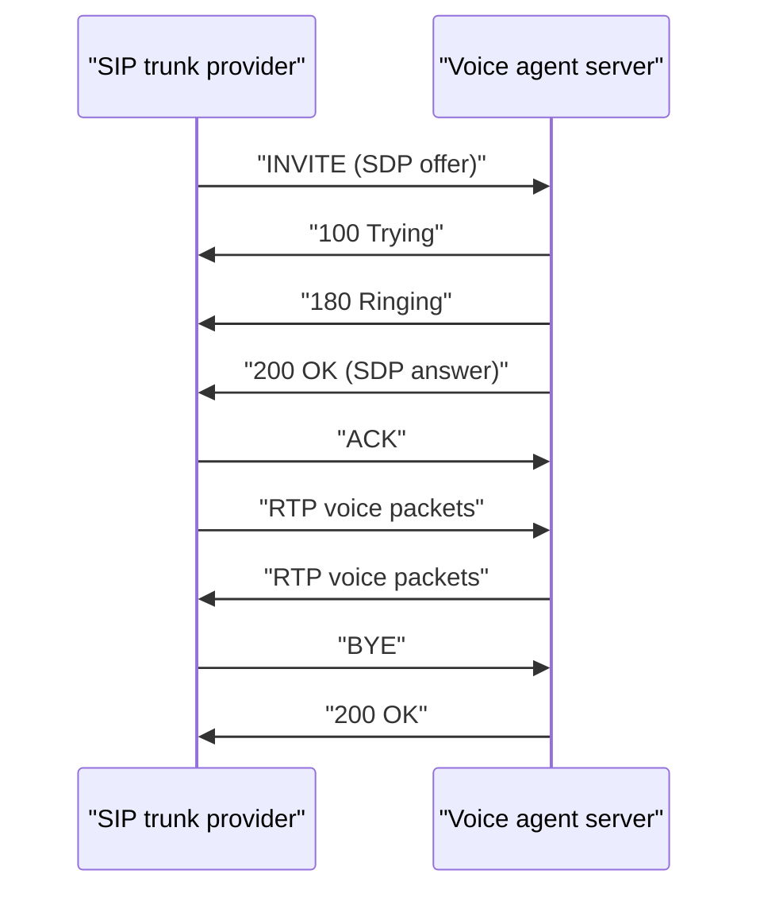
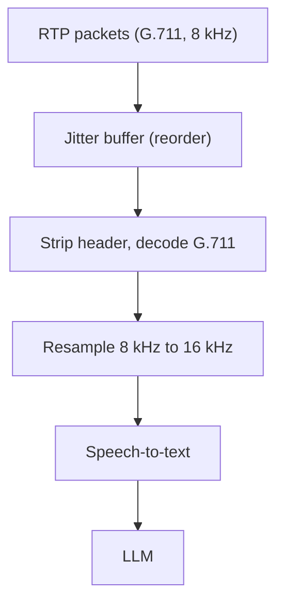

# How do SIP and RTP carry a phone call to a voice agent?

> **Step 16: AI Infrastructure, Deployment, and System Design** · ⏱️ 16 min read · [Read original](https://outcomeschool.com/blog/sip-and-rtp)

## TL;DR
SIP sets up, manages and ends a call (text messages, no voice). RTP carries the voice as small timestamped, sequence-numbered packets in both directions during the call. A SIP trunk provider bridges the phone network (PSTN) to our voice agent server; SDP inside SIP messages agrees on address, port and audio codec.

## Key Concepts
- **Voice agent** — system that listens, understands and replies with voice; runs on an internet server.
- **PSTN** — the traditional phone network.
- **SIP trunk provider** — gives phone numbers, connects PSTN to the internet, converts calls to internet traffic and forwards to our server.
- **Media server** — often sits in front of the agent, handles SIP and RTP, and passes plain audio on (blog treats it all as one voice agent server).
- **SIP** — Session Initiation Protocol: start, manage, end a call. Plain-text messages: first line (request), headers, optional body.
- **SDP** — Session Description Protocol: text inside SIP bodies saying where to send audio and in which format.
- **Codec** — method turning sound into bytes and back.
- **RTP** — Real-time Transport Protocol: audio/video in small packets, usually over UDP, with info for ordering and timing.
- **Jitter buffer** — receiver-side buffer that waits and reorders packets.
- **Packet loss concealment** — smooth guess of missing sound instead of a click.

## How It Works

### SIP messages
- `INVITE` — "I want to start a call."
- `100 Trying` — got it, working on it.
- `180 Ringing` — phone is ringing.
- `200 OK` — call accepted.
- `ACK` — got your OK, call set up.
- `BYE` — end the call.

Simplified INVITE: first line `INVITE sip:+15550100@agent.example.com SIP/2.0` (start a call with this number), then `From` (caller), `To` (dialed number), `Call-ID` (unique ID tying all messages of one call).

### Call setup
1. Provider sends INVITE (who calls, which number, which audio formats it supports).
2. Server replies 100 Trying (so provider does not resend).
3. Server replies 180 Ringing (caller hears ringing).
4. Server replies 200 OK (answered; includes chosen format and where it wants audio).
5. Provider sends ACK; call is set up and RTP starts. SIP is idle until the end.

### SDP
Offered in INVITE, answered in 200 OK (offer/answer model). Example:
- `c=IN IP4 203.0.113.10` — address to receive audio.
- `m=audio 40000 RTP/AVP 0 8` — audio over RTP on port 40000, formats 0 and 8.
- `a=rtpmap:0 PCMU/8000` — format 0 = PCMU (G.711 mu-law) at 8000 samples/s.
- `a=rtpmap:8 PCMA/8000` — format 8 = PCMA (G.711 A-law), 8000 samples/s.

G.711 is the classic, simple, widely supported phone codec. Server picks one format and replies with its own address, port and format.

### RTP
Voice is cut into pieces, commonly 20 ms per packet, so 1 second = 50 packets (1000/20). Sent over UDP, which does not resend lost data. Reason: late voice is useless and waiting for a resend would freeze the call; skipping a 20 ms gap keeps the conversation moving.

### RTP packet
Header (usually 12 bytes) plus audio. Fields:
- **Payload type** — audio format number agreed in SDP (0 = PCMU).
- **Sequence number** — random start, +1 per packet; used for ordering and detecting loss.
- **Timestamp** — which moment of audio; used to play at the right time.
- **SSRC** — random ID of the audio source, distinguishes streams.

Math (G.711, 20 ms): 8000 samples/s * 0.020 s = 160 samples = 160 bytes. Timestamp rises by 160 per packet.

| Packet | Seq | Timestamp | Audio bytes |
|---|---|---|---|
| 1 | 1000 | 0 | 160 |
| 2 | 1001 | 160 | 160 |
| 3 | 1002 | 320 | 160 |
| 4 | 1003 | 480 | 160 |

If the receiver sees 1000, 1001, 1003, it knows 1002 is missing and fills the 20 ms gap with a smooth guess (packet loss concealment). If packet 4 arrives before 3, sequence numbers reorder them via the jitter buffer.

### Agent receives RTP
1. Read packets, check sequence numbers, order via jitter buffer.
2. Strip header to get 160 bytes of G.711.
3. Decode G.711 to samples.
4. Resample 8000 to the STT rate (often 16000).
5. Send to speech-to-text, which transcribes piece by piece while the caller talks.
6. Text goes to the LLM.

Resampling does not bring back detail the phone network removed; it only changes the format.

### Agent speaks back
RTP is bidirectional; each side sends to the address and port in the other's SDP.
1. LLM writes reply text.
2. TTS makes audio, often 24000 samples/s.
3. Convert down to 8000.
4. Encode to G.711 (agreed format).
5. Cut into 160-byte pieces, add RTP header (next sequence number, timestamp +160), send one packet every 20 ms.

Pace matters: sending everything at once makes a burst the receiver's jitter buffer cannot hold, so parts may be dropped; send at playback pace. On interruption, the agent detects caller voice in incoming RTP, stops sending outgoing RTP immediately and discards remaining reply audio.

### Call end
Caller hangs up: provider sends BYE, server replies 200 OK, both stop RTP. The agent can also send BYE itself and receive 200 OK. SIP can return mid-call, e.g. transferring to a human's phone.

### SIP vs RTP
| Point | SIP | RTP |
|---|---|---|
| Job | Set up, manage, end call | Carry voice |
| Carries | Text messages about the call | Small audio packets |
| Used | Mostly start and end | Whole conversation |
| Example | INVITE, 200 OK, ACK, BYE | Packets with sequence number and audio |
| Runs over | UDP, TCP, or TLS | UDP |

## Diagram(s)

### SIP setup, RTP voice, SIP teardown

### Inbound audio path in the agent

## Trade-offs & Pitfalls
- UDP skips retransmission: lost packets are concealed, not recovered, because late audio is useless.
- Sending reply packets in a burst overflows the receiver's jitter buffer; pace at 20 ms.
- Upsampling 8 to 16 kHz does not restore lost audio quality.
- Media servers may hide SIP/RTP handling from the agent.

## Key Takeaways
- SIP signals (INVITE, 100, 180, 200, ACK, BYE); RTP carries the voice.
- A SIP trunk provider connects PSTN to our server.
- SDP, via offer/answer in INVITE and 200 OK, agrees address, port and codec (e.g. PCMU).
- RTP packets: 20 ms, 50/s, 160 bytes at G.711 8 kHz, 12-byte header with payload type, sequence, timestamp, SSRC.
- RTP uses UDP since late voice is useless; sequence numbers reveal loss and reorder packets.
- Inbound path: jitter buffer, decode, resample, STT, LLM; outbound reverses it, paced at 20 ms.
- Interrupt by stopping outgoing RTP and discarding queued reply audio.
