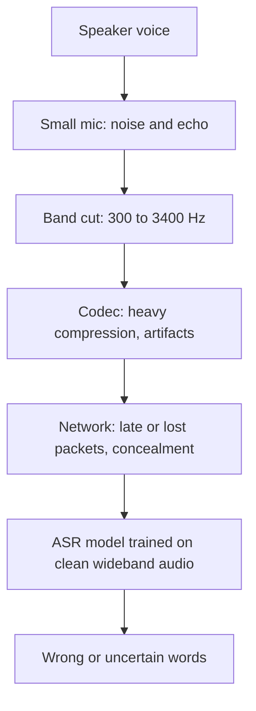
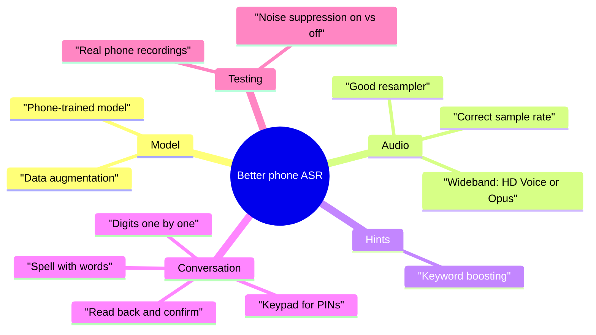

# Why does phone audio make speech recognition worse?

> **Step 16: AI Infrastructure, Deployment, and System Design** · ⏱️ 17 min read · [Read original](https://outcomeschool.com/blog/phone-audio-and-speech-recognition)

## TL;DR
A phone call throws away much of the voice before the model sees it: it cuts high sounds, compresses heavily, loses packets, and adds noise, and the model was usually trained on cleaner audio. These damages stack, so the same model does worse on calls. Lost sound cannot be recovered; fix by phone-tuned models, correct formats, wideband when possible, hints, and conversation design.

## Key Concepts
- **ASR** — Automatic Speech Recognition: audio to text. A wrong word here corrupts everything downstream (hearing "sixty" for "fifty").
- **Frequency (Hz)** — vibration speed; slow = low sound, fast = high sound. Speech spans below 100 Hz to about 8000 Hz and beyond.
- **Narrowband** — phone band of about 300 Hz to 3400 Hz.
- **Sample rate** — measurements per second; can hold sounds only up to half its value.
- **Codec** — coder + decoder, shrinks and expands audio.
- **Artifacts** — distortions added by a codec (robotic, buzzy, muffled).
- **Transcoding** — decode and re-encode when a call crosses networks; like a photocopy of a photocopy.
- **Packet loss concealment** — guessing missing sound, usually stretching or repeating the sound before the gap.
- **Domain mismatch** — gap between training audio and real-use audio.
- **Upsampling** — adding in-between samples to reach a higher rate.

## How It Works

### Journey of the voice
Speak -> small microphone (with noise) -> phone keeps only 300-3400 Hz -> codec squeezes into very few bits -> network loses some pieces -> ASR gets damaged audio.

### Reason 1: High sounds cut off
Phone network was designed when sending sound was expensive; people still understand each other with the middle band. Phone sample rate is 8 kHz (max 4 kHz sounds; band stops at 3400 Hz). ASR models usually expect 16 kHz (up to 8 kHz), so the phone gives under half the expected range.

| Property | Phone (narrowband) | Typical model input (wideband) |
|---|---|---|
| Sample rate | 8 kHz | 16 kHz |
| Highest sound | about 3.4 kHz | about 8 kHz |
| Lowest sound | about 300 Hz | close to 0 Hz |
| "s", "f" sounds | mostly lost | kept |

Consonants such as "s", "f", "th", "sh", "z" are hissing sounds with much energy above 4000 Hz ("s" especially). Cut off, they become faint and alike: "fat" vs "sat" both leave faint noise. This is why people say "S as in Sugar". Common confusions: "fifty"/"sixty", "f"/"s" in names or emails, "fin"/"thin", "mass"/"math". These hit numbers, names, emails, account IDs, where context cannot help.

### Reason 2: Compression
| Audio type | Bits per second |
|---|---|
| 16 kHz, 16-bit (model input) | 256,000 |
| G.711 phone call (8 kHz, 8 bits) | 64,000 |
| AMR mobile call | about 4,750 to 12,200 |

Mobile calls carry about 20 to 50 times less data. Codecs keep what the human ear needs and drop the rest, possibly dropping details the model needs; artifacts are ignored by people but confuse models never trained on them. Transcoding across networks (mobile to landline to our server) adds more damage each time.

### Reason 3: Lost packets
Audio goes in 20 ms packets; on weak signal some arrive late (treated as lost) or never. Silence would sound like a dropped call, so concealment fills the gap. Example: "4 7 2 9" with two packets (40 ms) of the "7" lost, filled with a stretched copy of earlier sound; a person hears a tiny glitch, the model may write "4 1 2 9" or skip the digit. Model gets less information plus made-up sound.

### Reason 4: Noise, echo, small microphones
- Background noise (traffic, fans, people, music).
- Echo: on speakerphone the agent's voice returns into the mic.
- Distance: quieter voice, louder room.

Phones also apply noise suppression, echo cancellation, automatic volume control. They help the listener but change the voice: strong suppression can clip soft word starts/ends or remove a quiet "s" as noise, after the band cut has already weakened it.

### Reason 5: Model trained on different audio
Many large ASR models train mostly on wideband clean audio (podcasts, videos, audiobooks, good mics). Phone audio is a domain mismatch (like learning English from clear movies, then a crackly line). Common mistake: upsample 8 kHz to 16 kHz and expect real 16 kHz quality. Upsampling only adds in-between samples; everything above 4 kHz stays empty, so the model sees 16 kHz audio with the top half silent. No processing recovers discarded sound.

### How problems stack up ("fifty")
Band cut makes "f" faint -> noise suppression weakens it -> codec fuzzes it -> lost packet adds guessed sound -> clean-trained model hears something between "fifty" and "sixty". No single step destroys the word; each worsens it.

### Making ASR work better
- **Phone-trained model** — or augment clean data: cut to 300-3400 Hz, pass through a phone codec, add noise (data augmentation).
- **Right format** — send 8 kHz if the model supports it and declare the rate; if it needs 16 kHz, upsample with a good resampler. A wrong declared sample rate makes voice sound too fast or slow and recognition fails badly.
- **Wideband when possible** — HD Voice uses AMR-WB at 16 kHz, keeping sound up to about 7000 Hz, but needs both phones and every network on the path; otherwise falls back to narrowband. App or web calls can use Opus, which keeps even more.
- **Hints (keyword boosting)** — pass expected words (products, cities, menu items).
- **Conversation design** — read numbers back for confirmation, ask for digits one by one, spelling with a word per letter, or keypad for account numbers and PINs.
- **Careful with cleanup** — test with and without strong noise suppression on real calls; keep what gives fewer errors.
- **Test on real phone audio** — real networks and noise, not only a clean test set.

## Diagram(s)

### Damage along the call path

### Mitigation map

## Trade-offs & Pitfalls
- Lost high-frequency sound cannot be recovered; upsampling does not help.
- HD Voice only works end to end; one narrowband hop forces fallback.
- Strong noise suppression can delete quiet consonants.
- Wrong declared sample rate breaks recognition.
- Numbers, names and emails suffer most because context cannot rescue them.
- Test sets must reflect real phone conditions.

## Key Takeaways
- Phone audio is narrowband (300-3400 Hz, 8 kHz) while ASR models expect 16 kHz wideband.
- Hissing consonants (s, f, th, sh, z) live above 4 kHz, hence "fifty"/"sixty" errors.
- Mobile codecs carry about 20 to 50 times less data than model input; transcoding compounds damage.
- Lost packets are filled with guessed sound that can alter digits.
- Noise, echo and noise suppression further degrade soft sounds.
- Upsampling 8 to 16 kHz fixes the format, not the missing information; domain mismatch remains.
- Fix with phone-tuned models, augmentation, correct sample rate, wideband, keyword boosting, confirmation-based dialog design, and real-call testing.
