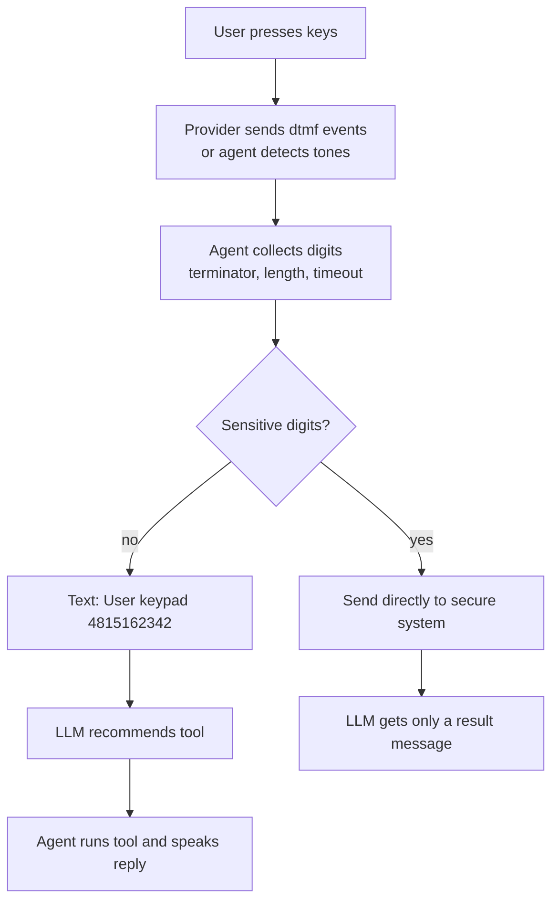

# How does DTMF keypad input work in a voice agent?

> **Step 16: AI Infrastructure, Deployment, and System Design** · ⏱️ 16 min read · [Read original](https://outcomeschool.com/blog/dtmf-in-voice-agents)

## TL;DR
DTMF turns each pressed phone key into a short sound of two simultaneous tones, which the network or the agent decodes back into an exact digit. The agent collects digits (terminator, fixed length, timeout), passes them to the LLM as text labeled "keypad", and routes sensitive digits around the LLM entirely. The agent can also press keys itself.

## Key Concepts
- **DTMF (Dual-Tone Multi-Frequency)** — each key plays two tones at once; each key uses its own pair from a fixed set of frequencies. Launched publicly by Bell System in 1963 as "Touch-Tone".
- **Frequency / Hz** — how high or low a sound is; wave cycles per second.
- **Telephony provider** — service linking the phone network to the agent code.
- **In-band** — beep travels inside the call audio.
- **Out-of-band** — key press sent as a separate event (RFC 4733 "telephone-event" packets on internet calls).
- **Goertzel algorithm** — checks only chosen frequencies, so very fast.
- **Barge-in** — user interrupting the agent.

## How It Works

### Why keypad input
- Long numbers are easy to mishear (fifteen vs fifty, dropped digit in noise).
- Private info (PIN, card digits) should not be spoken aloud.
- Noisy places hurt speech recognition; key presses are barely affected.
- Accents or speech difficulties.
- Existing "Press 1, Press 2" menus.
- A key press gives one exact digit, no guessing.

### Keypad grid
Rows have low tones, columns have high tones; the 4th column (A-D, 1633 Hz) is absent on ordinary phones.

| Row / Col | 1209 Hz | 1336 Hz | 1477 Hz | 1633 Hz |
|---|---|---|---|---|
| 697 Hz | 1 | 2 | 3 | A |
| 770 Hz | 4 | 5 | 6 | B |
| 852 Hz | 7 | 8 | 9 | C |
| 941 Hz | * | 0 | # | D |

- Example: 5 = 770 Hz + 1336 Hz; 9 = 852 Hz + 1477 Hz.
- Why two tones: speech can easily make one pure tone by accident, but rarely one low-group and one high-group tone, steady, simultaneously. Tones are also chosen so none is a simple multiple of another.

### How DTMF travels
- **In-band**: beep mixed in the audio; agent must detect it. Problem: codecs (compression) keep speech clear, not pure tones exact, so they may distort tones and cause missed or wrong keys.
- **Out-of-band**: phone system detects the key near the caller and sends a message (key 5 pressed, held for this long). Much more reliable; most providers do this.
- Over a WebSocket the provider sends a separate message: `{ "event": "dtmf", "dtmf": { "digit": "5" } }`. No listening needed.

### Detecting tones (when only audio arrives)
1. Measure strength of the 8 DTMF frequencies in a slice of a few tens of ms (Goertzel).
2. Pick strongest low-group and strongest high-group tone.
3. Check both are clearly stronger than everything else and similar in loudness.
4. Check the pair persists for a minimum duration (speech sounds are shorter).
5. Look up the pair in the grid (770 + 1336 = 5).
- Held keys: report once when the tone starts, wait for it to stop, else one press becomes "5 5 5 5".

### Collecting digits
- **Terminator key** — e.g. "followed by the hash key".
- **Fixed length** — stop after the 4th digit of a PIN.
- **Timeout** — a few seconds of no keys ends input.
- Used together, for a 10-digit account number: 4,8,1,5 then pause means timeout, ask again ("I got only 4 digits"); 10 digits + # is complete; 10 digits without # stops at the 10th by length.
- `*` often means "start again" and clears digits.
- If the user presses a key while the agent speaks, the agent stops speaking at once (like barge-in).

### Digits to the LLM
- Agent converts digits to text added to the conversation, e.g. `User (keypad): 4815162342`. The "keypad" label tells the LLM the input is exact, unlike spoken numbers.
- Menu example: "User (keypad): 2" means support.
- The LLM only recommends a tool (e.g. `look_up_account("4815162342")`); agent code runs it and speaks the reply.

### Sensitive digits
- Card number, PIN, security code must not enter history, logs, or the LLM.
- Agent code sends digits directly to the secure system (e.g. payment service); the LLM gets only a result: "the user entered the card number on the keypad, and it was verified".
- Spoken digits go through STT into the transcript; key presses can bypass the LLM. Also helps with payment card security rules.

### Agent presses keys
- When the agent calls another system ("Press 3 for order status"), the LLM recommends a tool like `press_keys("3")`; code asks the provider to send DTMF as tones or out-of-band event.

## Diagram(s)

### Digit flow to the LLM

## Trade-offs & Pitfalls
- In-band DTMF is fragile under codec compression; prefer out-of-band.
- Misdetection from speech is rare but guarded by pair, dominance, loudness and duration checks.
- Held key must be reported once.
- Never let sensitive digits reach the LLM, transcripts, or logs.

## Key Takeaways
- DTMF = two simultaneous tones per key (row low + column high).
- Keypad input is exact where speech is error-prone and private-unfriendly.
- Out-of-band events (RFC 4733) are more reliable than in-band audio.
- Detection: check 8 frequencies, strongest pair, dominance, duration, grid lookup.
- Digits end by terminator, fixed length, or timeout.
- Label keypad input for the LLM; the LLM recommends tools, code runs them.
- Route sensitive digits around the LLM.
- The agent can send DTMF too (`press_keys`).
