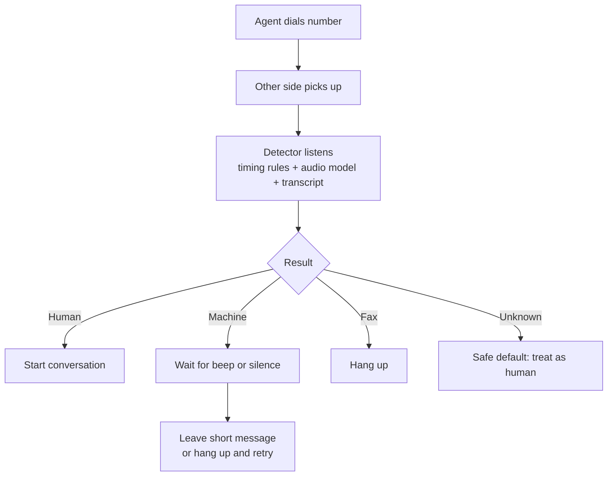
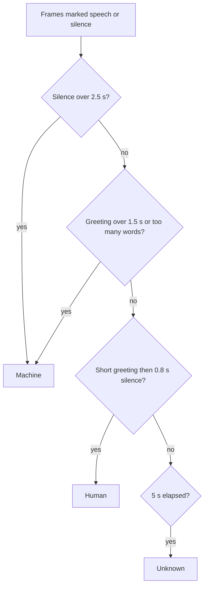

# How does voicemail and answering machine detection work?

> **Step 16: AI Infrastructure, Deployment, and System Design** · ⏱️ 16 min read · [Read original](https://outcomeschool.com/blog/answering-machine-detection)

## TL;DR
Answering Machine Detection (AMD) listens to the first few seconds of an outgoing call and decides whether a human or a voicemail greeting answered. It uses timing rules on speech and silence, a beep/pure-tone detector, optionally an audio classifier and transcript reading by keywords or an LLM. It trades speed against accuracy and decides what the voice agent does next.

## Key Concepts
- **AMD** — deciding within seconds whether a live person or a voicemail picked up.
- **Results** — Human; Machine; Machine, greeting ended (usually after the beep, now recording); Fax; Unknown (could not decide in time).
- **Frame** — 10-20 ms audio piece; energy = loudness; above a level = speech, below = silence.
- **Spectrogram** — picture of the audio showing frequencies over time.
- **Classifier** — model putting input into a group (human or machine).
- **Blocking vs background detection**.

## How It Works

### Why needed
- Clinic example: voice agent calling 1,000 patients with reminders.
- Always talk: the agent talks over the greeting; voicemail records only after the beep, so the message is half lost.
- Always wait for a beep: a live "Hello?" hears silence and hangs up.

### Core difference
- A person says something short ("Hello?") then waits in silence. A machine plays a long continuous greeting, then beeps.

### Approach 1: Timing rules
Audio becomes a speech/silence timeline. Asterisk AMD defaults:

| Setting | Default | Meaning |
|---|---|---|
| Initial silence | 2500 ms | Longest silence before anyone speaks |
| Greeting | 1500 ms | Longest greeting before it is a machine |
| After greeting silence | 800 ms | Silence after greeting meaning a person waits |
| Total analysis time | 5000 ms | Max time to decide |
| Minimum word length | 100 ms | Shortest speech burst counted as a word |
| Between words silence | 50 ms | Shortest gap splitting two words |

Rules: silence over 2.5 s gives Machine; greeting over 1.5 s gives Machine; too many words gives Machine; short greeting then 0.8 s silence gives Human; 5 s with none of these gives Unknown.
- Call 1 (person): 0.0-0.4 silence, 0.4-0.9 "Hello?" (0.5 s), 0.9-1.7 silence 0.8 s; Human at 1.7 s.
- Call 2 (voicemail): 0.0-0.6 silence, speech from 0.6 s continues; at 2.1 s greeting reaches 1.5 s; Machine at 2.1 s.
- Fast and cheap, catches many in 2-3 s, but only looks at loudness and time: a long human sentence looks like a machine, a very short greeting looks like a person.

### Finding the beep
- Needed to start speaking after the beep, or the message start is lost.
- Speech mixes many changing frequencies; a beep is one steady frequency. Detector splits frames into frequencies, checks nearly all energy sits at one frequency, and checks it stays steady over many frames (the same pure-tone idea as DTMF).
- Beep frequency varies and some greetings have none, so look for any pure steady tone; if none, wait for a long silence as end of greeting.
- Hence two machine results: "it is a machine" and "greeting ended, time to speak".
- Fax: long steady 2100 Hz tone, returns Fax.

### Approach 2: Audio model
- Recorded greetings are cleaner, even, steady rhythm (quiet room); live phones have noise, breathing, uneven rhythm.
- Train on thousands of labeled call openings; convert first seconds to spectrograms; train a classifier; live output a score (e.g. 92% machine) and decide when it crosses a threshold.
- Learns hard-to-write patterns (clean recording, voice rising in "Hello?"); better on tricky cases. Still confused by a long clear human greeting ("Hello, this is Rahul speaking, how can I help you?").

### Approach 3: Reading words
- Streaming STT gives text during the greeting.
- Voicemail phrases: "You have reached...", "I cannot take your call right now", "Please leave a message after the tone", "The person you are calling is not available". Humans: "Hello?", "Yes?", "Who is this?", their name.
- **Keyword matching** — fast, misses other wording. **LLM classifier** — prompt with the transcript, answer "human or voicemail"; understands meaning ("Sorry I missed you, drop me a message").
- Cost: STT and LLM latency, so systems combine: timing rules and beep give a fast first answer, transcript confirms or corrects.

### Speed vs accuracy
- Fast decision = less heard = more mistakes; slow = accurate but the person waits in silence (up to 5 s with defaults); some think it is spam and hang up.
- **Blocking** — call waits for the decision, then the agent speaks; simple but silence.
- **Background** — agent starts at once, detector keeps listening; on Machine it switches to the voicemail flow. Better for real people, but on voicemail the agent may talk over a few words of the greeting.

### Where it fails
- Human sounds like machine: long sentence ("Good morning, Sharma Electronics, Rahul speaking..."), talking to someone else.
- Machine sounds like human: very short greeting ("Priya. Leave a message."), greeting starting "Hello?" then a pause, carrier message ("The number you have dialed is not reachable").
- Beep hard to find: no beep, background music with steady tones.
- Timing fails on long human greetings, audio model handles some, transcript catches many of the rest.
- Unknown: pick a safe default, commonly treat as human (hanging up on a person is worse than talking to a recording).

## Diagram(s)

### End-to-end call flow

### Timing-rule decisions

## Trade-offs & Pitfalls
- Speed vs accuracy; blocking gives silence, background may overlap the greeting.
- Each approach has blind spots; combine them.
- Unknown needs a safe default.

## Key Takeaways
- AMD = human vs machine in the first seconds, plus Fax and Unknown.
- Humans speak briefly then wait; machines speak long then beep.
- Timing rules are cheap and fast but fooled by atypical greetings.
- Beep = one steady frequency; fall back to long silence; fax = 2100 Hz.
- Audio classifiers and transcript/LLM reading raise accuracy at a latency cost.
- Background detection suits real people better than blocking.
- Default Unknown to human.
- No STT is needed for basic AMD.
