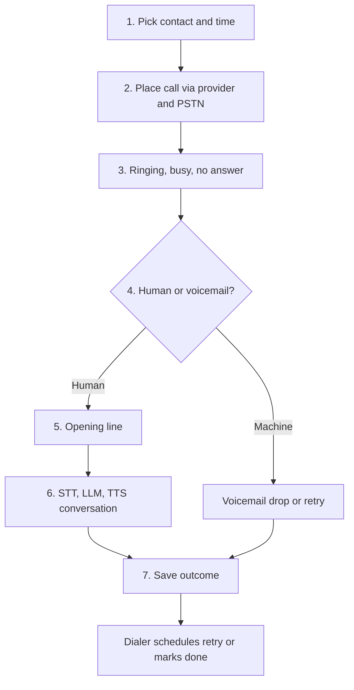

# How does an outbound calling voice agent work?

> **Step 16: AI Infrastructure, Deployment, and System Design** · ⏱️ 16 min read · [Read original](https://outcomeschool.com/blog/outbound-calling-voice-agent)

## TL;DR
An outbound calling voice agent dials numbers itself, talks to whoever answers, and saves the result. The journey: pick contact and time, place the call via a telephony provider, handle ringing/busy/no answer, detect human vs voicemail, open the conversation, run the STT-LLM-TTS conversation, then save an outcome that drives retries.

## Key Concepts
- **Campaign** — list of contacts plus a goal (e.g. confirm tomorrow's appointments).
- **Dialer** — picks next contact and starts the call.
- **Telephony provider** — connects the internet to the phone network.
- **PSTN** — Public Switched Telephone Network.
- **SIP** — Session Initiation Protocol; an INVITE starts a call.
- **Caller ID** — a real number the business owns, so people can call back.
- **AMD** — Answering Machine Detection.
- **Voicemail drop** — pre-written message left on a voicemail.
- **Warm transfer** — human gets a short call summary before connection.
- **Disposition / call outcome** — saved result of the call.

## How It Works

### Inbound vs outbound
| Point | Inbound | Outbound |
|---|---|---|
| Who starts | Customer | Agent |
| Who speaks first | Agent greets | Usually person says "Hello?" |
| Voicemail possible | No | Yes |
| Unanswered calls | No retry | Must retry later |
| Choosing the time | Customer | We must choose |

The conversation is nearly the same; extra work is dialing, waiting, voicemail detection and retries. Example: 500 patients to confirm appointments; the agent dials, asks, understands, marks confirmed/cancelled, moves on, and runs many calls in parallel.

### Step 1: Whom to call and when
Dialer checks:
- Good time? Use time zone and allowed hours (no 6 AM local calls).
- Allowed? Do Not Call lists, consent rules.
- Concurrency? Each live call needs its own STT, LLM, TTS, and the telephony account has limits.
- Tried before? e.g. already called three times today, skip.
Then it prepares call details (name, appointment time, clinic) into the LLM instructions.

### Step 2: Placing the call
- Server asks the telephony provider (web API or SIP) to call; provider reaches the PSTN and the phone.
- Caller ID is a real owned number.
- Audio streams both ways, often over a WebSocket; phone audio is 8 kHz (lower than 16 kHz+), so STT must handle it.

### Step 3: Ringing, busy, no answer
Call progress events, SIP codes: 180 Ringing; 200 OK (picked up, but human or voicemail unknown); 486 Busy Here; 404 Not Found (invalid or disconnected); no answer after a set time (e.g. 30 s) ends the call.

### Step 4: Human or voicemail (AMD)
- Talking at once over voicemail records half the message; staying silent makes the human say "Hello? Hello?" and hang up.
- Human: short greeting then silence. Voicemail: long continuous greeting, often ending with a beep. AMD uses first-speech length, following silence, beep; some systems read phrases like "leave a message".
- Results: **Human** (start conversation); **Machine** (wait for end by beep or silence, then voicemail drop, or hang up and retry); **Unknown** (default rule, e.g. treat as human).
- Never perfect: speed vs accuracy, varies by network; tune the waiting time.

### Step 5: Starting the conversation
- Person says "Hello?" first, same short greeting AMD used. Once AMD says human, agent speaks its opening line; if the person stays silent briefly, agent speaks anyway.
- Opening line answers who, from where, why, in seconds: confirm the person, say it is an AI assistant (legally required in some places, builds trust), state the reason. Example: "Hi, am I speaking with Rahul? This is an AI assistant calling from City Clinic about your appointment tomorrow at 10 AM."
- Pre-generate the line and its audio before connect so there is no delay.

### Step 6: Running the conversation
- STT, then LLM (with instructions and contact details), then TTS; or a single speech-to-speech model.
- Tools: e.g. `reschedule_appointment` recommended by the LLM, run by our code against the booking system.
- Common situations: wrong person (ask a better time); not interested (end politely and mark the person so we do not call again); interruptions ("Yes, yes, I know"; stop and listen); transfer to a human when asked or too complex (warm transfer).

### Step 7: Ending and saving outcome
- Outcomes: confirmed, rescheduled, not_interested, callback_requested, voicemail_left, no_answer, busy, transferred.
- no_answer/busy/voicemail_left come from Steps 3-4; real conversations: LLM reads the transcript and picks one outcome from a fixed list and extracts details, e.g. `{ "outcome": "rescheduled", "new_time": "Friday 11 AM", "notes": "Prefers mornings" }`.
- Next action: no_answer/busy/voicemail_left schedule a retry (hours later or another day, up to a max); callback_requested schedules the requested time; confirmed/rescheduled/not_interested are done, never called again in this campaign.
- Save recording and transcript for quality checks and improving instructions.

### Use cases
Appointment reminders, payment reminders (with pay link), delivery updates, lead follow-up, surveys and feedback.

## Diagram(s)

### Journey of one call

## Trade-offs & Pitfalls
- AMD errors: too fast means mistakes, too slow means humans hang up.
- Must respect calling hours, Do Not Call lists, consent, and concurrency limits.
- 200 OK does not reveal who answered.
- 8 kHz phone audio needs a suitable STT.

## Key Takeaways
- Outbound adds dialing, waiting, AMD and retries to a normal voice conversation.
- Dialer gates calls by time zone, consent, concurrency and attempt history.
- Telephony provider bridges the server to the PSTN, via API or SIP.
- 200 OK only means picked up; AMD tells human from voicemail.
- Open with who, from where, why, and disclose it is an AI.
- LLM recommends tools; code runs them; warm transfer to humans when needed.
- Every call ends with a structured outcome that drives retries.
