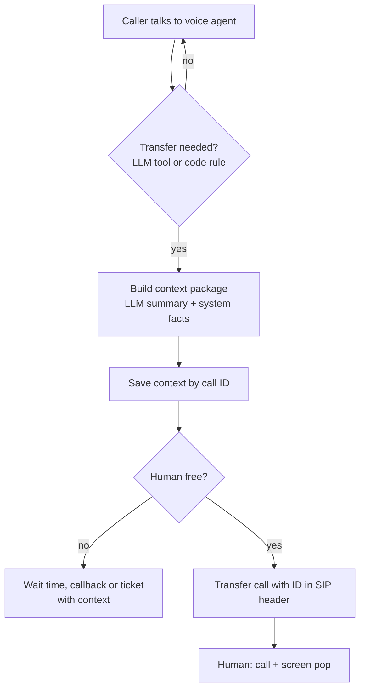
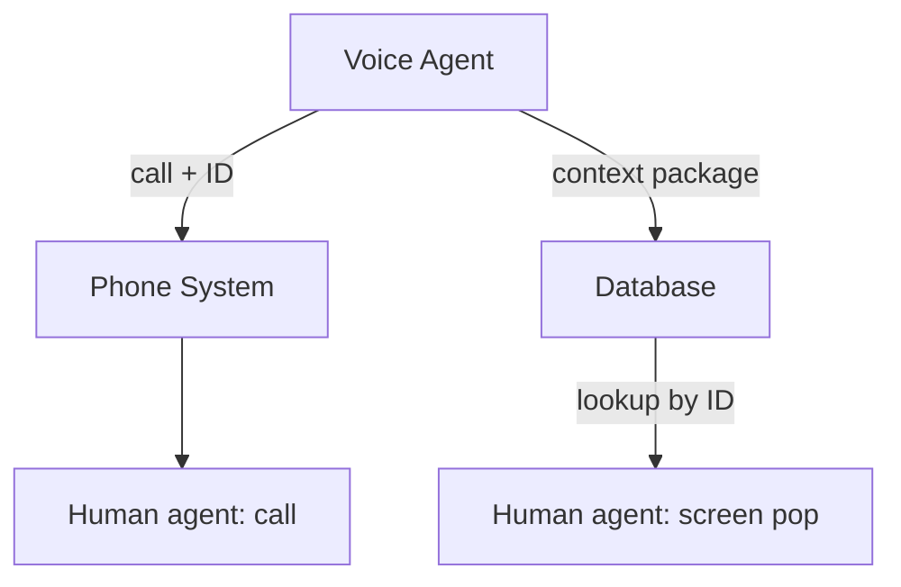

# How does a voice agent transfer a call to a human with context?

> **Step 16: AI Infrastructure, Deployment, and System Design** · ⏱️ 18 min read · [Read original](https://outcomeschool.com/blog/call-transfer-with-context)

## TL;DR
A voice agent transfers a call with context by deciding a human is needed, packaging a short summary plus facts from the caller, and moving the call and that package to the human together. The caller never repeats the story. The call (audio) and context (data) travel on separate paths, so they must be linked, usually via a call ID.

## Key Concepts
- **Call transfer with context** — handoff of the live call to a human plus everything the caller already shared (who, problem, what was checked, what they want).
- **Three parts** — Decide (human needed), Package (collect context, write summary), Hand off (move call and context together).
- **`transfer_to_human` tool** — LLM only recommends it with a reason; our code performs the transfer.
- **Cold (blind) transfer** — agent sends the call to a human or queue and leaves immediately.
- **Warm (attended) transfer** — agent first connects to the human, briefs them, then connects the caller.
- **Whisper** — the spoken briefing during a warm transfer; only the human hears it.
- **SIP** — Session Initiation Protocol; sets up, moves and ends calls. Headers carry small labeled data (custom `X-` headers, standard `User-to-User`).
- **REFER** — SIP method asking the phone system to move the call elsewhere; commonly used for cold transfer.
- **Screen pop** — caller details automatically appear on the human's screen when the call arrives.
- **CRM** — Customer Relationship Management system the human agents use.

## How It Works

### The problem
Example: Riya talks to the bank's agent for 3 minutes (identity verified, 5,000 rupees charged twice). Refund needs a human. Rahul picks up and asks for name and account number again, so she repeats everything and gets more upset. The call moved but the information did not. With context, Rahul's screen already shows "Riya Sharma, identity verified, payment of 5,000 rupees charged twice on 12 October, wants refund of the second payment", and he proceeds directly.

### When to transfer
Too early wastes humans; too late frustrates callers. Triggers:
- Caller asks for a human (clearest signal, must respect).
- Task outside agent's ability (refunds, legal details, fraud complaint).
- Agent stuck (failed to understand 2-3 times in a row).
- Caller upset (words, sometimes tone).
- Business rule (e.g. every account-closing call).

How: give the LLM a `transfer_to_human` tool, described in the system prompt. The LLM recommends it with a reason; code executes. Critical rules ("failed three times", "caller mentioned fraud") are checked directly in code and trigger the transfer even without the LLM, so they never depend on the LLM alone.

### What context to send
Human has seconds to read, so keep it short:
- Caller identity (name, phone, account number)
- Verification status (saves repeating security questions)
- Reason for transfer
- Summary of problem (2-3 sentences)
- What has been done/checked
- Caller mood
- Full transcript as backup (only its ID in the package; screen loads it on demand)

The summary is the key item; the LLM writes it from the transcript with a prompt: handoff note for a human agent, main problem in one sentence, what was checked/done, what the caller wants next, under 60 words, only facts from the transcript. Facts such as account number and verification status come from our own system, not the LLM, because a hallucinated detail makes the human act on wrong information.

Package example:
```
{
  "caller_name": "Riya Sharma",
  "account_id": "ACC-48213",
  "identity_verified": true,
  "transfer_reason": "Refund of duplicate payment needs human approval",
  "summary": "Payment of 5,000 rupees was charged twice on 12 October. ...",
  "caller_mood": "frustrated",
  "transcript_id": "call-7731"
}
```

### Cold vs warm transfer
Warm transfer steps:
1. Agent tells the caller to hold (hold music).
2. Agent places a new call to a human.
3. On pickup, agent whispers a briefing ("I have Riya Sharma on the line. Identity verified. 5,000 rupees charged twice, wants the second refunded.").
4. Agent connects caller and human.
5. Agent leaves.

| Point | Cold transfer | Warm transfer |
|---|---|---|
| Agent talks to human first | No | Yes |
| Speed | Fast | Slower |
| Caller waits on hold | Only in the queue | During briefing too |
| Context delivery | Only on screen | Screen and spoken |
| Risk of caller repeating | Higher | Lower |
| Best for | Simple calls, big queues | Complex or sensitive calls |

Cold: fast and simple, but nobody confirms the human read the context. Warm: human hears context first, but slower and needs a free human right now. In practice: cold to a queue for simple calls, warm for upset callers or high-value cases.

### How call and context travel together
The call is audio through the phone system; context is data through our software (CRM). Unlinked, the human's screen shows nothing or the wrong caller.
- **Way 1: context inside the call.** Attach data (account ID, reason) in a SIP header; the human's phone system reads it and does a screen pop.
- **Way 2: store and look up.** Save the package in a database keyed by call ID; the human's software loads it by ID. Headers have size limits, so carry a short ID, not the whole summary.
- Most real systems combine both: a small ID in the call, full context in the database.

### Code flow
Tool definition: `transfer_to_human` with `reason` and `team` (enum refunds, fraud, general), both required. Handler `handle_transfer(call, reason, team)`:
1. Summarize transcript with LLM and build the context (name, account_id, verified, reason, summary, transcript_id from the system).
2. Save the context to the store by call ID.
3. If no free agent in team, offer a callback with the context.
4. Tell the caller "I am connecting you to a specialist. Please hold."
5. `call.transfer(destination=team_queue(team), headers={"X-Context-Id": call.id})`.

This is a cold transfer to a team queue. Order matters: save context before transferring, or the call may reach the human before the context exists and the screen shows nothing.

### No human available
Check availability before transfer. If nobody is free (busy, or offline at night):
- Tell the caller the expected wait (e.g. about 6 minutes).
- Offer a callback, saving context with it so the callback human sees the same summary.
- Create a ticket with full context for the team next morning.
Context is always saved first, so the human starts where the agent stopped.

## Diagram(s)

### Decide, package, hand off


### Two paths linked by the call ID


## Trade-offs & Pitfalls
- Transferring too early burdens humans; too late frustrates callers.
- Cold transfer: no confirmation the context reached the human.
- Warm transfer: longer hold, needs a free human immediately.
- LLM-supplied facts risk hallucination; take identity and verification from our system.
- Headers have size limits; pass an ID, not the summary.
- Transfer before saving context leaves the screen empty.
- Unlinked call and context path shows nothing or another caller's details.

## Key Takeaways
- Transfer with context = decide, package, hand off, so callers never repeat themselves.
- The LLM recommends `transfer_to_human`; code does the transfer, and critical rules are enforced in code.
- Keep the package short: identity, verification, reason, 2-3 sentence summary, done so far, mood, transcript ID.
- Facts come from our system; the LLM only writes the summary from transcript facts.
- Cold transfer is fast but unconfirmed; warm transfer uses a whisper briefing and suits complex calls.
- Link audio and data with a call ID in a SIP header plus a database lookup (screen pop).
- Always save context before transferring.
- If no human is free, give wait time, callback or ticket, all with context saved.
