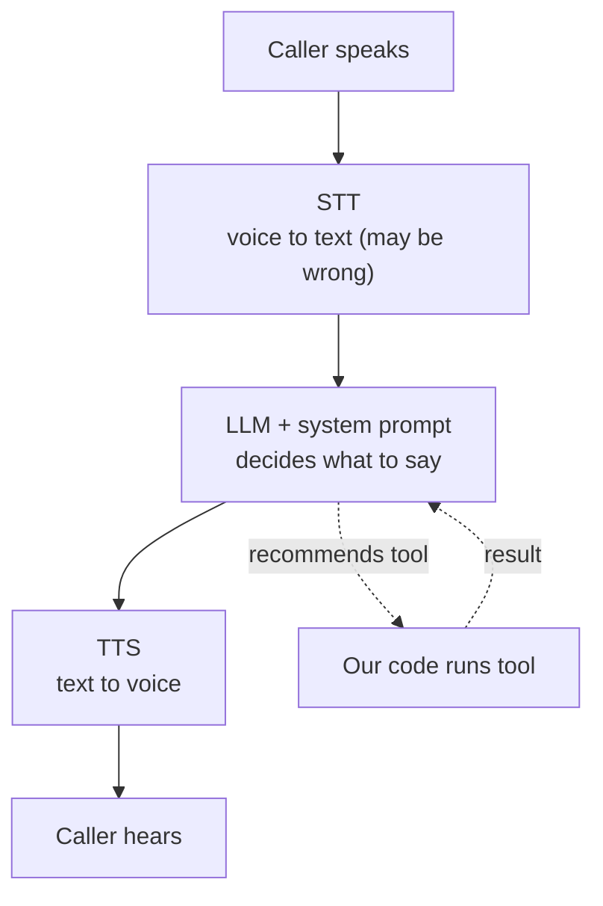
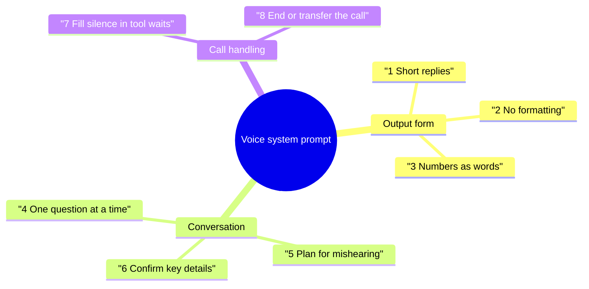

# How do you write a system prompt for a voice agent, not a chat bot?

> **Step 16: AI Infrastructure, Deployment, and System Design** · ⏱️ 17 min read · [Read original](https://outcomeschool.com/blog/voice-agent-system-prompt)

## TL;DR
A voice agent system prompt tells the LLM its replies will be spoken aloud, so it must produce short, plain, natural-sounding text. Every rule follows from one fact: the caller hears the answer instead of reading it. The prompt is refined by calling the agent and listening.

## Key Concepts
- **System prompt** — instructions given to the LLM before the conversation; defines who it is, its job, behavior. The user never sees it, but the model gets it with every reply. Like a page of day-one instructions for a clinic front-desk hire.
- **Voice agent** — STT, then LLM plus system prompt, then TTS; no screen. Newer speech-to-speech models follow the same rule: output is heard, not read.
- **Transcript** — text the STT engine produces; may be wrong.
- **Markdown** — symbols like `**` and `-` that LLMs use for formatting; useless in speech.

## How It Works

### Why a chat bot prompt fails
Chat prompt: "You are a helpful assistant for City Clinic. Answer questions about appointments." For "What are your timings?" the LLM writes bold heading, bullet list ("Mon-Fri: 9:00 AM - 6:00 PM"), a URL and an emoji. TTS may read the asterisks, spell out the URL piece by piece, say "smiling face", or read "Mon-Fri" and "9:00 AM - 6:00 PM" oddly; a link cannot be clicked on a call; too many pieces to remember after one hearing. The LLM was never told it is speaking.

### The eight rules
| Rule | Why | Prompt instruction |
|---|---|---|
| 1. Keep replies short | Listeners hear each word once, forget a 40-second reply's first half; calls are back-and-forth | One or two short sentences; most important info first; caller asks if they want more |
| 2. No formatting | Voice cannot show headings, bold, bullets, tables, links, code, emoji | State the reason ("replies will be converted to speech"), forbid markdown, lists, headings, bold, emojis, links; say several items in one natural sentence with "and" and "then" |
| 3. Numbers, dates, symbols as spoken | TTS reads "$1,250.50", "12/04", "9876543210", "Dr.", "St." in odd ways | Write in words: "one thousand two hundred fifty dollars and fifty cents", "the fourth of December", "three thirty in the afternoon"; phone numbers and booking codes digit by digit in small groups ("nine eight seven, six five four"); say "Doctor", "Street" |
| 4. One question at a time | Caller hears three questions, answers one, forgets the rest | Ask one question, wait for the answer |
| 5. Plan for mishearing | LLM gets what STT thinks was said (noise, accents, names); e.g. "look for Friday" instead of "book for Friday" | Input may contain mistakes; guess likely meaning from context; if unclear ask to repeat; never mention "transcript" or "speech recognition"; say "Sorry, I did not catch that" |
| 6. Confirm important details | Wrong name, date or phone number ruins a booking | Read back name, phone, date, time in one sentence and ask if correct; ask to spell hard names |
| 7. Fill silence during tools | Tool takes a second or more; silence feels like a dropped line | Say "Let me check that for you" first; give the result as one short spoken sentence, not raw data |
| 8. Know how to end the call | A call must be ended on purpose, else "Anything else?" loops | After request is done ask once if anything else; if no, thank, goodbye, end; if human requested or cannot help, say transferring and transfer |

Extra details:
- Rule 2: timings become "We are open from nine in the morning to six in the evening on weekdays, from ten to two on Saturday, and we are closed on Sunday."
- Rule 3: some TTS engines convert numbers already, but not always as wanted; writing words gives control. A phone number read as one big number ("nine billion...") is useless.
- Rule 5: without this, the LLM treats every transcript as perfect and acts on a wrong word with confidence. Giving context (a clinic booking) lets it infer "book".
- Rule 6: example readback "Rahul Verma, phone nine eight seven, six five four, three two one zero, on Friday the fourth of December at three thirty in the afternoon. Is that correct?" Caller corrects "Varma, V A R M A" before anything is saved. Do not confirm everything, or the call slows; only confirm what matters.
- Rule 7: tool flow: LLM recommends tool and input, our code runs it and returns the result.
- Rule 8: ending and transferring are tools from our code; the prompt says when to recommend them.
- Give the reason behind a rule; the model then generalizes to unlisted cases.

### Complete prompt (City Clinic, "Asha")
Organized in sections inside the prompt (headings help the model read and are not spoken):
- **Role** — Asha, AI phone receptionist; admits being an AI if asked; live phone call; books, changes, cancels appointments.
- **Clinic details** — hours in words.
- **How you speak** — converted to speech, warm calm friendly, one or two short sentences, important first, no markdown/lists/emojis/links.
- **Numbers and names** — words, digit groups, no short forms.
- **Conversation flow** — one question at a time; collect name, phone, preferred day; read back; spell hard names.
- **Mishearing** — may contain mistakes, guess, "Sorry, I did not catch that".
- **Tools** — "Let me check that for you", one short result sentence.
- **Limits** — no medical advice (a doctor helps at the visit); transfer on human request.
- **Ending** — ask once about anything else, thank, goodbye, end.

Result for "What are your timings?": the plain spoken timings sentence plus "Would you like to book a visit?"

Improve by calling the agent and listening; problems invisible on screen are obvious in sound. Fix or add one rule, then call again.

## Diagram(s)

### Voice agent pipeline

### The eight rules

## Trade-offs & Pitfalls
- Chat-style output (markdown, links, emoji, tables) breaks on TTS.
- TTS handling of symbols and numbers varies by engine; do not rely on it.
- Treating transcripts as perfect causes confident wrong actions.
- Confirming everything slows the call; confirm only critical details.
- Raw tool data read aloud sounds wrong; summarize in a sentence.
- Silence during tools feels like a dropped line.
- Without an end rule the agent loops on "anything else?".

## Key Takeaways
- The core fact: the caller hears the LLM output, so write the prompt for the ear.
- Short replies, most important first, one or two sentences.
- No markdown, lists, emoji or links; turn lists into one natural sentence.
- Numbers, dates, prices and short forms in words; phone numbers digit by digit in small groups.
- One question at a time; expect STT mistakes and ask politely to repeat.
- Read back only critical details; speak a filler phrase while tools run.
- Define ending and transfer behavior; state the reason behind rules.
- Iterate by calling the agent and listening, one rule fix at a time.
- A chat bot prompt cannot be reused for voice.
