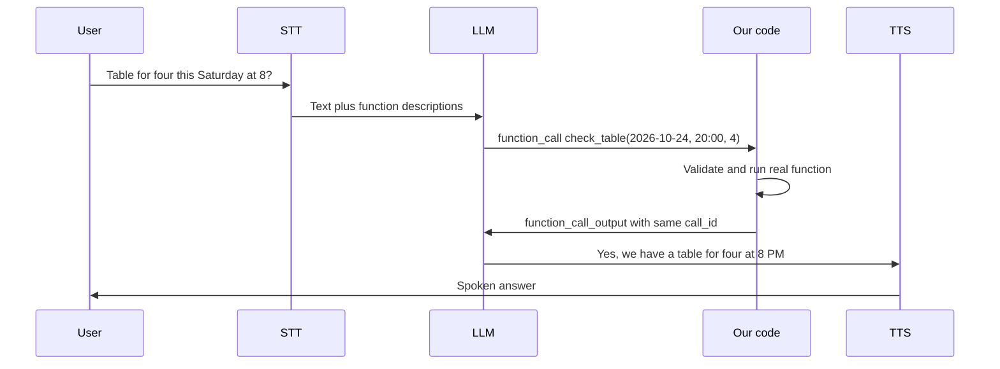

# How does function calling work in a voice AI agent?

> **Step 16: AI Infrastructure, Deployment, and System Design** · ⏱️ 17 min read · [Read original](https://outcomeschool.com/blog/function-calling-in-voice-agents)

## TL;DR
Function calling lets a voice agent take real actions mid-call. The LLM reads the transcript plus function descriptions and recommends a function and inputs, our code runs it, the result goes back to the LLM, and the LLM writes a reply that the TTS speaks. The LLM never runs anything itself.

## Key Concepts
- **Function calling (tool calling)** — we describe our code's functions to the LLM, and it replies with a function name and inputs instead of normal text. Functions are also called tools.
- **Agent** — our code that reads the recommendation, runs the function, and returns the result.
- **Voice pipeline** — STT (speech to text), LLM, TTS (text to speech). STT and TTS know nothing about functions.
- **call_id** — unique id that matches a result to its call.
- **Speech-to-speech model** — takes audio in and produces audio out, no separate STT/TTS.

## How It Works

### Where it fits
Each LLM reply is one of two choices: text (goes to TTS, spoken) or a function call (goes to our code, not spoken). Example: restaurant agent with `check_table(date, time, guests)` and `book_table(date, time, guests, name)`.

### The six steps
1. **Describe the functions** — before the call, write name, description (what it does and when to use it) and parameters (types, JSON Schema) for each function. Sent with the system prompt on every turn. This text is all the LLM knows, so clear descriptions give correct calls.
2. **User speaks** — "Do you have a table for four this Saturday at 8 in the evening?" The agent waits until the user finishes, STT converts it, and the conversation plus function descriptions go to the LLM.
3. **LLM picks function and inputs** — chooses `check_table`, converts "this Saturday at 8 in the evening" to `2026-10-24` and `20:00` (works if today's date, Sunday 2026-10-18, is in the system prompt), `guests: 4`. Output has `name`, `arguments` (JSON string) and `call_id`. Nothing is spoken.
4. **Our code runs it** — read the name, parse arguments, validate them (e.g. guests is a number), call the real function against the booking system. Result: `{ "available": true, "time": "20:00", "table": "T12" }`.
5. **Result back to LLM** — add a `function_call_output` message with the same `call_id`, then ask the LLM to continue. It may make another call or write text, so call-run-return can repeat.
6. **Agent speaks** — LLM writes "Yes, we have a table for four this Saturday at 8 PM. Shall I book it for you?" which goes to TTS (often streamed, so TTS starts before the LLM finishes). User says "Yes, the name is Rahul", steps 2 to 6 repeat with `book_table`, and the agent says "Your table is booked, Rahul. See you on Saturday."

The LLM is called twice per question: once to pick the function, once to turn the result into a reply.

### What changes with voice
1. **STT mishears inputs** ("for five two one", or "4512" for "4521"). Prompt the LLM to read back important values; make functions validate format and return clear errors so the LLM can re-ask.
2. **Some functions need a clear yes** (book, cancel, pay). Ask confirmation first and run only after clear agreement ("Shall I book it for you?").
3. **Silence while the function runs** (no spinner on a call, 3 seconds feels like a dropped call). Speak a filler like "Let me check that for you". Many LLMs return short text plus a function call in one reply, so speak and run together.
4. **User interrupts** ("Actually, make it 9 PM"). Read-only calls like `check_table`: drop the old result and rerun. State-changing calls like `book_table`: ensure no two bookings (8 PM and 9 PM).
5. **Results must be sayable** — tables, long lists, links are hard to hear. Summarize: "We have tables at 7, 8, and 9 PM. Which one works for you?"

### Speech-to-speech models (OpenAI Realtime API example)
Same six steps, only audio in and audio out:
1. Send function descriptions at start via `session.update`.
2. User speaks, model hears audio directly.
3. Model sends events with name and arguments; `response.function_call_arguments.done` signals arguments are complete.
4. Our code runs the function.
5. Send result via `conversation.item.create` with item type `function_call_output` and same `call_id`.
6. Send `response.create`, and the model speaks the answer.

### Code core
`FUNCTIONS` dict maps names to real functions. Loop per user turn:

```python
def handle_user_turn(audio, conversation):
    text = stt(audio)
    conversation.append({"role": "user", "content": text})
    while True:
        reply = llm(conversation, tools=TOOL_DESCRIPTIONS)
        conversation.extend(reply.items)
        if not reply.function_calls:
            tts_speak(reply.text)
            return
        for call in reply.function_calls:
            args = json.loads(call.arguments)
            result = FUNCTIONS[call.name](**args)
            conversation.append({"type": "function_call_output",
                "call_id": call.call_id, "output": json.dumps(result)})
```

Saving the reply items lets the LLM see its own calls next round. The while loop lets it chain calls. The blog's code omits error handling, confirmation before booking, and filler speech.

## Diagram(s)

### One function call end to end


## Trade-offs & Pitfalls
- Misheard values cause wrong lookups: read back and validate.
- Acting on unconfirmed state-changing calls can book or cancel the wrong thing.
- Silence during slow tools feels like a dropped call.
- Interruptions can duplicate state-changing actions.
- Raw tool output is unsuitable to speak.

## Key Takeaways
- The LLM only recommends a function and inputs, our code runs it.
- Function calling equals tool calling.
- Function descriptions (name, description, JSON Schema parameters) are all the LLM knows about a tool.
- A function call is not spoken, only text replies go to TTS.
- One question means two LLM calls (pick, then phrase), possibly more in a loop.
- Match results to calls using `call_id`.
- Voice adds mishearing, confirmation, silence, interruption and speakability problems.
- Speech-to-speech models use the same flow, just with audio.
