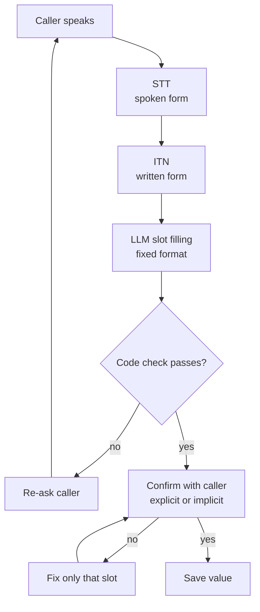

# How does a voice agent handle structured inputs like dates, numbers, and addresses?

> **Step 16: AI Infrastructure, Deployment, and System Design** · ⏱️ 17 min read · [Read original](https://outcomeschool.com/blog/structured-inputs-in-voice-agents)

## TL;DR
A voice agent turns free speech into a fixed-format value, checks it in code, and reads it back to the caller before using it. The path is hear, convert (ITN), extract (LLM slot filling), check, confirm. Special tricks make dates, long numbers, names and addresses reliable.

## Key Concepts
- **Structured input** — information with a fixed format a computer can use directly (date, phone, order ID, amount, zip, address). Example: "sometime next Tuesday afternoon" must become `{ "date": "2026-10-27", "time": "15:00" }`.
- **Inverse Text Normalization (ITN)** — spoken form to written form ("twenty seven" to "27", "three thirty pm" to "3:30 PM", "at gmail dot com" to "@gmail.com"). Often offered by STT as smart formatting.
- **Text Normalization** — the opposite: written to spoken ("$500" to "five hundred dollars") before TTS. ITN after STT, TN before TTS.
- **Slot filling** — extracting each required value (slot) from what the caller says.
- **SSML** — markup telling the TTS how to read a value.
- **DTMF tones** — exact digits sent from the keypad, no speech recognition needed.

## How It Works

### Why it is hard
- Many ways to say one date ("October twenty seventh", "next Tuesday", "27th").
- Similar sounds: "fifteen"/"fifty", B/D, M/N, worse on noisy phone lines.
- Phone audio has less detail, so more recognition errors.
- No screen, so wrong digits stay hidden unless spoken back.
- Self-corrections: "98... sorry, 89..." must keep the corrected value.
- One wrong word is usually fine in conversation, one wrong digit ruins a phone number.

### Journey of a spoken value
Caller speaks, STT gives spoken form ("march fifth nineteen ninety"), ITN gives written form ("March 5th 1990"), LLM extracts `{ "date_of_birth": "1990-03-05" }`, our code checks, agent confirms ("That is March fifth, nineteen ninety. Is that right?"), caller says yes, value saved.

### ITN limits
ITN also guesses: "one twenty" is 120 or 1:20, "twenty twenty" is 2020 or 20 20. It gives a better starting point, not a trusted value.

### Slot filling with the LLM
Describe slots as a tool (e.g. `book_appointment` with `date` as YYYY-MM-DD, `time` as 24-hour HH:MM, `patient_name`). Description tells the LLM the format. Leave a slot null when the caller has not said it, never invent; the agent then asks ("May I have the patient's name?"). The LLM sees the full text, so it can keep only corrected digits. Slots are collected one by one. The LLM recommends the tool, our code runs it, so code can check first.

### Checking the value
LLMs can output "2026-02-30" or drop a digit. Code example: `date.fromisoformat` rejects non-real dates, then reject dates in the past. On failure send the reason to the LLM, which re-asks politely. Other checks: phone digit count per country, order ID pattern (e.g. two letters and six digits), positive amount within limit, address via lookup service.

### Confirming
A value can pass checks and be wrong ("March fifth" vs "fifteenth").
- **Explicit** — direct yes/no ("...Is that correct?"). For costly mistakes: phone number, money, card number.
- **Implicit** — repeat inside the next sentence ("booking you for Tuesday, October twenty seventh at three PM. And the patient's name?"). For cheap, easy-to-fix values, keeps call fast.
- On "No, it is fifteenth, not fifth": update only that slot and reconfirm. On a bare "No": ask for that one value again, not restart.

### Speaking values back
TTS guesses "10/27" ("ten slash twenty seven"). Spoken forms:

| Written | Spoken |
|---|---|
| 10/27 | October twenty seventh |
| 3:30 PM | three thirty P M |
| $1,250.50 | one thousand two hundred fifty dollars and fifty cents |
| 9876543210 | nine eight seven six five, four three two one zero |
| 221B Baker St. | two twenty one B Baker Street |

Common fix: system prompt tells the LLM to write dates, times, amounts, phone numbers as words, and read phone numbers and IDs digit by digit in small groups (also easier to verify in the head). SSML example: `<say-as interpret-as="characters">AB12</say-as>` reads letters one by one. Tag support differs per TTS engine, so check.

### Dates
- Put current date, weekday and caller time zone in the system prompt ("Today is Sunday, October 18, 2026. The caller's time zone is Asia/Kolkata."), else "tomorrow" or "next Friday" go wrong.
- Ambiguous ("next Friday"): say the exact date back ("Friday, October 23rd. Is that right?").
- "05/03" differs by country: store as YYYY-MM-DD and read the month as a word.

### Numbers and phone numbers
- Ask in groups (first five digits, then last five).
- Handle "double seven", "triple zero", "oh"; mention in prompt.
- Count digits in code, re-ask if 9 instead of 10.
- Keypad (DTMF) for card numbers and PINs.
- Caller ID: "Can we use the number you are calling from?"
- Amounts: confirm and say digits ("fifteen dollars, one five").

### Names, spellings, addresses
- Names like "Kavya" may become "cave ya" or "Gavya".
- Ask caller to spell, LLM joins letters.
- Spelling alphabet ("B as in Bravo"), LLM turns "S as in Sierra, H as in Hotel" into "SH".
- Keyword boosting or custom vocabulary (street names, product names) for STT.
- Addresses in parts: zip first (gives city and state), then street and number.
- Address lookup service, then confirm ("I found 221B Baker Street, London. Is that your address?").
- Email: "kavya dot sharma at gmail dot com" becomes `kavya.sharma@gmail.com`, validate format, read back the part before "@" letter by letter.

## Diagram(s)

### Spoken value to trusted value

## Trade-offs & Pitfalls
- ITN guesses, never treat its output as final.
- LLM output can be invalid or drop digits, always validate in code.
- Valid does not mean correct, so confirm.
- Explicit confirmation everywhere slows the call, implicit can be missed on costly values.
- TTS and SSML support varies by engine.
- Restarting a whole value after one error invites new mistakes.

## Key Takeaways
- Pipeline: STT, ITN, LLM slot filling, code validation, confirmation.
- ITN (spoken to written) after STT, Text Normalization (written to spoken) before TTS.
- Leave unspoken slots empty, never let the LLM invent.
- Explicit confirmation for costly values, implicit for cheap ones.
- Fix only the wrong slot after a "no".
- Put today's date, weekday and time zone in the prompt, store YYYY-MM-DD.
- Read numbers in small digit groups, ask for spelling, use DTMF for sensitive numbers.
- Use keyword boosting and address lookup for names and addresses.
