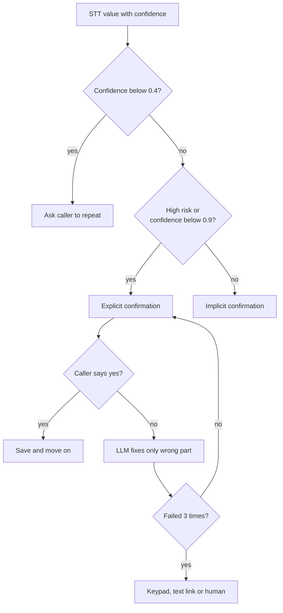

# How does a voice agent confirm and correct misheard information?

> **Step 16: AI Infrastructure, Deployment, and System Design** · ⏱️ 18 min read · [Read original](https://outcomeschool.com/blog/confirm-and-correct-in-voice-agents)

## TL;DR
A voice agent confirms by reading important details back and asking "Is that correct?", and corrects by finding which part the caller says is wrong and fixing only that part. Confirmation depth depends on the STT confidence score and the cost of a mistake, and simple rule checks catch errors even when confidence is high.

## Key Concepts
- **Confirmation** — agent repeats key info so the caller can say right or wrong.
- **Correction** — agent takes the "no", finds the wrong part, fixes it.
- **Confidence score** — 0 to 1 number for how sure STT is, often per word.
- **N-best results** — top few STT guesses in order, e.g. "fifteen" (0.51), "fifty" (0.47).
- **Explicit / implicit confirmation** — direct yes/no question vs repeating inside the next question.
- **Luhn check** — math check on a card number's last (check) digit; failing means a digit is wrong.

## How It Works

### Why mishearing happens
Pipeline STT, LLM, TTS. STT hears sound and guesses words. "Amit, A-M-I-T" may become "A-N-I-T" (M/N close on phone lines). Also "fifteen"/"fifty", "thirteen"/"thirty", B/D/P/T, plus noise, weak network, accents. The LLM sees only text, so it cannot know the text is wrong. Real harm: booking "Anit" or charging 50 dollars instead of 15.

### Confirm and correct flow
Like giving a phone number at a pizza shop: they read back, you say "No, the last digit is 0", they fix only that digit. Flow: caller speaks, STT text, agent extracts value, reads back, caller yes (save) or no (fix only the wrong part). Do not confirm everything, or the call is slow and annoying.

### Confidence score
Example digits 4 7 1 9 2 5 with confidences 0.98, 0.97, 0.55, 0.96, 0.99, 0.62: third and last are unsure. Example rule:
- Above about 0.9: move ahead, repeat lightly in the next sentence.
- Low: confirm clearly.
- Below about 0.4: ask to say it again.

Thresholds are illustrative: each STT scores differently, so tune with real calls. High confidence does not guarantee correctness.

N-best: if top two are close, confirm using both ("Did you say fifteen, one five, or fifty, five zero?").

Confirm based on two factors: STT uncertainty and cost of a mistake (wrong greeting name is minor, wrong payment amount is major).

### Explicit vs implicit
| Point | Explicit | Implicit |
|---|---|---|
| How | Reads back, asks "Is that correct?" | Repeats value inside the next question |
| Extra turn | Yes | No |
| Safety | High | Medium |
| Call speed | Slower | Faster |
| Best for | Money, dates, addresses, account changes | Low-risk details, high confidence |

- Explicit example: "Just to confirm, you want to send 500 dollars to Rahul. Is that correct?" Agent waits for yes.
- Implicit example: "Sure, a table for Tuesday. How many people?" Caller: "Not Tuesday, Thursday. And four people." Downside: caller may miss it while thinking about the next question.

### Reading back numbers and spellings
1. Digits one by one in small groups: "9 8 7 6 5, 4 3 2 1 0", not "nine billion...".
2. Tricky numbers two ways: "fifteen, that is one five".
3. Spell with a word per letter: "A as in Apple, M as in Mango, I as in India, T as in Tiger"; ask the caller to do the same.
4. Write read-back for the voice: "amit dot s at gmail dot com" rather than the raw email.

### Correcting only the wrong part
Naive "tell me the full number again" can introduce new STT errors and frustrates the caller. Better: understand it is a correction, find the changed part, replace only it, read back again ("Got it, 9 8 7 6 5, 4 3 2 1 0. Is that correct now?"). The LLM handles this: give old value 9876543219 plus "No, the last digit is zero", ask for the corrected number only, returns 9876543210.

Correction styles:
- "No, it is Thursday, not Tuesday." (right value given)
- "No, the last digit is zero." (points to part)
- "Not M, it is N." (letter swap)
- "No." (nothing more): ask "Which part is wrong?" or confirm the value part by part.

If the same value fails two or three times, stop voice: keypad entry, text message link, or transfer to a human. Looping frustrates the caller.

### Rule checks in code
Run before read-back, so wrong values are caught even at high confidence and a read-back turn is saved:
- Mobile number digit count (9 where 10 needed).
- Luhn check for card numbers.
- Impossible dates like "February 30".
- Email: exactly one "@" and a domain.
- Order ID or account number looked up in the company database, missing most likely misheard.

### Code core
```python
def choose_confirmation(confidence, is_high_risk):
    if confidence < 0.4: return "ask_again"
    if is_high_risk or confidence < 0.9: return "explicit"
    return "implicit"

def speak_digits(number):
    groups = [number[i:i+5] for i in range(0, len(number), 5)]
    return ", ".join(" ".join(g) for g in groups)
```

`confirm_value(value, max_tries=3)` loops: read back and ask, if yes return, else `llm_correct(value, reply)` applies the fix, validate with `is_valid_phone`, re-ask if invalid, after 3 failures `transfer_to_human()`. Spaced digits make TTS say each digit, and commas give a pause.

### When to confirm or skip
- Explicit when: money, hard-to-hear values (names, emails, codes, long numbers), hard-to-undo actions (cancelling an account), or low confidence.
- Implicit when low-risk and high confidence (e.g. number of people at a table).
- Skip when just answering a question ("What are your opening hours?") with nothing saved or changed.
- Confirm several values together at the end ("A table for 4 people, on Thursday, at 7 PM, under the name Amit. Is that all correct?"): saves turns, fix only the wrong part.

## Diagram(s)

### Choosing how to confirm


## Trade-offs & Pitfalls
- LLM cannot detect STT errors, only read-back catches them.
- High confidence can still be wrong.
- Over-confirming slows and annoys, under-confirming risks costly errors.
- Implicit confirmation can be missed.
- Asking for the whole value again invites new errors.
- Endless re-ask loops: escalate after 2 to 3 failures.
- Thresholds must be tuned per STT model.

## Key Takeaways
- STT mishears similar sounds, and the LLM only sees the text.
- Confirm by confidence score and cost of a mistake.
- Explicit for money, dates, addresses, irreversible actions, implicit for low-risk high-confidence, skip for plain questions.
- Read digits in small groups, spell with word-per-letter.
- After "no", fix only the wrong part with the LLM, then reconfirm.
- Rule checks (digit count, Luhn, valid date, DB lookup) catch errors despite high confidence.
- After 2 to 3 failures, switch to keypad, text link or human.
- N-best close scores mean confirm, even using both guesses.
