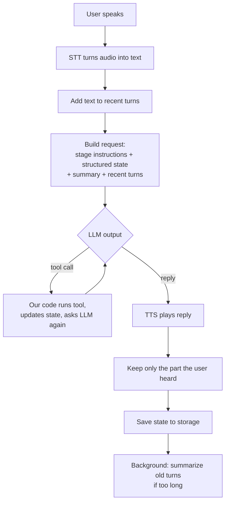
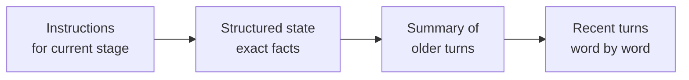

# How does a voice agent manage conversation state across a long call?

> **Step 16: AI Infrastructure, Deployment, and System Design** · ⏱️ 17 min read · [Read original](https://outcomeschool.com/blog/conversation-state-in-voice-agents)

## TL;DR
A voice agent keeps a small set of important facts in a structured state, keeps only the recent turns word by word, and turns older turns into a short summary. The LLM then gets what it needs on every turn without the history growing forever. This keeps replies fast and cheap, which matters because even one second of silence feels broken on a call.

## Key Concepts
- **Conversation state** — everything the agent must remember so the next reply makes sense: user words, agent words, collected facts (name, patient ID, date), tool results (free slots), and the call stage ("verify", "booking").
- **State lives in our code** — the LLM remembers nothing between requests. Our code resends the full picture each time.
- **Context window** — the limit on tokens the LLM reads in one request.
- **Sliding window** — keep only the last N messages (plus the system message).
- **Summary** — an LLM-written short version of older turns, replacing them.
- **Structured state / slot** — a fixed place holding named facts; each named fact is a slot.
- **Stage** — a step of the call flow (greet, verify, understand, book, confirm) kept in the state.

## How It Works

### Simple approach and why it breaks
Keep a list of messages (system, user after STT, assistant) and send the whole list each turn. Fine for 2-3 minute calls. At 30 minutes:
- Context window fills up, especially with large tool results.
- Every reply slower (more to read before the first word).
- Every reply costs more (same old turns paid again and again).
- LLM loses focus: facts buried deep (a name from 25 minutes ago, two appointment dates) get missed or mixed up.

Voice suffers more than chat since extra silence feels broken.

### Approach 1: Sliding window
Keep the system message at the top plus the last 10 messages; when the 11th arrives, drop the oldest.
- Pro: fixed size, so speed and cost stay steady.
- Con: forgets everything outside the window (name said in minute 1 is gone by minute 20); facts are dropped along with small talk.

### Approach 2: Summarize older turns
Keep recent turns verbatim. When the older part exceeds a limit, ask an LLM for a short summary and replace those turns with it (e.g. "Summary so far: The caller is Riya Sharma. She wants to move her appointment with Dr. Mehta... prefers mornings").
- Summarizing is an extra LLM request, so do it in the background, never while the user waits; later replies use it once ready.
- Pro: small history, main points of the whole call kept.
- Con: loses exact details (patient ID 48213 becomes "her patient ID", dates drift). Each new summary is often built from the old summary plus new turns, so small errors accumulate.

### Approach 3: Structured state
Pull facts out into slots so they never depend on free text:
`caller_name`, `patient_id: "48213"`, `verified: True`, `doctor`, `current_appointment`, `requested_day`, `preferred_time`.
- Slots are filled via a tool such as `update_state(state, field, value)`. The LLM only recommends the call; our code runs it and saves the value, so control stays with our code.
- Each request has four parts: instructions, known facts (always near the top), summary of older turns, recent turns word by word.
- Pro: exact facts survive however long the call is.
- Con: slots must be decided ahead of time with a way to fill them; non-slot info still relies on summary and recent turns.

### Tracking the stage
Typical clinic flow: greet, verify, understand request, book, confirm. Store `state["stage"]`; our code gives the LLM only instructions and tools for the current stage ("verify" gets the date-of-birth check tool; "booking" gets find-slots and book tools) and moves to the next stage when done.
- Short per-stage instructions keep requests small.
- Fewer tools means better tool choice.
- No skipped steps (cannot book before verifying, since the tool is not available).
- A finished stage's turns are mostly unneeded; only the result matters (`verified: True`), so a stage change is a natural time to summarize.

### Keeping tool results small
Large tool results (e.g. 40 fields per past appointment) bloat the history for the rest of the call. So:
- Keep only needed fields (date, time, doctor).
- Save useful values into the structured state.
- Remove or shorten the full result after it has been used.

### Saving only what the user heard
Users can interrupt mid-sentence. If the planned reply "Your appointment is on Monday at 10 AM, and you can also bring your old reports" is cut after "10 AM" but is saved in full, the agent thinks it already mentioned the reports and never repeats them. On interruption, replace the last assistant message with only the spoken part (`messages[-1]["content"] = spoken_text`). The spoken part is found from word timings that many TTS services send with the audio. This keeps history matching reality. Related blog: truncating memory to what the user heard.

### Surviving a dropped call
Calls and servers can fail; in-memory state would be lost. Save after every turn or important change to fast storage (database or key-value store). The record holds: structured state (slots and stage), summary, recent turns, call ID and caller phone number. If the caller calls back, look up by phone number and resume ("Welcome back, Riya. We were finding a Thursday morning slot with Dr. Mehta."). The same record helps human transfers, since the human gets the full picture.

## Diagram(s)

### Per-turn flow of a long call

### Layers of a request

## Trade-offs & Pitfalls
| Approach | Advantage | Disadvantage |
|---|---|---|
| Full history | Simple, fine for short calls | Window fills, slow, costly, loses focus |
| Sliding window | Fixed size, steady speed and cost | Forgets dropped facts |
| Summary | Small, keeps main points | Loses exact details, errors accumulate |
| Structured state | Exact facts preserved | Slots predefined, needs a fill mechanism |

- Summarizing inline makes the user wait; do it in the background.
- Saving the full planned reply after an interruption records things the user never heard.
- Keeping state only in process memory loses everything on a drop.
- In practice combine all three: sliding window for recent turns, summary for older, structured state for exact facts.

## Key Takeaways
- The LLM has no memory between requests; state lives in our code.
- Full history on a long call hurts window, latency, cost, and focus, and voice is least tolerant of delay.
- Sliding window is steady but forgets; summary remembers but blurs exact values.
- Put exact facts (names, IDs, dates) into slots, filled by an update tool our code executes.
- Track the call stage to limit instructions and tools and prevent skipped steps.
- Trim large tool results; store only needed values.
- Save only the part of a reply the user actually heard after an interruption.
- Persist state externally every turn, keyed by call ID and phone number, so dropped calls resume.
