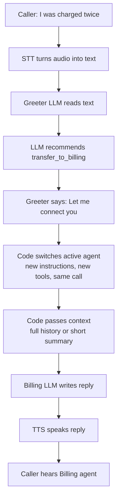
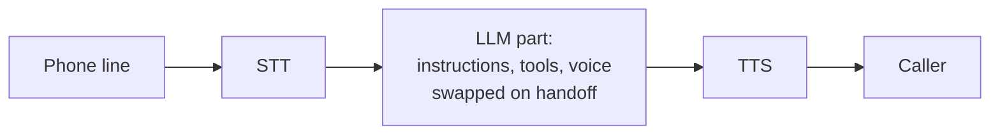

# How do multi-agent handoffs work in a voice AI system?

> **Step 16: AI Infrastructure, Deployment, and System Design** · ⏱️ 17 min read · [Read original](https://outcomeschool.com/blog/multi-agent-handoffs-in-voice-ai)

## TL;DR
A handoff is when one AI agent passes a live call to a more specialized agent along with everything said so far. The current agent's LLM recommends the handoff as a tool call, our code swaps in the new agent's instructions and tools, and the caller stays on the same call without repeating anything.

## Key Concepts
- **Multi-agent voice system** — several specialized agents (e.g. Greeter, Orders, Billing), each with its own instructions, tools, and small job. The caller never moves; only the agent behind the voice changes.
- **Handoff** — control of the live conversation passes from the current agent to another, which becomes the **active agent** until it hands off again or the call ends.
- **Handoff tool** — a handoff described to the LLM like any tool (`transfer_to_billing`), with a clear description and a `reason` input.
- **Handoff loop** — agents keep bouncing the caller between each other and nobody answers.

## How It Works

### Why not one big agent?
- Long instructions with rules for orders, billing, returns, and complaints confuse the LLM, which may follow the wrong rule.
- With 40 tools the LLM more often picks the wrong one.
- Voice needs speed; a long prompt plus many tools adds tokens and delay on every turn (1-2 second pauses feel awkward).
- Hard to change: a billing tweak can break orders behaviour.

Splitting gives each agent a short prompt and few tools; handoff makes them act as one on a single call.

### Three questions in every handoff
- Who decides: usually the current agent's LLM, sometimes our code by fixed rule (e.g. go to Billing right after identity check).
- What moves: conversation history and useful facts (order number).
- What the caller hears: must feel like one smooth conversation.

### Where it sits in the pipeline
Caller, STT, LLM, TTS, caller hears. The phone line, STT, and TTS stay the same for the whole call. A handoff changes only the LLM part's configuration: instructions, tools, and sometimes the TTS voice. The connection never drops. So an AI handoff is much faster than a human transfer, since nothing is dialled again. With a speech-to-speech model (no separate STT/TTS) the idea is the same: our code updates the live session with the new agent's instructions and tools.

### Step 1: Describe handoff as a tool
The LLM can only recommend what we tell it about. The Greeter gets `transfer_to_orders` ("track an order or change a delivery address") and `transfer_to_billing` ("refund or payment problem"), each with a `reason` string. The description is crucial because the LLM uses it to pick the tool. Greeter instructions: find out why they call, transfer orders to Orders and payments to Billing, do not solve them yourself.

### Step 2: LLM recommends
Priya (name and order A1234 collected, identity checked) says "I was charged twice for my order." STT gives text; the LLM sees a payment problem and returns `{ "tool": "transfer_to_billing", "arguments": { "reason": "caller was charged twice" } }`. The LLM never moves the call; our code does.

### Step 3: Our code swaps the active agent
- Mark Billing as active.
- Load Billing instructions in place of the Greeter's.
- Load Billing tools (`check_payment`, `issue_refund`).
- Switch the TTS voice if Billing uses a different one.

STT and the phone line are untouched.

### Step 4: Context travels with the call
An empty-memory Billing agent would ask "how can I help?" and force the caller to repeat. Two ways:

| Way | Advantage | Disadvantage |
|---|---|---|
| Full history | Nothing lost | Long calls mean more tokens, cost, and delay |
| Short summary of key facts, e.g. `{reason, order_id, caller_name, verified: true}` (written by code or the LLM) | Short, fast | Missed details are unknown to the new agent |

`verified` stops Billing re-asking identity. Many systems mix both: short summary plus the last few messages. Choose by use case. Related blog: conversation state in voice agents.

### Step 5: New agent speaks
Billing: "Priya, I understand that you were charged twice for order A1234. Let me check the payments for you." TTS speaks it; Priya repeated nothing.

### Making it smooth for the caller
Silence feels like a dropped call, so:
- Say something before the switch ("Sure, let me connect you to our billing team") while code prepares the next agent.
- Tell the new agent to continue, not greet again.
- Voice choice: same voice means one assistant; different voices mean a new person, so the previous agent must announce the transfer.
- Keep listening during the switch; keep caller audio and pass its text to the new agent.
- Load all agents' instructions and tools at call start so the switch is near-instant.

### Hand back and loops
After Billing, the caller may ask "where is my other order?" Billing needs `transfer_to_greeter` or `transfer_to_orders`, repeating the same five steps. Loop example: Greeter sends to Billing, Billing to Orders, Orders back to Billing, forever "let me transfer you". Prevent by:
- Clear, non-overlapping tool descriptions.
- A cap on handoffs per call; after it the current agent answers or a human takes over.
- Passing the handoff reason in context so the receiver does not bounce it for the same reason.

### Code
Each agent has instructions, tools, and voice. `active` names the current agent (a handoff is a change of this value); `history` is one shared list (Way 1); `handle_turn` runs per STT result. On a `transfer_to_*` call: if `handoffs >= MAX_HANDOFFS` (3) call `transfer_to_human(history)`; else speak "Sure, let me connect you.", set `active`, increment `handoffs`, append a system message "Handoff reason: ...", and loop so the new agent replies right away. Otherwise append the assistant text and speak it. All three agents use `voice_a`.

## Diagram(s)

### Handoff flow

### What a handoff changes

## Trade-offs & Pitfalls
- Full history is lossless but slow and costly; a summary is fast but may omit something important.
- Different voices per agent feel like a new person unless announced.
- Silence during the switch feels like a dropped call.
- Overlapping tool descriptions cause handoff loops; cap handoffs and escalate to a human.
- Losing speech during the switch loses caller input.

## Key Takeaways
- A handoff swaps the LLM's instructions, tools, and maybe voice; the call line, STT, and TTS stay.
- The LLM only recommends a transfer tool call; our code performs the switch.
- Tool descriptions drive when the LLM picks a handoff, so make them clear and non-overlapping.
- Pass context (full history, summary, or both) so the caller never repeats anything.
- Cover the delay with a spoken line and keep capturing caller audio during the switch.
- Cap handoffs per call and pass the reason to prevent loops; fall back to a human.
- AI-to-AI handoff is much faster than a human transfer because nothing is redialled.
- Splitting into agents gives short prompts, fewer tools, and easier changes.
