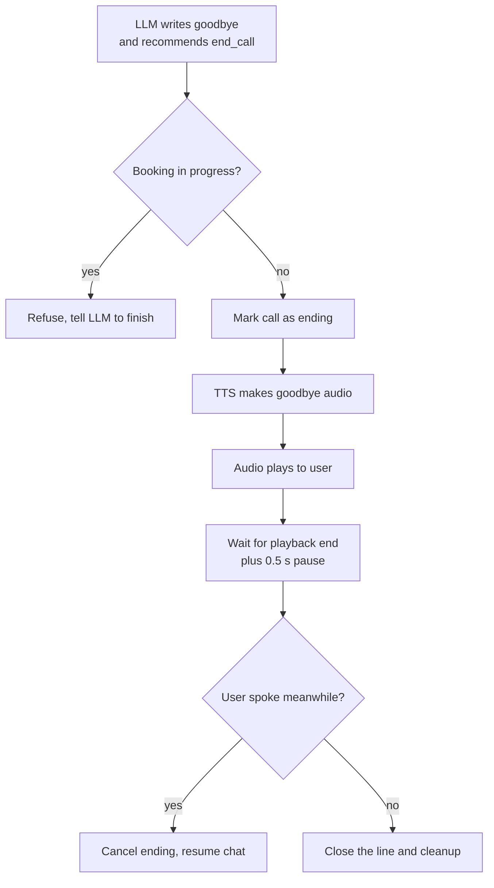
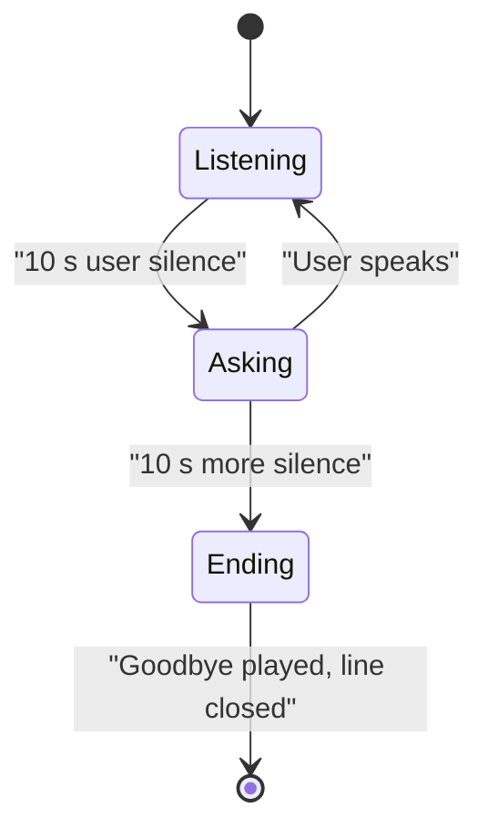

# How does a voice agent decide when to end the call?

> **Step 16: AI Infrastructure, Deployment, and System Design** · ⏱️ 17 min read · [Read original](https://outcomeschool.com/blog/call-ending-in-voice-agents)

## TL;DR
A voice agent ends a call on a few signals: the user hangs up, the LLM recommends ending once the conversation is complete, the user stays silent too long, the call hits a time limit, or it is transferred or reaches voicemail. When the agent ends it, it says a short goodbye, waits for the audio to finish playing, then hangs up. The LLM recommends, but our code has the final say.

## Key Concepts
- **Voice agent pipeline** — STT (speech to text) then LLM (decides reply) then TTS (text to speech).
- **Ending a call** — agent decides the conversation is over, finishes speaking, closes the line (like pressing the red button).
- **BYE (SIP)** — message sent when the user hangs up; in apps, the connection simply closes.
- **end_call tool** — function the LLM recommends; the LLM never runs it, our code does.
- **Silence timeout** — timer started when the user stops speaking, reset when they speak again.
- **Max call duration** — hard cap (e.g. 15 or 30 minutes).

## How It Works

### Why ending is hard (restaurant booking agent)
1. Hangs up too early: user says "Thank you" and pauses, then wanted to ask more; user angry, calls again.
2. Never hangs up: user walks away; line stays open, paying for phone, STT, LLM, TTS.
3. Cuts its own goodbye: closes after "Your table is".

### Signals that end a call
User hangs up, LLM recommends, user silent, time limit, transfer or voicemail.

### Signal 1: User hangs up
Easiest; the user decides. The agent must react fast: stop LLM and TTS, stop sending audio, run cleanup. Otherwise it keeps paying to talk to nobody.

### Signal 2: LLM recommends ending
- Keyword matching ("bye", "thank you") fails: "Thank you, and one more thing" (not done); "Okay, bye. Oh wait, what time do you close?" (not done); "Okay, that is all." (done, no keyword).
- Better: LLM sees the whole conversation and uses function calling with an `end_call` tool (parameter `reason`, e.g. booking_done, user_said_goodbye).
- Tool description must require both: request fully handled AND user clearly said goodbye or needs nothing else.
- System prompt: after booking, ask if anything else; if no or goodbye, say short goodbye then use end_call; never use end_call while user is still asking for something.
- Example: user "No, that is all, thanks." then the agent says "Have a great evening. Goodbye." and recommends end_call with reason booking_done.

### Saying goodbye without cutting it off
- The goodbye text still has to go through TTS, network, and the phone (a few seconds). Closing on seeing end_call gives "Have a great" then a click.
- Rule: close only after goodbye audio finishes playing. Mark call as "ending", wait for playback, add about 0.5 s pause so the last word is not clipped, then close.
- end_call must NOT trigger another LLM reply (the LLM could say "The call has ended."); in normal function calling the result goes back to the LLM, here we skip it.
- If the user speaks during the goodbye ("Wait, one more question"), stop the goodbye, cancel the ending, resume like any interruption.

### Signal 3: User goes silent
Silence timeout, reset whenever the user speaks:
1. About 10 s silence: "Are you still there?"
2. Another 10 s silence: "I am not able to hear you. Please call again anytime."
3. Wait for playback to finish, close the line.

- Numbers depend on use case (reading a long card number needs a longer timeout).
- Measure silence from the user's side only; do not count time when the agent is talking or waiting on a slow tool, or it will ask "Are you still there?" while keeping the user waiting.

### Signal 4: Time limit
Max duration (15 or 30 min) protects against loops, machine-to-machine chatter, and huge bills. Warn about 1 minute before ("We are almost out of time."), then goodbye, wait for audio, close.

### Signal 5: Transfer or voicemail
- Transfer to human: agent leaves after transfer completes (call continues with the human). Often a tool like `transfer_call`, recommended like end_call.
- Voicemail (outbound call): detect the answering machine, leave a short message or none, hang up.
- Decision comes from the task, not a goodbye.

### Stopping too-early hang-ups
Early is worse than late (user loses work, calls again). Guards:
- Ask "Anything else?" before ending; end only after no.
- Strict tool description (a vague "End the call" invites early use).
- Check state in code (e.g. booking started but unsaved: refuse and tell LLM to finish).
- Let the user cancel the ending.
- Test with many conversations; count early hang-ups and never-hang-ups; tune prompt and description.

### After the call ends
- Stop timers, STT, LLM, TTS.
- Save full transcript.
- Save end reason (booking_done, user_hung_up, silence_timeout, max_duration).
- Send follow-ups (e.g. confirmation text).
- Reasons reveal problems: 20% silence_timeout suggests confusing questions or user audio not reaching the agent.

### Code structure (Python, simplified)
- `end(goodbye, reason)`: set `ending=True`, record reason, `await speak` (returns after playback), sleep 0.5 s, hang up only if `ending` still true.
- `on_llm_tool_call`: for end_call, refuse if booking in progress, else call `end` and return None (no new LLM reply).
- `on_user_speech`: set `ending=False`, clear reason (cancels ending).
- `watch_silence`: wait 10 s user silence, ask "Are you still there?", wait 10 s more, then end with silence_timeout; helper counts only time when agent is not talking or on a tool.
- `watch_duration`: sleep MAX minus 60 s, warn, sleep 60 s, end with max_duration.
- `on_line_closed`: runs whoever closed; reason defaults to user_hung_up; stop pipeline, save transcript and reason.

## Diagram(s)

### Goodbye without cutting off

### Silence handling

## Trade-offs & Pitfalls
- Keyword detection misleads; rely on LLM with strict tool description plus code checks.
- Closing before playback ends clips the goodbye.
- Silence timer counting agent or tool time causes wrong "Are you still there?".
- Timeouts too short for tasks like reading card numbers.
- Always cap duration; otherwise loops and big bills.

## Key Takeaways
- Five end signals: user hangs up, LLM recommends, silence, time limit, transfer or voicemail.
- LLM recommends via end_call; our code decides, since hanging up is irreversible.
- Never hang up on words alone; the LLM judges whole-conversation meaning.
- Close only after goodbye audio finishes (plus about 0.5 s); end_call must not trigger another LLM reply.
- Any user speech during the goodbye cancels the ending.
- Silence: ask after about 10 s, end after another 10 s, measured from user side only.
- Guard early hang-ups: ask "anything else?", strict tool description, state checks, testing.
- Save the end reason; its distribution (e.g. many silence_timeouts) exposes problems.
