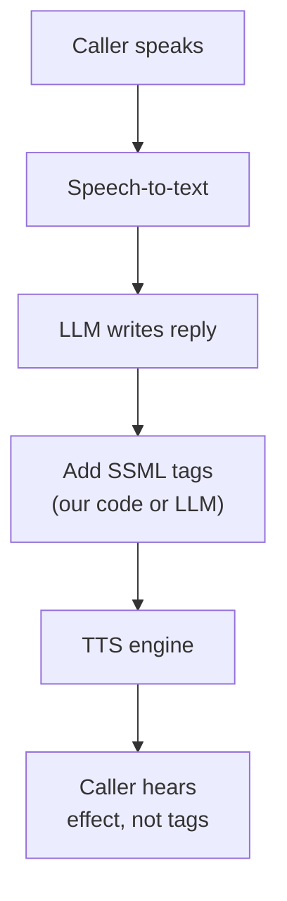

# How does SSML control how a voice agent speaks?

> **Step 16: AI Infrastructure, Deployment, and System Design** · ⏱️ 18 min read · [Read original](https://outcomeschool.com/blog/speech-synthesis-markup-language-ssml)

## TL;DR
SSML wraps the reply text in tags that tell the TTS engine where to pause, how fast to talk, which word to stress, and how to read dates, numbers and tricky names. It sits between the LLM and the TTS engine. Our code or the LLM writes the tags, and streaming needs care so tags are never cut in half.

## Key Concepts
- **SSML (Speech Synthesis Markup Language)** — W3C standard (v1.0 in 2004, v1.1 in 2010) that adds instructions to text so TTS knows what to say and how to say it. HTML tells how text looks, SSML tells how it sounds.
- **TTS engine** — turns written text into spoken audio; the voice the caller hears.
- **Text normalization** — turning numbers, dates and short forms into spoken words; plain text makes the engine guess.
- **Prosody** — rhythm, speed and melody of speech.
- **Phoneme** — smallest unit of sound ("cat" = k, a, t). **IPA** — standard symbol set where each symbol is one sound.
- **`<speak>`** — root tag; every SSML document starts and ends with it. Alone it changes nothing.

## How It Works

### Why plain text is not enough
"Your order 1234 will arrive on 03/04/2026. Please call us at 1800 555 0199." forces guesses: 1234 as "one thousand two hundred thirty-four" or "one two three four"? 3 April or 4 March? Phone number digit by digit or one huge number? Where to pause? A wrong guess (wrong date, rushed phone number) is a real problem on a call. SSML tells the engine exactly what to do.

### Main tags
| Tag | Purpose | Details |
|---|---|---|
| `<break>` | Pause | `time="500ms"` exact, or `strength` = none, x-weak, weak, medium, strong, x-strong. Self-closing (`/>`) as it wraps no text. Without pauses the agent sounds rushed. |
| `<prosody>` | Speed, pitch, volume | Attributes `rate`, `pitch`, `volume`. Accepts percentages (`rate="90%" pitch="+5%"`) and labels (rate x-slow to x-fast, volume loud). Example: reference number "A B 7 2 9" with `rate="slow"` so the caller can write it down; rest stays normal. |
| `<emphasis>` | Stress a word | `level` = strong, moderate, reduced, none. "Please do `not` share your PIN". Effect is engine-dependent (louder, slower or higher). |
| `<say-as>` | Tell engine the kind of text | `interpret-as`: `cardinal` (forty-two), `ordinal` (second), `characters` (letter or digit one by one), `date`, `telephone`. `characters` reads 1234 as "one two three four"; `date` with `format="dmy"` reads 03/04/2026 as 3 April 2026. |
| `` | Substitute spoken text | `alias="Outcome School"` on "OS": shows OS, says Outcome School. |
| `<phoneme>` | Exact sounds | `alphabet="ipa" ph="..."`, e.g. tomato "to-mah-to". Used to say a caller's name correctly. |

Note: the standard defines `say-as` but not a fixed list of `interpret-as` values; engines differ, so check the engine docs.

### Putting tags together
One confirmation reply combines: a `phoneme` for the caller's name (Kavya), `break` 400ms and 300ms between parts, `say-as characters` for booking ID BK72, `say-as date dmy` for 27/10/2026 (27 October 2026), and `emphasis strong` on "do not" in the reminder to bring an ID card.

### Who writes the SSML
| Way | How | Pros | Cons |
|---|---|---|---|
| Our code | LLM writes plain text; code finds dates, phones, IDs (e.g. regex wrapping `\d{4} \d{3} \d{4}` in `say-as telephone`, `. ` replaced by `. <break 300ms/> `, all wrapped in `<speak>`) | Predictable, same input same output | Only handles patterns we wrote rules for |
| LLM | System prompt asks it to emit tags directly ("wrap every phone number in say-as, add a short break after important info") | Understands meaning, so stresses the right word or pauses in the right place | Can forget to close a tag or invent unsupported tags; a broken tag can fail the engine or be read aloud |

Best: combine. LLM writes plain text, code adds tags for numbers, dates and phones, and code validates the final SSML before sending.

**XML escaping:** SSML is XML, so `&` and `<` in the LLM text must be escaped (`&amp;`, `&lt;`) before adding tags, otherwise "Tom & Jerry" breaks the SSML.

### SSML and streaming
The LLM streams small pieces and TTS starts at the first ready sentence to keep delay low. But a piece cut mid-tag (`<say-as interpret-as="tele` ... `phone">...`) is broken SSML. Solution: buffer text and send only at a safe point. The safe-point check returns True only when:
1. `<` count equals `>` count (no tag cut in the middle),
2. every `<say-as` opened is closed,
3. the buffer ends with `.`, `?` or `!`.

When True, wrap the buffer in its own `<speak>`, send it, start a new buffer. In the example it fails after piece 1 and passes after piece 2.

## Diagram

### Where SSML sits in the voice pipeline

## Trade-offs & Pitfalls
**Works well when:** numbers, dates, phones and IDs must be read the same way every time; a name or brand must be said correctly; clear pauses help the caller follow; the engine supports the needed tags.

**Falls short when:**
- The engine lacks a tag. Support varies, and many newer TTS models support only a small part of SSML or none.
- Emotion (happy, calm, sorry) is wanted: standard SSML has no emotion tag; engine-specific extra tags work only on that engine.
- Too many tags: choppy sound and hard-to-maintain rules.

Newer TTS models take a plain-text instruction ("say this in a calm and warm voice") and decide pauses, speed and stress themselves: natural speech, less control. SSML gives exact control. Choose by use case.

## FAQ
- **Can every TTS engine read SSML?** No. Support, including `interpret-as` values, differs; check docs before depending on a tag.
- **Can SSML make the agent sound happy or sorry?** Not in the standard; only via engine-specific tags or text-instruction models.
- **What if the LLM writes broken SSML?** The engine may fail or read the tag aloud; validate in code first.
- **Does the caller hear the tags?** No, only their effect.

## Key Takeaways
- SSML tells the TTS how to say text: pauses, speed, stress, number/date reading, pronunciation.
- Core tags: `break`, `prosody`, `emphasis`, `say-as`, `phoneme`, `sub`, all inside `<speak>`.
- Use `say-as` to remove guessing for IDs, dates (`format="dmy"`) and phone numbers.
- SSML sits between the LLM and the TTS; the caller hears only the effect.
- Hybrid is best: LLM writes text, code adds and validates tags, and escapes `&` and `<`.
- With streaming, send only at safe points where every tag is closed and a sentence has ended.
- Limits: patchy engine support, no standard emotion tag, overuse sounds choppy.
