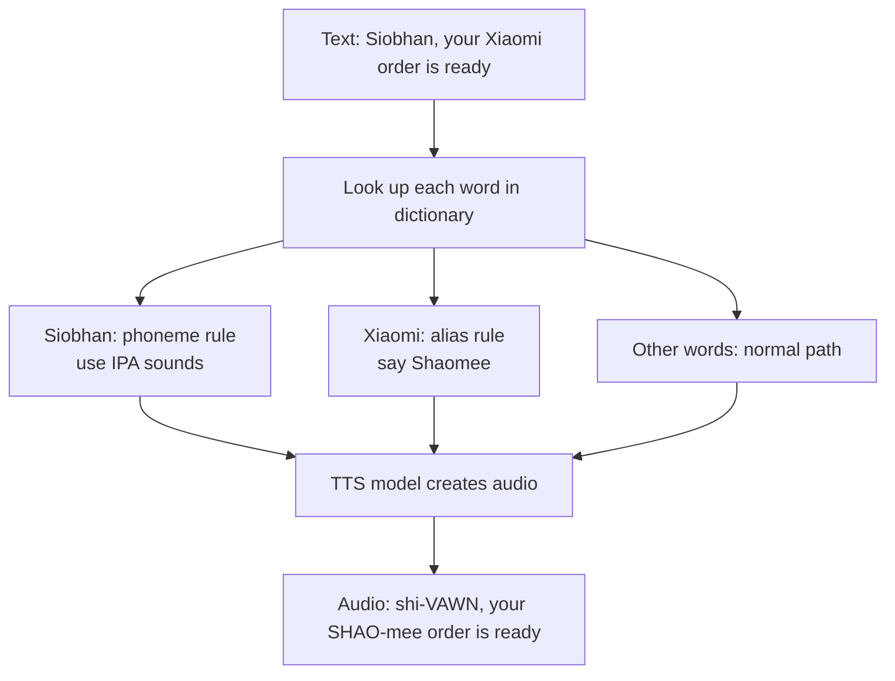

# How do pronunciation dictionaries fix how TTS says names and brands?

> **Step 16: AI Infrastructure, Deployment, and System Design** · ⏱️ 16 min read · [Read original](https://outcomeschool.com/blog/pronunciation-dictionaries-for-tts)

## TL;DR
A pronunciation dictionary is a list of words each paired with the exact way to say it. Before speaking, the TTS looks up each word and uses our rule instead of guessing from spelling. Rules are either aliases (respell with a known word) or phonemes (exact IPA sounds). It changes only the spoken version, not the shown text.

## Key Concepts
- **TTS** — text to spoken audio.
- **Phoneme** — smallest sound that can change a word's meaning ("cat" vs "bat" differ by one phoneme).
- **Grapheme-to-phoneme conversion** — letters to sounds. Many modern neural TTS models do it implicitly inside the model, but for unfamiliar words they still guess from spelling.
- **Rule** — one dictionary entry: word to find (exact text) plus how to say it.
- **Alias rule** — replace the word with another spelling the TTS already knows.
- **Phoneme rule** — exact sounds in a sound alphabet such as **IPA** (one symbol = one sound in any language) or **CMU Arpabet** (English sounds in capital letters and stress digits, e.g. `SH IH0 V AO1 N` for Siobhan).
- **PLS (Pronunciation Lexicon Specification)** — W3C open XML standard for dictionaries.

## How It Works

### Why TTS gets names wrong
English spelling does not match sounds ("ough" in though, through, tough), so letters cannot map to fixed sounds. Common words are well known; rare words are guessed from spelling patterns. Names and brands are rare in training data, often foreign (Xiaomi from Chinese, Siobhan from Irish), and new ones appear daily.

Examples: Xiaomi should be "SHAO-mee" but may be "zee-AH-oh-mee"; Siobhan "shi-VAWN" may be "see-OB-han"; Porsche "POR-shuh" may be "porsh"; SQL wanted as "sequel" may be read "S Q L"; "US" vs "us" share letters but differ in sound.

Analogy: a receptionist given a note on day one ("Nguyen is said 'win'") stops guessing.

### Two kinds of rules
| | Alias | Phoneme |
|---|---|---|
| What | Replace with another spelling (Xiaomi to Shaomee, SQL to sequel, Nguyen to win, Dr. to Doctor, Qdrant to quadrant) | Exact IPA, e.g. Siobhan `ʃɪˈvɔːn`, Xiaomi `ˈʃaʊmi`, Porsche `ˈpɔːrʃə` |
| Pros | Easy, anyone can write, works on most TTS models | Exact, no guessing |
| Cons | Not exact; may need several spellings before it sounds right | Needs IPA practice (can often be found online); not all models support it, some only alias |

In IPA, `ʃ` is always "sh"; `ˈ` precedes the stressed part (said louder and longer).

### How it is applied
For "Siobhan, your Xiaomi order is ready.": look up each word; Siobhan found, use phoneme `ʃɪˈvɔːn`; Xiaomi found, say "Shaomee"; other words take the normal path; TTS makes audio "shi-VAWN, your SHAO-mee order is ready." The shown text is unchanged.

### PLS file
XML with `lexicon` (whole dictionary; `alphabet="ipa"`, `xml:lang="en-US"`), `lexeme` (one rule), `grapheme` (word to find; several allowed, e.g. "Xiaomi" and "XIAOMI"), `phoneme` (exact sounds) or `alias` (replacement). Upload once to the TTS provider, then reference in requests; applied automatically.

SSML alternative: `phoneme` and `sub` tags inside the text fix a word only in that one sentence. Dictionary is better for words that recur.

### Matching: case and whole words
- **Case-sensitive:** "US" to "United States" must not turn "Call us today" into "Call United States today".
- **Whole words:** SQL to "sequel" must not alter MySQL or PostgreSQL.

If the provider has no dictionary support, or we want the same rules across providers, apply aliases in our own code before sending text, using a regex with `\b` (whole word) and case-sensitive match over a dict like `{"Xiaomi": "Shaomee", "SQL": "sequel", "US": "United States"}`. "Call us about the US launch of the Xiaomi phone." becomes "Call us about the United States launch of the Shaomee phone." Only the TTS gets the changed text; the screen text stays.

### In a voice agent
Pipeline STT, LLM, TTS; the dictionary sits right before TTS and fixes every known name and brand the LLM writes. Practical points:
- Start with our company, product and staff names and common regional customer names.
- Listen to real call recordings; add a rule for each mistake.
- Play audio to test every rule; an alias that looks right can sound wrong.
- Cover every spelling the LLM may write (Xiaomi, XIAOMI, xiaomi) as extra graphemes.
- One dictionary per language, since pronunciation differs by language.

## Diagram

### Dictionary lookup before TTS

## Trade-offs & Pitfalls
**Works well for:** known brand and product names; known people names (staff, saved customers); acronyms and short forms (SQL, Dr.); words TTS always gets wrong, since one rule fixes every sentence.

**Struggles with:**
- **Unknown names:** only listed words are covered; a rare new name is still guessed.
- **Same spelling, different sounds:** read (reed/red), live (liv/lyve), Dr. (Doctor/Drive). One rule always picks one.
- **Same name said differently by different people:** one rule per spelling, so store pronunciation with each person's record and inject it per sentence via an SSML `phoneme` tag.
- **Model support:** some models skip phoneme rules and use default pronunciation; use aliases there.

Related: keyword boosting solves the same problem on the listening (ASR) side.

## FAQ
- **Same as SSML?** No. SSML fixes a word only in one sentence; a dictionary is written once and applies everywhere.
- **Changes shown text?** No, only the spoken version, right before audio is created.
- **PLS file?** W3C XML dictionary; each lexeme has a grapheme plus phoneme or alias; many providers accept it.
- **No provider support?** Apply alias rules in our code before TTS, whole-word and case-sensitive; also portable across providers.

## Key Takeaways
- TTS guesses unfamiliar words from spelling, so rare names and brands go wrong.
- A pronunciation dictionary maps word to exact pronunciation, looked up before audio is generated.
- Alias rules are easy and portable but inexact; phoneme rules (IPA or Arpabet) are exact but need skill and model support.
- PLS is the W3C XML standard; upload once, applies everywhere.
- Matching must be case-sensitive and whole-word (US vs us, SQL vs MySQL).
- Build it iteratively: start with own names, listen to calls, test every rule, list every spelling, one dictionary per language.
- It cannot fix unknown names, context-dependent words or per-person pronunciations; use SSML per sentence for those.
