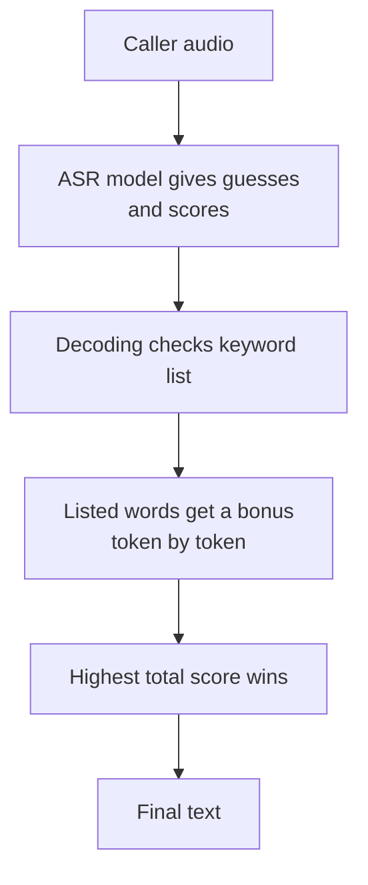

# How does keyword boosting help ASR recognize domain words?

> **Step 16: AI Infrastructure, Deployment, and System Design** · ⏱️ 17 min read · [Read original](https://outcomeschool.com/blog/keyword-boosting-in-asr)

## TL;DR
Keyword boosting gives the ASR a list of domain words and adds a small bonus score to candidates containing them during decoding. When the model is torn between a common word and our special word, the special word wins. The model is not retrained, so the list can change in seconds.

## Key Concepts
- **ASR (Automatic Speech Recognition)** — turns speech into text; first step of a voice agent, so a wrong word here corrupts everything after (the LLM only sees the text).
- **Domain word** — belongs to one business or field and is rare in daily speech (Atorvastatin, Zyvora Pro, Outcome School, Kubernetes, Anirudh).
- **Keyword boosting** — passing a word list so the model prefers those words when audio sounds close. Also called **contextual biasing** or **phrase hints**.
- **Beam search** — keeps several best candidate sentences alive and extends each.
- **Decoding** — turning scores into final text.
- **Token** — small word piece (Zyvora = "Zy", "vo", "ra").
- **Prefix boosting** — adding the bonus token by token.
- **False positive** — ASR writes a keyword that was never spoken.

## How It Works

### Why ASR misses domain words
Common words appear millions of times in training data; "Zyvora" (launched last month) appears zero times. The model maps the sound to known words: "I want to cancel my Zyvora Pro plan" becomes "...my zero ra pro plan", and the LLM cannot tell which plan. Retraining for each new product or doctor is slow and costly. Fixing text after ASR fails because mistakes vary ("zero ra", "Savora", "Ziva ra"); we cannot list every wrong spelling.

### Using it
Pass `keywords = ["Zyvora Pro", "Atorvastatin", "Outcome School"]` (words or short phrases) with the audio. The model is unchanged. This blog covers the common method, a bonus during decoding; some newer models instead read the list as a text prompt with the audio, with the same goal.

### How ASR picks words
Each guess gets a score; higher means more belief. For "zy-vo-ra": zero ra 0.45, Savora 0.35, Zyvora 0.20. "Zyvora" appears as a weak guess because the model can build it from pieces. Beam search keeps candidates such as "...my zero ra", "...my Savora", "...my Zyvora"; the highest total score wins at the end.

### How boosting changes scores
Assume bonus 0.30 for "Zyvora":
| Guess | Score | Bonus | New |
|---|---|---|---|
| zero ra | 0.45 | 0.00 | 0.45 |
| Savora | 0.35 | 0.00 | 0.35 |
| Zyvora | 0.20 | 0.30 | 0.50 |

Zyvora wins 0.50 vs 0.45. Real systems use log probabilities and add the bonus on that scale. The bonus does not create the word; it only lifts a weak guess already present. So boosting works best when the audio already sounds close.

### Piece by piece (prefix boosting)
Waiting for the full word is a problem: after "Zy" the candidate scores low and beam search may drop it before "ra". So bonus is added per token: "Zy" gets part, "vo" more, "ra" the rest, keeping the candidate alive. If the candidate goes "Zy" then "lo" (Zylo, not listed), the earlier partial bonus is taken back. A candidate keeps the bonus only if it completes a listed word; otherwise every "Zy..." word would be rewarded.

### Boost strength
- **Too weak:** "zero ra" still wins; no effect.
- **Too strong:** false positives, e.g. "I saw it on the zero balance screen" becomes "...the Zyvora balance screen".
- **Too long a list:** thousands of words, many close to normal words, get mixed into normal sentences. Keep it small and focused on the current call.
- **Tune by testing:** run recorded test calls at several strengths, count domain words fixed and new wrong words, pick the best balance.

### In a voice agent (clinic example)
Build the list per call or per step: after "Which doctor would you like to see?", pass only doctor names; for refills pass medicine names. Sources: clinic doctors, medicines in past orders, caller name from records. In practice we pass the list (and strength, if supported) to the provider, whose decoder applies it.

Simplified code: `apply_boost` adds `bonus` to each candidate containing a keyword (case-insensitive), then returns the max. Candidates `("refill my a torva statin", 0.50)` and `("refill my Atorvastatin", 0.30)` with bonus 0.30 give `('refill my Atorvastatin', 0.6)`. Real ASR does this inside beam search token by token, not on whole sentences.

## Diagram

### Boosting during decoding

## Trade-offs & Pitfalls
**Works well for:**
- New product names (never heard, but sound close to guesses).
- Names of people and places (hard to spell from sound).
- Technical terms (medicines, software).
- Fast changes: update the list in seconds, no retraining.

**Fails when:**
- The word is not among the guesses at all (very noisy audio, accent changes sound completely); the bonus has nothing to raise.
- Boost too strong, so keywords appear unspoken.
- Too many keywords, causing false positives.
- Very short keywords: "Zeno" sounds like "zero" and "see no", giving more false positives than long words like Atorvastatin.
- Words sounding like common words: strong boost on "Kloud" turns every "cloud" into "Kloud", even about weather.

When boosting is not enough: fine-tune the ASR on recorded audio with the domain words. Slower and costlier, but teaches the sound of the word itself.

## FAQ
- **Same as contextual biasing?** Yes, also called phrase hints; pass a word list, model unchanged.
- **Retrain needed?** No; list is used during decoding, so it updates in seconds.
- **Why not fix text after ASR?** Errors vary per caller; boosting makes the right word win before text is written.
- **How many keywords?** Few, focused on the current call or step.
- **When not enough?** Fine-tune the model; boosting can only raise words already guessed.

## Key Takeaways
- ASR errs on domain words because they are rare or absent in training data, and the LLM inherits the error.
- Boosting adds a bonus to candidates containing listed words during decoding; the model is not retrained.
- It only lifts words already among the guesses; it cannot invent them.
- Prefix boosting adds the bonus per token and revokes it if the word is not completed, so beam search keeps the candidate alive.
- Strength is a balance: too weak does nothing, too strong gives false positives; tune on recorded test calls.
- Keep lists small and per call or per step (doctor names when asking for a doctor).
- Short keywords and common-sounding words are risky; fine-tuning is the fallback.
