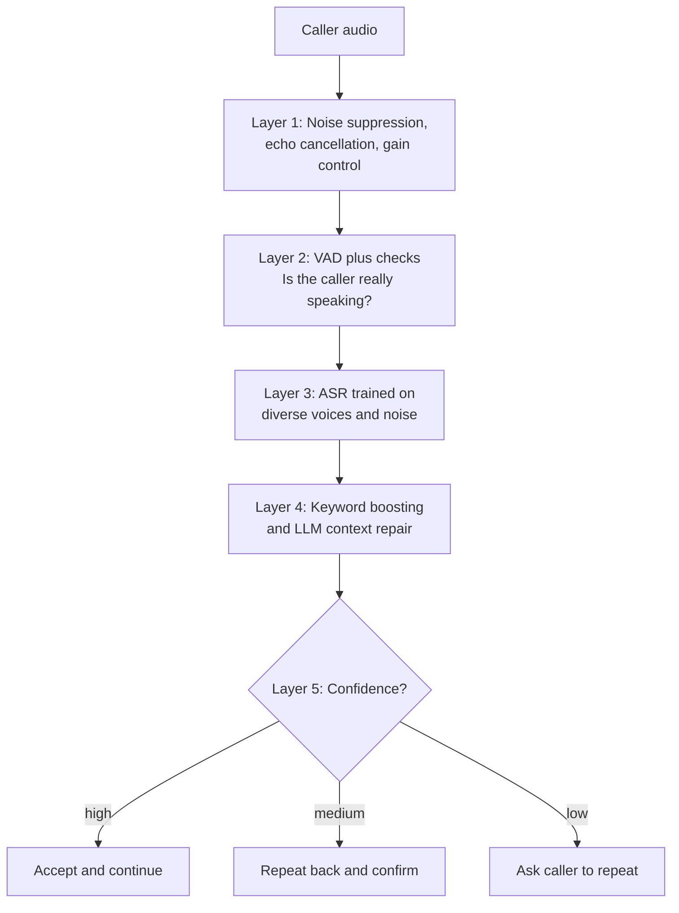

# How does a voice agent handle accents and noisy environments?

> **Step 16: AI Infrastructure, Deployment, and System Design** · ⏱️ 16 min read · [Read original](https://outcomeschool.com/blog/accents-and-noise-in-voice-agents)

## TL;DR
A voice agent handles accents and noise in five layers: clean the sound before listening, detect real caller speech (not noise), use an ASR trained on many voices and noise, use context to repair misheard words, and use confidence scores to confirm or re-ask. The LLM never hears the caller, only the ASR text, so the goal is making sure that text is what the caller really said.

## Key Concepts
- **Pipeline** — ASR (speech to text) then LLM (decides reply) then TTS (text to speech). Wrong ASR words mean the LLM replies to wrong words.
- **Noise suppression** — removes background sound while keeping the voice.
- **Echo cancellation** — removes the agent's own voice coming back via a speakerphone mic.
- **Automatic gain control** — evens out volume for soft or shouting callers.
- **VAD (Voice Activity Detection)** — decides many times per second whether a human voice is present.
- **Data augmentation** — adding noise, echo, bad phone-line effects, speed changes to clean training audio.
- **Fine-tuning** — training the ASR a bit more on the agent's own call recordings (with permission, transcribed).
- **Keyword boosting** — giving the ASR a list of expected words so it leans to them.
- **Confidence score** — ASR certainty, usually 0 to 1.

## How It Works

### Why accents and noise confuse the agent
Caller says "I want to cancel my order."
- Quiet room, common accent: correct text.
- Rare accent (different vowels/stress): "counsel my order".
- Busy street (bus, horn, nearby talker): "cancel my daughter".

The ASR matches sound patterns learned from recorded speech; unfamiliar patterns trigger guesses, some wrong. Noise also breaks turn-taking: a TV or nearby voice looks like the caller, so the agent stops its own reply or answers words never said. Two problems: hear the right words; know whose voice it is and when the caller is really speaking.

### Layer 1: Clean the sound
- Old filters cut steady hum (fan) but fail on changing noise (traffic, baby, chatter).
- Modern noise suppression is a small neural net trained on clean speech vs the same speech with noise; keeps voice, lowers the rest.
- Plus echo cancellation (otherwise the agent treats its own voice as the caller) and automatic gain control.
- Caveat: too-strong suppression removes parts of the voice and hurts recognition; tune it.

### Layer 2: Know when the caller is really speaking
- Simple VAD checks loudness only, so a loud truck counts as speech.
- Better VAD is a neural net asking "does this sound like a human voice?"; trucks and doors usually don't trigger it.
- But TV or a nearby person is also a human voice, so add checks:
  - Minimum speech length (ignore "uh", cough).
  - Check words: wait for the ASR to return real words before stopping own reply; if nothing useful, keep speaking.
  - Focus on main speaker: voice closest to the mic is louder and clearer.
- End of turn: noisy places are never fully silent, so use VAD plus the meaning of words together.
- A separate blog covers real interruption vs cough/noise.

### Layer 3: ASR that has heard many voices
Like a child hearing many regions understands new accents; one-accent training works for that accent only.
1. **Diverse training data** — ages, regions, accents, phones, mics. Whisper: about 680,000 hours of multilingual web audio; OpenAI reports it improved accent and noise handling.
2. **Data augmentation** — mix traffic/cafe/music, room echo, low-quality phone line, slight speed change. Words same, sound harder, so model learns they are the same words.
3. **Fine-tune** on the agent's real accents, words, and phone lines.
4. **Pick the right region model** — e.g. English (India), (UK), (US) instead of one general setting.

### Layer 4: Context repairs mistakes
1. **Keyword boosting** — e.g. pharmacy boosts medicine names, bank boosts product names; ASR leans to them over similar-sounding common words.
2. **LLM uses the conversation** — agent asked "cancel your order or change the delivery date?" and ASR gave "counsel my order"; LLM infers "cancel". System prompt tells the LLM the text comes from speech recognition, similar words can be swapped, use the conversation, and ask to repeat or confirm if unsure.
- Caveat: do not guess when stakes are high (phone number, money).

### Layer 5: Confidence and confirmation
Example: "My account number is 4 5 8 2 7", confidence 0.62, so unclear digits.

| Confidence | Agent action |
|---|---|
| High | Accept and continue |
| Medium | Repeat back the important part, ask to confirm ("I heard 4 5 8 2 7. Is that correct?") |
| Low | Politely ask to repeat |

If no, ask again. (Separate blog on confirm and correct.) In very bad noise:
- Ask to spell names or say digits one by one.
- Ask for keypad entry (tones are far easier to detect than spoken digits).
- Ask to move somewhere quieter.
- After a few failures, hand over to a human.

## Diagram(s)

### Five layers from caller to LLM

## Trade-offs & Pitfalls
- **Works well:** steady noise (fan, engine, crowd hum); accent well represented in training data; known words boosted; important details confirmed.
- **Still fails:**
  - Loud person right next to the caller (voice sounds like the caller).
  - Rare accent with no recordings to fine-tune on.
  - Very poor line, speech lost.
  - Caller mixes two languages in one sentence while ASR is set for one.
  - Names, addresses, rare words (little training data).
- Over-aggressive noise suppression damages speech.
- LLM guessing on numbers or money is unsafe.

## Key Takeaways
- The LLM only sees ASR text, so accuracy of that text is the core problem.
- Layered defense: clean audio, VAD, robust ASR, context, confidence.
- Neural noise suppression beats simple filters but must not be too strong.
- Echo cancellation stops the agent hearing itself on speakerphone.
- Diverse training data, data augmentation, fine-tuning, and region-specific models improve accent handling.
- Keyword boosting plus a prompt telling the LLM the text may be wrong recovers misheard words.
- Use confidence to accept, confirm, or re-ask; for critical details use spelling, keypad, or human handoff.
- Same-sounding nearby voices and rare accents remain the hardest failures.
