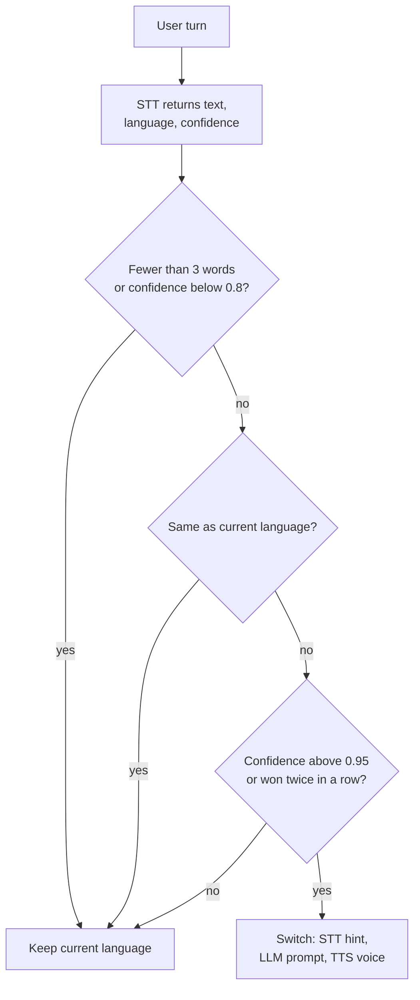

# How does a voice agent detect and switch the user's language mid-call?

> **Step 16: AI Infrastructure, Deployment, and System Design** · ⏱️ 16 min read · [Read original](https://outcomeschool.com/blog/language-switching-in-voice-agents)

## TL;DR
A voice agent detects language per turn from the audio (with the text as a backup), gets a confidence score, and switches only when rules are met. A switch updates STT (language hint), LLM (system prompt), and TTS (voice) together, while the conversation history is kept.

## Key Concepts
- **Fixed language problem** — English-locked STT turns Hindi speech into nonsense; the customer hangs up. Users switch by comfort, emotion, or topic.
- **Language detector** — returns a score per language (e.g. Hindi 0.86, English 0.10, Urdu 0.04; sum is 1). The top score is the confidence.
- **Spoken Language Identification** — finding the language from sound patterns, rhythm, and word joining.
- **Language hint** — tells STT which language to expect next; the possible-language list stays, but short sentences are written more correctly. Some streaming STT services allow changing it mid-call without a new connection.
- **Code-switching** — mixing languages in one sentence (Hinglish).
- **Pipeline** — STT, LLM, TTS all depend on language, so all three must change together.

## How It Works

### Three approaches to finding the language
| Approach | Pros | Cons |
|---|---|---|
| 1. Ask the user (IVR "press 1" or voice) | Correct at start | Only once, misses mid-call switches; extra step |
| 2. Detect from audio | Works every turn, catches switches | Short sounds ("Okay", "Hmm") too little; close languages confuse (Hindi/Urdu) |
| 3. Detect from text (text detector or LLM told "reply in the user's latest language") | Simple; LLMs know many languages | Depends on STT; if STT was locked wrong, text is nonsense, so use only as backup |

- Whisper predicts the language first, scoring each of 99 languages, then writes text in the winner.
- STT services accept a list of possible languages and return per turn: text, language code (hi, en), confidence, e.g. `{ "text": "...", "language": "hi", "confidence": 0.86 }`.
- Common setup: audio tells early, text confirms. Each turn: STT returns text, language, confidence; agent checks switch rules; LLM replies in the latest language; TTS speaks.

### Confidence: when to switch
Switching too fast causes mistakes (name "Rajesh Kumar" in an English sentence may look Hindi); too slow ignores the user. Rules:
- Confidence above a limit (e.g. 0.8).
- Ignore very short sentences (MIN_WORDS = 3).
- Switch when the new language wins two turns in a row, or one long sentence has very high confidence (above 0.95).
- Direct request ("Can we speak in Hindi?") switches immediately (LLM recommends, code switches).
- If unsure, ask once: "Would you like to continue in Hindi?"

Code logic of `should_switch`: short text then False; confidence below 0.8 then False; same language then False; confidence above 0.95 then True; else True only if `history[-1]` equals the new language. `history` holds earlier long-enough detected languages.

### What changes on a switch
1. **STT** — language hint set to Hindi.
2. **LLM** — add to system prompt "The user is now speaking Hindi. Reply in Hindi." (on top of the reply-in-latest-language rule).
3. **TTS** — use a voice that speaks Hindi; prefer one multilingual voice so the same "person" speaks (a woman to man change feels like someone else).
- Not changed: conversation history, so the user need not repeat anything.

### Full call example (bank balance)
- Turn 1: "Hi, I want to check my balance." English 0.97, no change.
- Turn 2: "Okay." Too short, ignored, stay English.
- Turn 3: Hindi sentence ("Mera account number bataiye, main confirm karna chahti hoon"), Hindi 0.91: above 0.8 but below 0.95; last counted turn was English, so wait. LLM still sees Hindi text and replies in Hindi for this turn; STT and voice settings wait. TTS can read it since one multilingual voice.
- Turn 4: "Aur last transaction bhi bata dijiye", Hindi 0.89: second win in a row, so switch. STT expects Hindi, LLM told Hindi, TTS Hindi same voice. Balance question from Turn 1 still remembered.

### Mixed-language speech
Code-switching (e.g. "Mera balance check karo, and send me the statement") has no single language answer; switching per sentence sounds broken. Treat the mix as its own language: use STT multilingual mode (two languages in one sentence) and tell the LLM "Reply in the same mix of languages the user is using."

## Diagram(s)

### Per-turn switch decision

## Trade-offs & Pitfalls
- **Works well:** full sentences; clearly different languages (English and Japanese); small known language list (e.g. English, Hindi, Tamil for an Indian bank).
- **Fails:** very short answers; close languages (Hindi/Urdu, Spanish/Portuguese); heavy background noise; many foreign names, places, or product names; rare languages with little training speech.
- Text detection is only as good as the STT output.

## Key Takeaways
- STT, LLM, and TTS all depend on language and must switch together.
- Detectors return a score per language; the top score is the confidence.
- Asking only once at the start cannot follow a mid-call switch; audio detection runs every turn.
- Use text or LLM detection as a backup, not a replacement.
- Guard switches: confidence above 0.8, ignore short turns, two wins in a row or above 0.95, honour explicit requests, ask when unsure.
- Use a language hint for STT, a prompt line for LLM, and one multilingual voice for TTS.
- Keep conversation history across a switch.
- For code-switchers, treat the mix as its own language rather than flip-flopping.
- A smaller list of possible languages means fewer mistakes.
