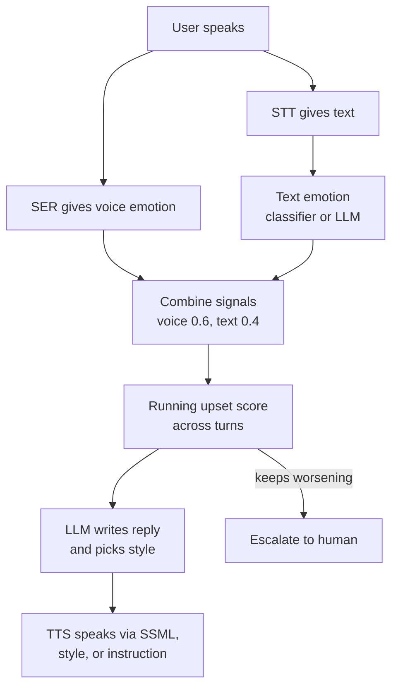

# How does a voice agent match its tone and emotion to the user?

> **Step 16: AI Infrastructure, Deployment, and System Design** · ⏱️ 18 min read · [Read original](https://outcomeschool.com/blog/emotion-matching-in-voice-agents)

## TL;DR
A voice agent first detects how the user feels from both words and voice, then chooses a fitting reply tone and words, and finally tells the TTS to speak with the right speed, pitch, and warmth. Matching means responding appropriately, not copying the emotion. The tone is kept steady across turns.

## Key Concepts
- **Tone** — how something is said; **emotion** — the feeling behind it. "Okay, fine." can be happy, tired, or angry.
- **Prosody** — pitch, speed, loudness, and pauses together (everything but the words).
- **Emotion classification** — text model giving labels (angry, happy, neutral). **Sentiment analysis** — simpler: positive, negative, or neutral. Both fast and cheap.
- **Speech Emotion Recognition (SER)** — model that reads raw audio and outputs emotion plus confidence, e.g. `{ "emotion": "angry", "confidence": 0.78 }`; may give a score per emotion.
- **SSML** — markup that tells TTS how to speak (prosody tag, break).
- **Speech-to-speech model** — audio in, audio out, no text step.
- **Escalation** — handing the call to a human.

## How It Works

### Why match tone, and what matching means
Bank example: user says "Someone took 500 dollars from my account and I did not do it." A bright, fast "Great. I can totally help you with that today." feels uncaring; a slow, calm "I am sorry to hear that. Let's sort this out together right now." feels heard. On a call, voice is all the user has, so tone matters more than in chat. Do not copy emotion (angry user does not get an angry agent); sometimes move the same way, sometimes the opposite.

| User feels | Agent sounds |
|---|---|
| Angry | Calm, slow, respectful |
| Worried | Gentle, reassuring, clear |
| Confused | Patient, slow, simple steps |
| Happy or excited | Warm, upbeat |
| In a hurry | Short, quick, to the point |
| Sad | Soft, kind, unhurried |

Text loses the feeling (STT drops pitch, speed, loudness), so extra pieces are needed to listen for feeling, decide reply feeling, and instruct the TTS.

### Step 1: Emotion from the words
- Classifier model, or ask the LLM (already reads every sentence).
- Clues beyond words: repeating the same question, "I already told you that" show frustration.
- Problem: "Great, just great." looks happy as text but is often angry.

### Step 2: Emotion from the voice
SER looks at pitch (angry or excited goes higher, varies more), loudness (angry louder), speed (stress faster, sad slower), pauses (long means confusion or sadness). Trained on audio clips labelled by humans; runs on the same audio sent to STT, in parallel.

### Step 3: Combine both signals
Weighted sum, voice weight 0.6, text weight 0.4. For "Great, just great.": text {happy 0.7, angry 0.2, neutral 0.1}, voice {happy 0.1, angry 0.8, neutral 0.1}.
- happy: 0.4*0.7 + 0.6*0.1 = 0.34
- angry: 0.4*0.2 + 0.6*0.8 = 0.56
- neutral: 0.4*0.1 + 0.6*0.1 = 0.10

Pick the max: angry (voice shows the sarcasm). Some systems use one model taking audio and text together.

### Step 4: Decide the reply tone
- **Way 1, rules:** fixed mapping (angry then calm, confused then patient); easy to build and test.
- **Way 2, LLM:** pass text plus detected emotion (e.g. angry, 0.78) with a system rule such as: acknowledge the feeling in one short sentence, then give the next step, keep calm and short, never cheerful. LLM can also return a style label (calm, warm).
- Or mix: rules for clear cases, LLM for the rest.

### Step 5: Choose the words
Order arrives Friday:
- Neutral: "Your order will arrive on Friday."
- Angry: "I am really sorry about the delay. Your order will arrive on Friday."
- Confused: "No problem. Your order is on the way, and it will arrive on Friday."
- In a hurry: "Friday."

Upset users need acknowledgment first; confused need simple words; angrier user means shorter, clearer reply (long replies feel like not listening).

### Step 6: Speak with the right tone (TTS)
1. **SSML prosody** — e.g. `rate="slow" pitch="low" volume="soft"` on the apology, then `<break time="300ms"/>` so it is not rushed.
2. **Style or emotion settings** — ready-made styles (cheerful, calm, sad, empathetic) picked from the Step 4 decision.
3. **Plain-language instruction** — e.g. "Speak in a calm, warm, and slow voice, like a caring support agent."

### Speech-to-speech models
Audio in, audio out; hears pitch, speed, loudness itself and replies with matching feeling, no SSML needed.
- Advantage: feeling not lost; more natural.
- Disadvantage: less control, harder to see why a tone was chosen (separate parts let you log emotion and style and fix rules).
- Choose by use case: control and logs, use separate parts; most natural feel, use speech-to-speech. (Separate blog: Cascaded vs Speech-to-Speech.)

### Keeping tone steady across the call
Do not react only to the last sentence (angry, then "My order number is 4521." must not trigger a cheerful switch). Keep a running upset score: rises when angry, falls slowly when calm. Example: 0.8, then 0.6, then 0.4; keep calm style while above 0.5, so calm persists one more turn like a caring human. If the user keeps getting more upset, offer escalation to a human.

## Diagram(s)

### Emotion-aware pipeline

## Trade-offs & Pitfalls
- **Works well:** customer support (upset users), healthcare (worried users), strong clear feelings (loud anger, clear happiness).
- **Fails:**
  - Hidden feelings and sarcasm ("Oh, wonderful." hard even for humans).
  - Culture and language: same tone means different things (loud may be normal).
  - Noisy calls and poor lines confuse the emotion model.
  - Wrong guesses: "I can hear that you are upset" to a calm user feels strange; act only on high confidence and avoid naming the feeling directly (show care via words and a calm voice).
  - Delay: each extra model adds time; the emotion step must be fast (SER runs in parallel with STT; text classifiers are cheap).

## Key Takeaways
- Matching tone means responding appropriately, not mirroring (calm for angry).
- STT strips prosody, so voice emotion needs a separate signal (SER).
- Words alone mislead (sarcasm); combine words and voice with weights, e.g. 0.4 text, 0.6 voice.
- Decide tone with rules, the LLM, or both; reply words matter as much as voice.
- Control TTS via SSML prosody, style presets, or plain-language instructions.
- Speech-to-speech sounds natural but is less controllable and observable.
- Use a decaying upset score across turns so tone does not flip suddenly; escalate to a human if it worsens.
- Act on emotion only when confident, keep it fast, and do not announce the user's feelings.
