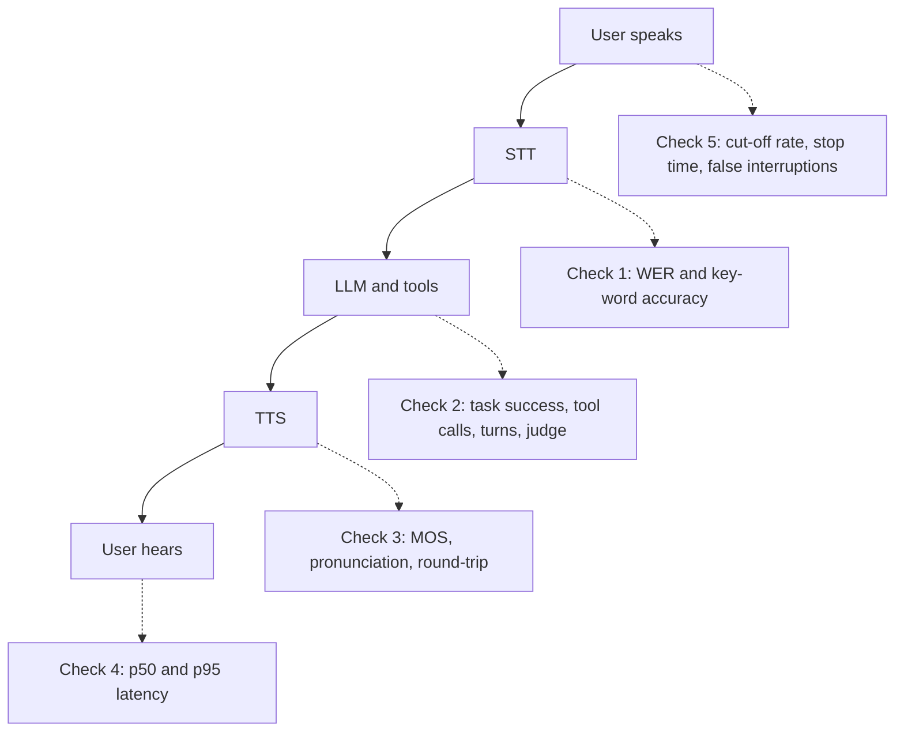
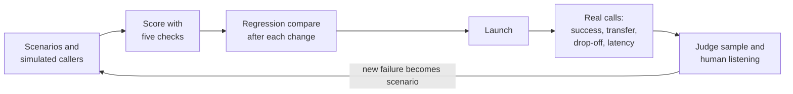

# How do you evaluate a voice AI agent?

> **Step 16: AI Infrastructure, Deployment, and System Design** · ⏱️ 17 min read · [Read original](https://outcomeschool.com/blog/voice-agent-evaluation)

## TL;DR
Evaluating a voice agent means checking, on many real and simulated calls, whether it heard correctly, did the right thing, spoke well, replied fast enough, and took turns naturally. Each of these five checks gets its own number, then the whole call is checked end to end. It is harder than chat evaluation because a voice agent can fail even when every LLM sentence is perfect.

## Key Concepts
- **Voice agent pipeline** — STT (ASR, voice to text) then LLM (decides reply or tool call) then TTS (text to voice), plus **turn-taking** logic that decides when the user has finished and when the agent must stop. A mistake in any part reaches the user. Speech-to-speech agents replace the three parts with one model, and most checks still apply.
- **WER (Word Error Rate)** — word mistakes of STT relative to reference length.
- **Reference / Hypothesis** — what the user really said (human-written) / what STT produced.
- **Task success rate** — calls completed correctly / total calls.
- **LLM-as-a-judge** — another LLM scores a transcript against a scoring guide, with a reason.
- **MOS (Mean Opinion Score)** — average human rating of voice quality, 1 (bad) to 5 (excellent).
- **Voice-to-voice latency** — from user stops speaking to user hears first sound of the reply.
- **p50 / p95** — half of turns / 95% of turns were faster than this value.
- **Barge-in** — user interrupts the agent; the agent must stop quickly.
- **Simulated caller** — an AI agent playing the user, given a goal and persona.
- **Regression testing** — rerunning the same set after every change to see if something broke.

## How It Works

### Why it is harder than chat evaluation
Chat is text in and out, so we can read the reply. In voice:
- Noisy places make STT mishear.
- Correct text can be spoken wrongly by TTS (names, numbers).
- A correct reply can arrive so late the user speaks again.
- The agent can cut the user off mid-sentence.

So we check each part, then the whole call. We cannot listen to every call (e.g. after making the prompt more polite, did booking get worse?), so we need comparable before/after numbers.

| Check | Question | Part mostly tested |
|---|---|---|
| Hearing | Did it hear correctly? | STT |
| Doing | Did it do the right thing? | LLM and tools |
| Speaking | Did it speak well? | TTS |
| Speed | Was it fast enough? | Whole pipeline |
| Turn-taking | Did it take turns naturally? | Turn-taking logic |

### Check 1: Did it hear correctly?
Count S (substitutions), D (deletions), I (insertions) against N reference words:

$$
\text{WER} = \frac{S + D + I}{N}
$$

Example: reference "book a table for four at seven", hypothesis "book table for four at eleven". N = 7, D = 1 ("a" missing), S = 1 (seven became eleven), I = 0. WER = 2/7, about 28.6%. Lower is better.
- Normalize both texts first ("7" and "seven" must match) or fake errors are counted.
- WER treats all words equally: missing "a" is harmless, wrong "seven" books the wrong time. So also measure accuracy on important words only (names, dates, times, phone numbers, order IDs).
- Measure on audio like real calls (phone quality, noise, accents); clean studio audio gives a too-good number.

### Check 2: Did it do the right thing?
$$
\text{Task success rate} = \frac{\text{calls completed correctly}}{\text{total calls}}
$$

Example: 100 booking calls, 87 booked the correct table, date, time, and people, so 87%. "Correct" is defined by writing the expected result in advance, e.g. `{ "action": "book_table", "date": "2026-10-20", "time": "19:00", "people": 4 }`, and comparing with the real booking.

Also check inside the call:
- **Tool call correctness** — right tool with right input (book_table with right time, not cancel_table). The LLM recommends the tool, our code runs it.
- **Number of turns** — 12 turns when 4 would do is poor even if successful.
- **Following rules** — confirmed details before booking, avoided forbidden topics.

For fuzzy criteria (politeness, answered the question) use LLM-as-a-judge: give transcript plus scoring guide. Prefer yes/no questions with a one-line reason (confirmed date, time, people? answered every question? said anything untrue versus tool results?) over "rate 1 to 10", since they are easier to trust and compare. Validate the judge against human answers on a small call set.

### Check 3: Did it speak well?
- **MOS** — needs real people, so slow and costly.
- Quicker checks:
  - Pronunciation of important words (names, brands, addresses, numbers).
  - Round-trip check: TTS audio into STT, compare with the original text; gives a WER for the agent's speech. If STT cannot recover the words, a human on a phone line may struggle too.
  - Automatic quality models predicting MOS from audio: quick but less reliable than listeners.

### Check 4: Was it fast enough?
A slow reply feels like a broken call; the user thinks they were not heard and speaks again. Measure voice-to-voice latency on every turn and look at percentiles, not the average.
- Example: p50 = 800 ms, p95 = 3 s means most replies are quick, but 1 in 20 makes the user wait 3 s or more. The average hides this, so always track p95 with p50.
- Record STT, LLM, and TTS times separately to know what to fix (see the latency budget blog).

### Check 5: Did it take turns naturally?
Two failure modes, where fixing one can worsen the other:
- **Cutting the user off** — measured by **cut-off rate** (turns where the agent spoke mid-sentence).
- **Waiting too long** — measured by **response delay** (wait after user truly finished); part of Check 4 latency, so read together.

For barge-in:
- **Stop time** — how fast the agent went silent after the user started speaking.
- **False interruption rate** — agent stopped for a cough, "hmm", or noise.

Measure with two-channel recordings (user and agent on separate tracks of one timeline).

### Testing with simulated callers before launch
No real users exist yet, so a simulated caller (AI agent with a goal and persona, own TTS voice) calls the agent, e.g. "book for 4 at 7 PM Friday, speak fast, change your mind once about the time, ask about parking at the end". The call is recorded and scored with the five checks.
1. Write scenarios: common tasks, hard cases, things to refuse.
2. Run each many times (agent and caller vary each time).
3. Add real conditions: noise, phone-quality audio, accents.
4. Score every call and store the numbers.
5. After every prompt, model, or voice change, rerun the same set and compare with the last run (regression testing: did a change fix one thing but break another?).

### Evaluating real calls after launch
Real users do things scenarios missed. Track:
- Task success rate on real calls, from system results (was a booking actually created?).
- **Transfer rate** — handed to a human; some are correct, a sudden rise is a warning.
- **Drop-off rate** — user hung up mid-task.
- p50 and p95 latency on live calls.

Daily, score a small sample with LLM-as-a-judge and have a human listen to some. A call that failed in a new way becomes a new simulated scenario, so the test set grows with real problems.

## Diagram(s)

### Five checks mapped to the pipeline

### Evaluation loop before and after launch

## Trade-offs & Pitfalls
- **Works well:** five checks show which part to fix; simulated callers run hundreds of calls quickly and repeat after every change.
- **Fails:**
  - Low WER can still hide a wrong date or name.
  - LLM judge can err (check against humans) and reads only the transcript, so it misses bad tone or long silence.
  - Simulated callers are clearer and more polite than real people, so passing all simulated tests can still fail with real callers.
  - Good per-part numbers do not guarantee a good call; still listen to full calls.

## Key Questions
- **Good WER?** Lower is better, but the number alone is not enough: add important-word accuracy and test on real-sounding audio.
- **Why p95, not the average?** The average hides slow turns; track p95 with p50.
- **Can LLM judge replace human review?** No; it can be wrong and cannot hear tone or silence, so humans still listen daily.
- **Do checks work for speech-to-speech agents?** Mostly yes; the user still needs to be heard, helped, and answered quickly.

## Key Takeaways
- A voice agent can fail even when every LLM sentence is perfect, so check each part and the whole call.
- Five checks: hearing, doing, speaking, speed, turn-taking.
- WER = (S + D + I) / N, on normalized text; add key-word accuracy since all words are not equal.
- Define the expected result per test call in advance; measure task success rate plus tool-call correctness and turns.
- Use yes/no LLM-as-a-judge questions and validate the judge against humans.
- Track p50 and p95 voice-to-voice latency; average hides slow turns.
- Measure both cut-off rate and response delay, plus barge-in stop time and false interruptions.
- Simulated callers plus regression testing before launch; real-call metrics and failed calls feeding new scenarios after launch.
