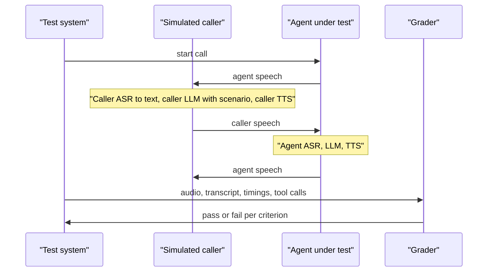
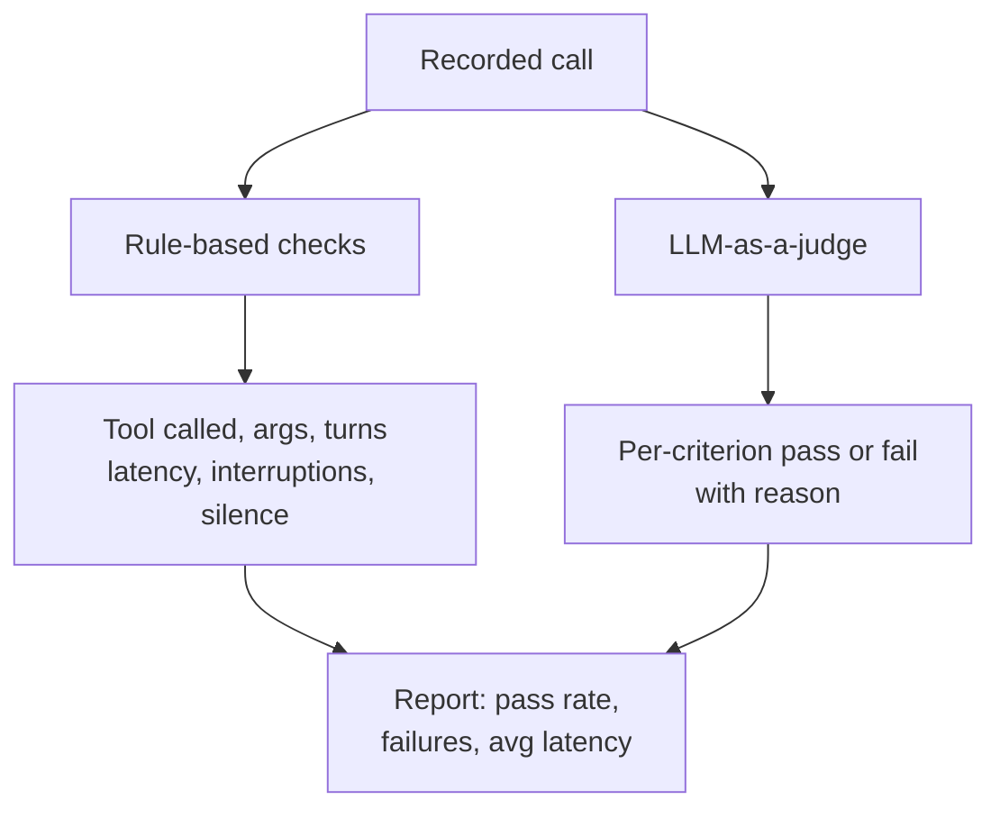

# How do simulated callers test a voice agent automatically?

> **Step 16: AI Infrastructure, Deployment, and System Design** · ⏱️ 17 min read · [Read original](https://outcomeschool.com/blog/simulated-caller-testing)

## TL;DR
A simulated caller is an AI agent that pretends to be a customer, calls our voice agent with a goal, and keeps talking until the goal is met. A grader (rule-based checks plus LLM-as-a-judge) then scores the recorded call. It lets us test many caller types and rerun everything after each change, but it does not replace real-world feedback.

## Key Concepts
- **Voice agent** — talks over phone or mic: ASR (speech to text), LLM (decides reply, may call tools), TTS (text to speech).
- **Agent under test** — our voice agent. **Simulated caller** — the AI playing the customer (like a friend playing interviewer in a mock interview).
- **Scenario** — persona, goal, facts, behavior, and success criteria.
- **Turn** — one time one side speaks.
- **Test suite** — saved list of scenarios covering every important flow (booking, cancelling, rescheduling, asking for a human).
- **Regression testing** — checking a new change did not break something that worked.
- **LLM-as-a-judge** — LLM gets transcript plus success criteria and returns pass/fail with a reason per criterion.

## How It Works

### Why manual testing is hard
Example: a dental clinic agent (Smile Dental) books cleanings. Calling it ourselves works for a few calls, then:
1. **Too many kinds of callers** — fast, indecisive, on a busy street, asking for something not offered.
2. **Every change can break something** — one prompt line fixes booking, cancellation breaks; 50 manual calls after each change is impractical.
3. **Same test is never the same** — we phrase things differently and the LLM replies differently, so results are hard to compare.
4. **Voice is more than words** — a text-correct reply can take 3 seconds, talk over the caller, or stop when the caller coughs; text tests miss this.

### What a simulated caller is made of
1. **Scenario** — persona (e.g. Riya, 34, polite, fast, a little impatient), goal (book cleaning next Tuesday afternoon), facts (phone number, date of birth), behavior (change the time once after a slot is offered).
2. **Caller LLM** — reads the scenario and reacts each turn to what the agent said; no fixed script.
3. **Caller TTS** — speaks the caller text so the agent hears real audio.
4. **Caller ASR** — turns the agent's spoken reply into text for the caller LLM.
5. **Success criteria** — what must happen to pass (e.g. confirm the final time).

Text-only mode skips TTS and ASR: faster and cheaper, but does not test the agent's ASR, TTS, or timing.

Scenario as JSON: `persona`, `goal`, `facts` (phone, dob), `behavior`, `success_criteria` (asks for phone number before booking; books Tuesday afternoon; confirms final time). The caller LLM reads the first four, the grader reads `success_criteria`.

### How one test call runs
1. Test system starts the call (dials the real number or connects to the agent's audio stream over the internet).
2. Agent answers: "Hello, thank you for calling Smile Dental. How can I help you?"
3. Caller ASR turns it into text.
4. Caller LLM, with the scenario, decides the reply ("Hi, I want to book a cleaning for next Tuesday, afternoon if possible.").
5. Caller TTS speaks it into the call.
6. Agent runs its own ASR, LLM, TTS and replies; loop returns to step 3.
7. Ends when the caller decides the goal is reached and hangs up, the agent ends the call, or the maximum number of turns is crossed.

Recorded: full audio of both sides, transcript, start/stop times of each side, and every tool call with input and output (if agent logs are readable).

**Max turns matter:** otherwise two polite agents loop ("Anything else?" / "No, thank you."). The limit stops the call and marks it a failure.

### How the call gets graded
**Way 1: rule-based checks** (fast, cheap, same answer every time):
- Text: did the agent call `book_appointment`? Was the tool date next Tuesday? Did the call end in fewer than 20 turns?
- Audio-based: latency (e.g. fail if any reply took more than 1.5 s), interruptions (agent talked over caller), silence (long quiet). These solve Problem 4.

**Way 2: LLM-as-a-judge** for fuzzy criteria ("stayed polite", "confirmed the final time", which can be said many ways). Judge returns results per criterion: criterion, pass true/false, reason. Example: third criterion failed because the agent said "You are all set" without the time, so we know what to fix in the prompt. Write each criterion as one clear, specific statement to reduce guessing.

### Making callers sound real
Otherwise a calm caller in a quiet room lets the agent pass tests yet fail with real people. Vary:
- **Personas** — angry, confused elderly, wrong details corrected later, off-topic questions.
- **Voices and accents** — different TTS voices, speeds, accents to test the agent's ASR.
- **Background noise** — traffic, crying baby, TV mixed into caller audio.
- **Interruptions** — caller speaks while agent talks; does the agent stop and listen?
- **Pauses and fillers** — "umm" and a 2 s pause mid-sentence; does the agent avoid cutting in early?
- **Edge cases** — silent caller, caller asking for a human.

One scenario gives many versions: 10 personas x 5 accents x 3 noise levels = 150 test calls from one goal (solves Problem 1).

### Running hundreds of calls at once
Many simulated calls can run in parallel, if agent and phone setup handle the load.
- Keep a test suite of all important flows.
- Run it automatically before any new version goes live, on every change of prompt, model, voice, or code.
- Run each scenario a few times; passing 9 of 10 means not fully reliable.
- Report: passed and failed scenarios, pass rate, average latency.

This is regression testing (solves Problem 2); since the same scenarios run every time, today's pass rate is comparable to yesterday's (solves Problem 3).

| Aspect | Manual testing | Simulated callers |
|---|---|---|
| Calls at a time | One | Many at the same time |
| Cost per call | A person's time | Model and phone usage |
| Repeatability | Low | High, same scenario every time |
| Variety of callers | Limited to the tester | Many personas, accents, noises |
| Runs after each change | Rarely | Automatically |
| Catches subtle issues | Good, a human notices tone | Depends on judge and checks |

## Diagram(s)

### One test call loop

### Grading paths

## Trade-offs & Pitfalls
- **Works well:**
  - Retesting every flow after every change.
  - Covering accents, noise, and personas a small team cannot do by hand.
  - Replaying a failed production call as a scenario kept in the suite so the bug cannot return unnoticed.
- **Fails:**
  - Not a real person; the suite covers only what we think of.
  - Caller LLM is too perfect (clean sentences), so ask it to be messy on purpose (mumble, repeat, go off-topic).
  - Caller goes off script (forgets goal, invents facts), so the failure is the caller's, not the agent's.
  - Judge can pass a bad call or fail a good one; check its decisions from time to time.
  - Cost: each call uses LLM, TTS, ASR, sometimes a real phone line; thousands per change add up.

## Key Questions
- **Replaces real-user testing?** No; it catches known problems early, real calls add new scenarios.
- **Why run a scenario more than once?** The LLM varies; one pass proves nothing.
- **Text instead of audio?** Yes, but slow replies and talking over the caller are missed.
- **Why max turns?** To stop endless polite loops; marks the call failed.
- **Can the caller cause a false failure?** Yes, and the judge can be wrong too.

## Key Takeaways
- A simulated caller is an AI agent with a scenario (persona, goal, facts, behavior) plus its own LLM, TTS, ASR, and success criteria.
- It solves four manual-testing problems: caller variety, regressions, non-repeatability, and audio-level issues.
- Record audio, transcript, timings, and tool calls for grading.
- Grade with rule-based checks (cheap, deterministic, includes latency and interruptions) plus LLM judge for fuzzy criteria.
- Always set a maximum number of turns.
- Multiply one scenario into many (10 x 5 x 3 = 150) via personas, accents, and noise.
- Run each scenario several times and run the suite automatically before every release.
- Make callers messy, verify the judge, and feed real failed calls back into the suite.
