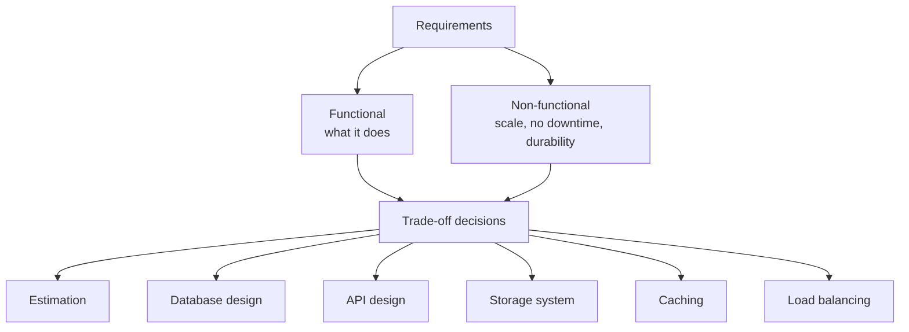

# What is System Design?

> **Step 16: Supporting reads for AI System Design** · ⏱️ 6 min read · [Read original](https://outcomeschool.com/blog/system-design)

## TL;DR
System Design is defining the components, API, database tables and so on for a system so it satisfies the functional and non-functional requirements. It is "System" (assembly of components) plus "Design" (how efficiently they are assembled). We do it so the system scales, stays up, is fast, and its parts work together at best efficiency.

## Key Concepts
- **System** — assembly of different components for the specified requirements.
- **Design** — how efficiently that assembly is done.
- **Functional requirements** — what the product does.
- **Non-functional requirements** — qualities such as durability, availability, scalability.
- **Trade-off** — choosing what is important and what can be relaxed.

## How It Works

### Start from requirements (large apps: Facebook, Uber, Instagram, WhatsApp, YouTube)
| App | Functional | Non-functional |
|---|---|---|
| Instagram | Upload image, like, share, comment | No uploaded image lost, no downtime, easily scalable |
| YouTube | Upload video, view, like, comment, search, subscribe | (same style of qualities) |

### Balancing and trade-offs
Decide what matters per requirement. Instagram:
- Important: fast image rendering on the user device (Instagram is all about images).
- Less important: exact comment count. Trade-off: no real-time sync across same-type servers, so different servers may show different comment counts for a post; they sync gradually.

### Why we need it (goals)
- Scale easily: add a machine or enlarge one as users grow.
- No downtime; no failed requests.
- Low latency; fast API.
- Multiple server copies so hardware failure recovers with almost no downtime.
- Sync across same-type servers for data consistency.
- Evenly distributed load across servers.
- Reusable components that work together as a system, each at best efficiency.

### Required concepts
Computer science foundations: Computer Network, Distributed Systems, Parallel Computing. Using them we: do estimation, design the database, design the API, decide the storage system, implement caching, integrate load balancing, and more.

### Diagram: from requirements to design

## Trade-offs & Pitfalls
- Everything is balancing: decide per requirement what is critical and where relaxing (e.g. eventual consistency of comment counts) is acceptable.
- The blog is a simplified overview, not the design of a particular app.

## FAQ
- Functional vs non-functional? → Features (upload, like, comment) vs qualities (no loss, no downtime, scalable).
- How to decide what matters? → From requirements; balance, e.g. fast image rendering for Instagram.
- Different data on different servers OK? → Sometimes, as with comment counts that sync gradually.

## Key Takeaways
- System Design = components, API, database tables to meet functional and non-functional requirements.
- Always list requirements first and split them into functional and non-functional.
- Prioritise and trade off; not everything needs strict consistency.
- Goals: scalability, availability, low latency, redundancy, consistency, load balance, reusability.
- Builds on networks, distributed systems and parallel computing.
