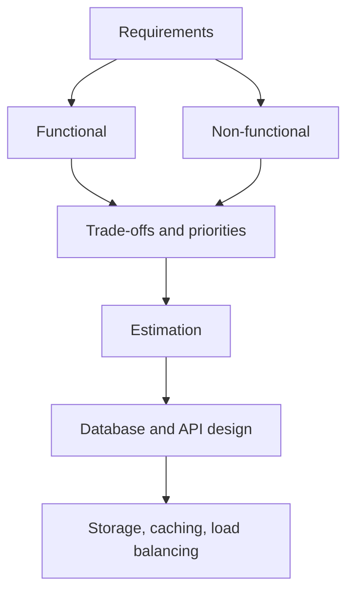

# What is System Design?

> **Step 16b: Supporting Reads** · ⏱️ 6 min read · [Read original](https://outcomeschool.com/blog/system-design)

## TL;DR
System Design is defining the components, APIs, database tables, and so on that let a system meet its functional and non-functional requirements. It is about assembling components efficiently and balancing trade-offs for large applications.

## Key Concepts
- **System Design** — system (assembly of components for requirements) plus design (how efficiently they are assembled).
- **Functional requirements** — what the system does (Instagram: upload image, like, share, comment; YouTube: upload video, view, search, subscribe).
- **Non-functional requirements** — qualities such as no lost images, no downtime, easy scalability.
- **Trade-off** — decide what matters most and where compromise is fine.

## How It Works
1. Note down the requirements and split them into functional and non-functional.
2. Decide priorities and trade-offs. For Instagram, fast image rendering is critical; the exact comment count on every server can be eventually consistent and sync gradually.
3. Engineer the system using Computer Network, Distributed Systems, and Parallel Computing concepts.
4. Concrete design work: estimation, database design, API design, storage system choice, caching, and load balancing.

**Goals a good design pursues**
- Easy scaling as users grow (add or enlarge machines).
- No downtime and no failed requests; multiple server copies to recover from hardware failure.
- Low latency APIs.
- Data consistency across servers of the same type.
- Even load distribution.
- Reusable components that work together and each run efficiently.

## Diagram

## Key Takeaways
- System Design starts from requirements, split into functional and non-functional.
- Everything is balancing; choose what to prioritize and where to trade off.
- Core goals are scalability, availability, low latency, consistency, and even load.
- Building blocks: estimation, DB, API, storage, caching, load balancer.
