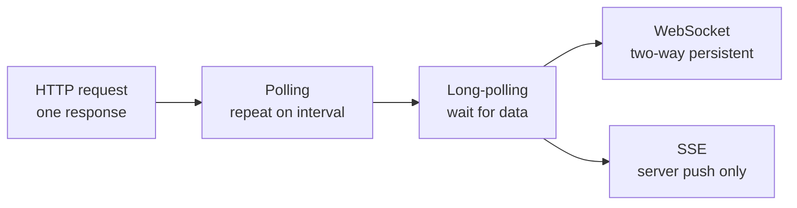

# HTTP Request vs HTTP Long-Polling vs WebSocket vs Server-Sent Events

> **Step 16b: Supporting Reads** · ⏱️ 9 min read · [Read original](https://outcomeschool.com/blog/http-request-long-polling-websocket-sse)

## TL;DR
These are four ways for a client and server to exchange data, differing in who can start communication and how long the connection stays open. The blog compares them using a WhatsApp-style chat, a delivery location update, and a stock price feed.

## Key Concepts
- **HTTP request** — open connection, one response, close.
- **HTTP polling** — client repeats requests at an interval (for example every 2 s).
- **HTTP long-polling** — request held open until the server has data or a timeout.
- **WebSocket** — persistent, bidirectional, full-duplex channel over one TCP connection.
- **SSE (Server-Sent Events)** — persistent server-to-client push only.

## How It Works

| Approach | Connection | Direction | Weakness | Fit |
|---|---|---|---|---|
| HTTP request | Opened, one response, closed | Client asks | Not for live updates | Fetch profile info |
| HTTP polling | Repeated requests every 1 to 2 s | Client pulls | Mostly empty responses, delayed by interval, drains battery | Delivery location update (2 s lag fine) |
| Long-polling | Held open until response, then client re-requests; timeout added | Client pulls | Repeated reconnects | Better chat than polling: real time, no empty responses |
| WebSocket | One handshake, persistent | Both ways anytime | More setup | Best for chat (WhatsApp uses it) |
| SSE | Persistent | Server to client only | Client must use normal HTTP to send | Stock prices, LLM token streaming |

**Details**
- Polling for chat has two problems: up to 2 s message delay and mostly empty responses.
- Long-polling closes and reopens after each response or timeout.
- WebSocket does the handshake only once, cutting repeated overhead, and either side can send at any time.
- SSE suits cases where the client has nothing to send. Modern use: token streaming in ChatGPT/Claude-style apps, one token at a time over one open connection.

## Diagram

## Key Takeaways
- Polling wastes requests; long-polling removes empty responses but reconnects constantly.
- WebSocket is bidirectional with a single handshake; ideal for chat.
- SSE is one-way server push; ideal for stock tickers and LLM token streaming.
- Pick by who sends data and how fresh it must be.
