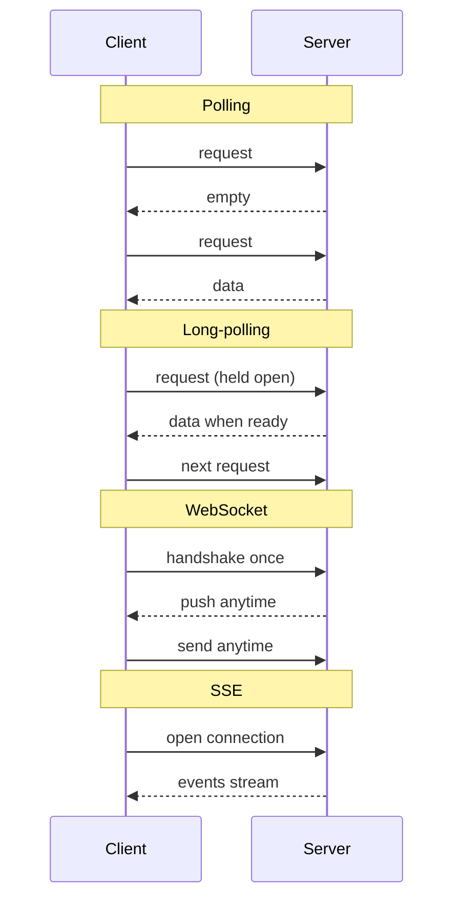
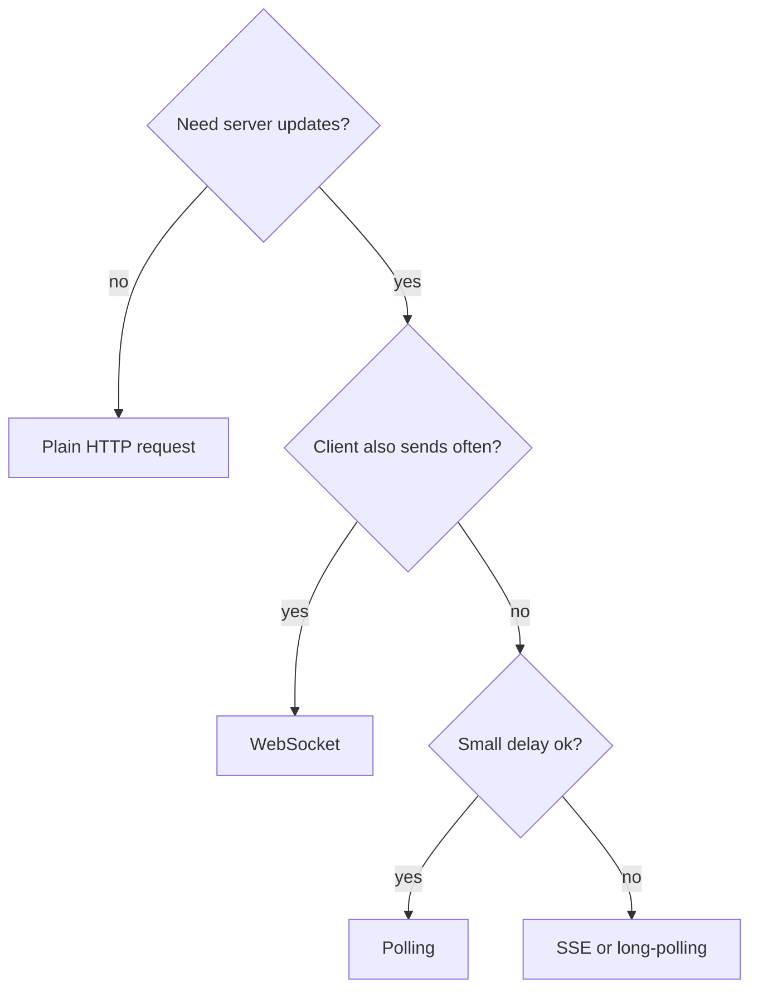

# HTTP Request vs HTTP Long-Polling vs WebSocket vs Server-Sent Events

> **Step 16: Supporting reads for AI System Design** · ⏱️ 9 min read · [Read original](https://outcomeschool.com/blog/http-request-long-polling-websocket-sse)

## TL;DR
HTTP request: client asks, server answers once. Polling: client repeats requests on an interval. Long-polling: server holds the request until data is ready. WebSocket: one persistent two-way connection. SSE: persistent one-way server-to-client push. Pick by direction and freshness needs; chat suits WebSocket, token streaming and stock tickers suit SSE.

## Key Concepts
- **HTTP request** — handshake, connection opens, server responds on it, connection closes. Example: fetching a Facebook profile.
- **HTTP polling** — client keeps requesting every 1–2 s.
- **HTTP long-polling** — server keeps the connection open until it has a response; a timeout is also set.
- **WebSocket** — persistent, bidirectional, full-duplex channel over a single TCP connection after one handshake.
- **SSE (Server-Sent Events)** — server push over a persistent connection; client cannot send over it.

## How It Works

### HTTP Polling
- Client requests every e.g. 2 s. Most responses may be empty, so many unnecessary network calls.
- WhatsApp example: new messages delayed up to 2 s and constant polling drains mobile battery. Sending via HTTP request is fine, receiving via polling is not.
- Acceptable for delivery-person location updates, where a 2 s delay is fine (not recommended, but usable).

### HTTP Long-Polling
- Client requests and waits; the connection stays open until the server has data, then the server responds, connection closes, and the client immediately sends another request. Each request has a timeout; on timeout or response the client reconnects.
- For chat: messages arrive in real time and there are no empty responses (despite repeated timeouts/reconnects). Still not the best solution.

### WebSocket
- Client does the WebSocket handshake once, TCP connection is established; afterward server and client can send anytime. Handshake overhead is paid once.
- Best for WhatsApp chat (WhatsApp uses WebSocket).

### SSE
- Persistent long-term connection; server sends data over it. Client can't send; it must use normal HTTP requests.
- Chat: receiving works but sending needs HTTP again, so not best. Fits real-time stock prices (continuous updates, nothing to send).
- Modern major use: token streaming in LLM apps (ChatGPT, Claude): server pushes the reply token by token over one open connection.

### Comparison
| Technique | Direction | Connection | Empty responses | Best use |
|---|---|---|---|---|
| HTTP request | Client asks, server answers | Opened and closed per request | No | Fetch profile |
| Polling | Client repeats | Repeated requests | Many | Delivery location (2 s delay ok) |
| Long-polling | Client request, server holds | Reconnect after each response/timeout | None | Better than polling for chat |
| WebSocket | Two-way | Persistent, handshake once | None | Chat (WhatsApp) |
| SSE | Server to client only | Persistent | None | Stock prices, LLM token streaming |

### Diagram: message patterns

### Diagram: picking one

## Trade-offs & Pitfalls
- Polling: wasted calls, delay equal to interval, battery drain.
- Long-polling: repeated reconnects and timeouts.
- SSE: one-way only.
- WebSocket: best for chat; the connection stays open and persistent.

## FAQ
- Best for WhatsApp-like chat? → WebSocket.
- Client send via SSE? → No, use normal HTTP.
- When is polling OK? → Small delay is fine (delivery location).
- Why less overhead for WebSocket? → Handshake once.
- SSE in modern apps? → LLM token streaming, stock prices.

## Key Takeaways
- Request/response is one-shot; polling repeats it wastefully.
- Long-polling holds the request open for real-time without empty responses.
- WebSocket is full-duplex with a single handshake: best for chat.
- SSE is server-push only: ideal for token streaming and live feeds.
- Choose by direction of data and tolerance for delay.
