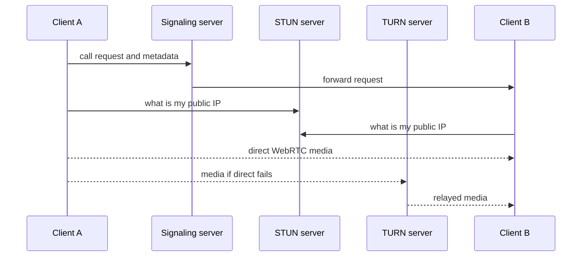

# How do Voice and Video Call work?

> **Step 16b: Supporting Reads** · ⏱️ 5 min read · [Read original](https://outcomeschool.com/blog/voice-and-video-call)

## TL;DR
Voice and video calls use WebRTC for peer-to-peer media streaming, supported by signaling to set up the call, a STUN server to discover public IPs, and a TURN server as a relay when direct connection fails.

## Key Concepts
- **WebRTC** — open project giving browsers and mobile apps real-time communication through simple APIs; optimized for media.
- **Signaling** — exchange of keys, messages, and media metadata so two clients agree to connect (WebSocket can be used).
- **STUN server** — tells a client its public IP address.
- **TURN server** — relays media when peer-to-peer fails.
- **NAT** — gives devices local (private) IPs that cannot be used to connect peer to peer directly.

## How It Works
1. **Signaling:** the clients indicate they want to call each other and exchange metadata. Non-media events (call ended, setting changes, messages) also go over signaling.
2. **STUN:** each client asks the STUN server for its public IP, since a public IP is globally unique while a private IP behind NAT is not usable publicly.
3. **Peer-to-peer:** with both public IPs, the clients connect via WebRTC, which handles all media streaming.
4. **TURN fallback:** if public IPs cannot be obtained, the TURN server acts as mediator and relays media between the clients.

**Why WebRTC does not do signaling:** the standard leaves signaling unspecified to avoid redundancy and maximize compatibility with existing technologies; WebRTC focuses on media.

## Diagram

## Key Takeaways
- WebRTC streams media; it is not enough alone.
- Signaling sets up the call; a WebSocket is a common choice.
- STUN gets public IPs for peer-to-peer; TURN relays when that fails.
- Signaling carries call-control data; WebRTC carries media.
