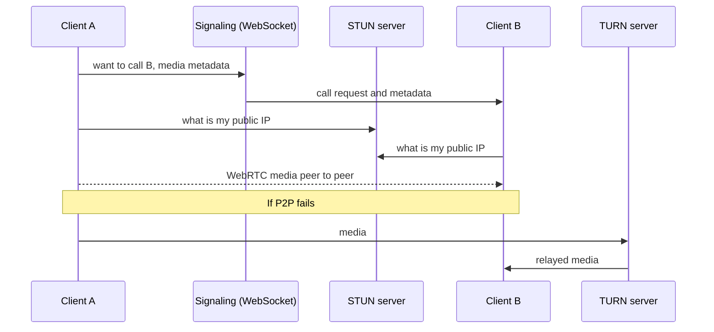
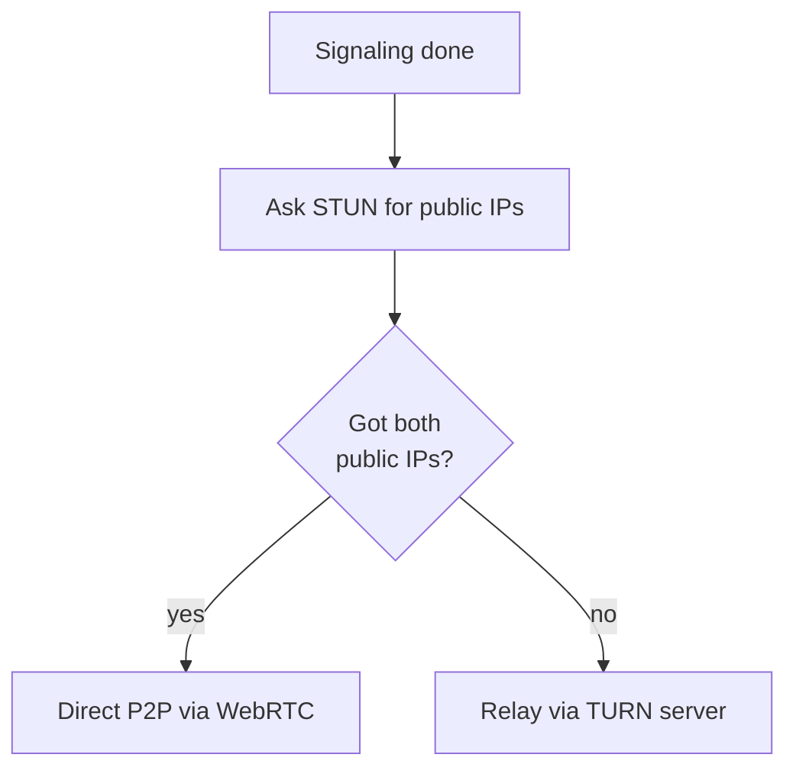

# How do Voice and Video Call work?

> **Step 16: Supporting reads for AI System Design** · ⏱️ 5 min read · [Read original](https://outcomeschool.com/blog/voice-and-video-call)

## TL;DR
Voice and video calls stream media between two clients using WebRTC. Clients first exchange call details via signaling (often WebSocket), then connect peer to peer using public IPs obtained from a STUN server. If that fails, a TURN server relays the media.

## Key Concepts
- **VoIP** — Voice over Internet Protocol, a popular standard for voice/video calling (WhatsApp, Skype, Messenger).
- **WebRTC** — free open project giving browsers and mobile apps Real-Time Communications via simple APIs; handles media streaming. Not enough alone.
- **Signaling** — clients exchange key data, messages and metadata about the media to set up the call.
- **STUN server** — gives a client its public IP address.
- **TURN server** — relays media when peer to peer fails.
- **Public vs private IP** — public is globally unique on the Internet (one device); private is not unique and never directly connected to the Internet.
- **NAT** — Network Address Translation; gives the device a local IP unusable for peer-to-peer.

## How It Works
1. **Signaling**: the two clients tell each other they want a call and exchange metadata. WebSocket can implement it. Other small non-media data (cut the call, settings changes, messages) also goes over signaling.
2. **STUN**: each client asks the STUN server for its public IP, since NAT hides it behind a local IP and WebRTC needs a public one.
3. **Peer to peer**: with both public IPs, WebRTC connects the clients directly and streams media.
4. **TURN fallback**: real-world connectivity is not ideal; if public IPs can't be obtained and P2P fails, TURN takes data from one client and sends it to the other (media relay).

Why can't WebRTC do signaling? The standard deliberately does not specify signaling methods/protocols, to avoid redundancy and maximise compatibility with established technologies. WebRTC is optimised for media.

Related: the same WebRTC audio stream is used to talk to an AI (see Design a Real-Time Voice AI Agent).

### Diagram: call setup

### Diagram: decision

## Trade-offs & Pitfalls
- WebRTC alone is not enough: signaling, STUN and TURN are needed.
- TURN is only needed when P2P fails, since it relays all media.

## FAQ
- WebRTC enough? → No.
- STUN vs TURN? → STUN reveals public IP; TURN relays media when P2P fails.
- Always need TURN? → No, only when P2P not possible.
- Non-media events like ending a call? → Over signaling.

## Key Takeaways
- WebRTC does media streaming; signaling is separate.
- Signaling carries call setup and non-media events (WebSocket works).
- STUN gets public IPs to bypass NAT limits for P2P.
- TURN is the relay fallback.
- WebRTC deliberately leaves signaling unspecified.
