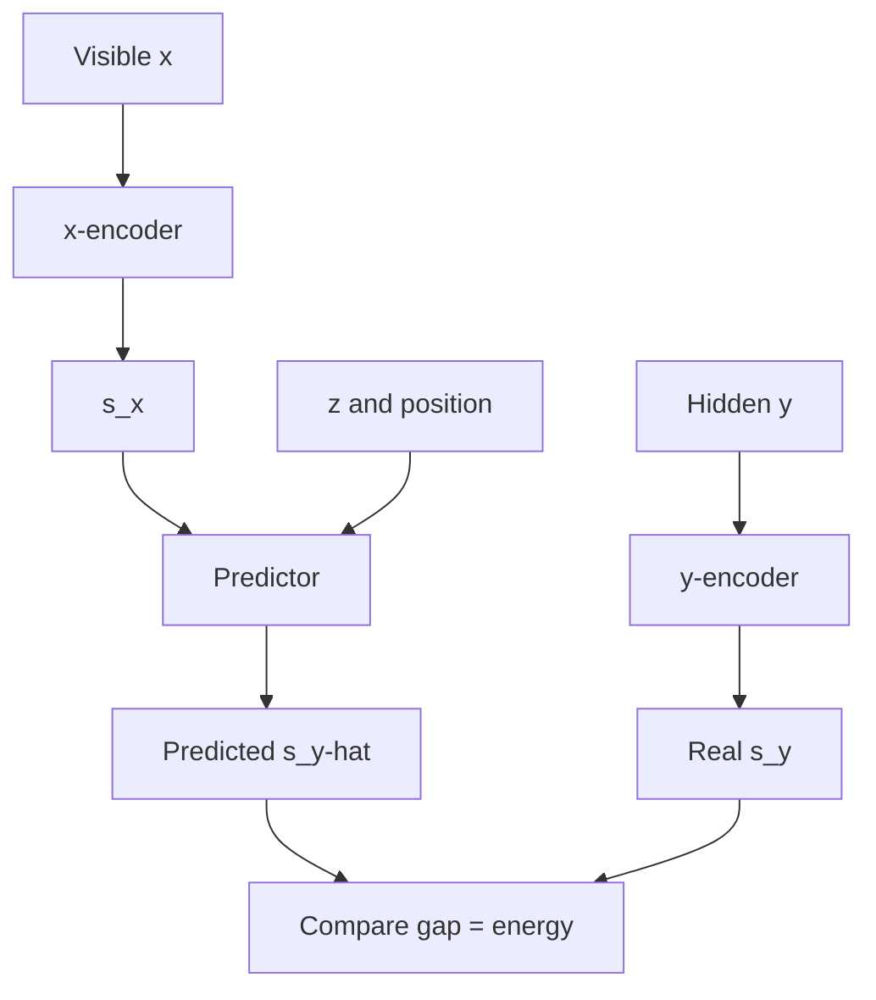

# What is Joint Embedding Predictive Architecture (JEPA)?

> **Step 17: Frontier Ideas in AI** · ⏱️ 28 min read · [Read original](https://outcomeschool.com/blog/joint-embedding-predictive-architecture-jepa)

## TL;DR
JEPA, proposed by Yann LeCun, learns by predicting the embedding (summary) of a hidden part of the data from the embedding of the visible part, instead of redrawing pixels. It avoids the wasted effort of generative models and the negative-example burden of contrastive methods, and points toward world models.

## Key Concepts
- **Embedding / representation space** — compact numeric summary of meaning; similar things sit close together.
- **Generative model** — predicts raw content (pixels); wastes effort on unpredictable detail.
- **Contrastive learning** — pulls matching views together and pushes negatives apart; needs many negatives and hand-made augmentation.
- **x-encoder / y-encoder** — turn visible context x and hidden target y into summaries s_x and s_y.
- **Predictor** — given s_x, a position, and optionally z, outputs the guessed summary s_y-hat.
- **Latent variable z** — extra note carrying information the context cannot supply (e.g. whether it rains in the hidden half), handling uncertainty.
- **Energy** — wrongness score: the gap between s_y-hat and s_y; low means a good match.
- **Representation collapse** — encoders output the same boring summary for everything.

## How It Works
**Core idea:** like guessing the gist behind a covered half of a photo (more grass, a tail), JEPA predicts in embedding space, not pixel space. It is non-generative: it ignores unpredictable detail and learns only predictable meaning.

**JEPA vs older methods**

| | Predicts | Pain |
|---|---|---|
| Generative | Raw pixels | Effort on unpredictable detail |
| Contrastive | Compares views in summary space | Many negatives and hand-made tricks |
| JEPA | Hidden summary from visible summary | Neither |

**I-JEPA (images, Meta AI 2023):** self-supervised. Cut the image into patches (ViT). Pick one context block and several target blocks (target patches removed from the context). Context encoder summarizes the context; target encoder runs on the whole image and the target block summaries are selected from its output; predictor, given positions, predicts target summaries. Training makes predictions close to real summaries.

**Avoiding collapse:** the context encoder learns fast; the target encoder follows it slowly via exponential moving average (EMA) and a stop-gradient, acting as a fixed answer key. No negatives or augmentations needed.

**V-JEPA (video, Feb 2024)** hides regions of unlabeled video and predicts their summaries. **V-JEPA 2 (June 2025)** moves toward world models; a version trained on a little robot video controlled a robot arm to pick and place objects in new labs from a goal image, planning by imagining outcomes in embedding space. These models still trail humans on hard physical and reasoning tests.

## Diagram

## Key Takeaways
- JEPA = Joint Embedding Predictive Architecture: predict summaries, not pixels.
- It sidesteps both generative waste and contrastive negatives/augmentations.
- Energy is the gap between predicted and real summaries; training minimizes it.
- I-JEPA avoids collapse with a slow EMA target encoder plus stop-gradient.
- V-JEPA and V-JEPA 2 extend this to video and world-model-style planning, complementing LLMs.
