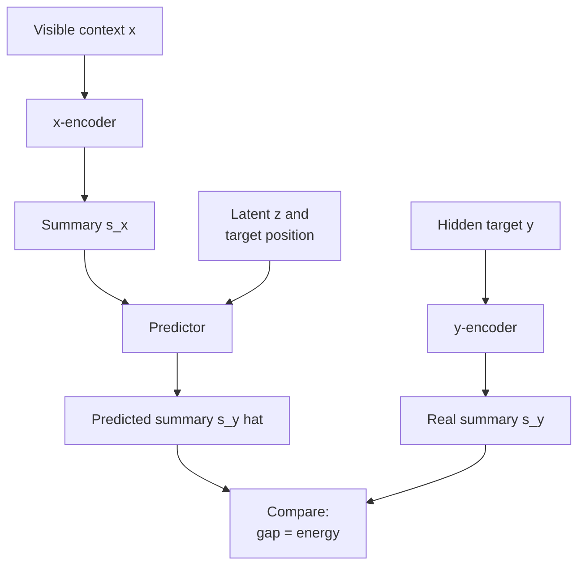
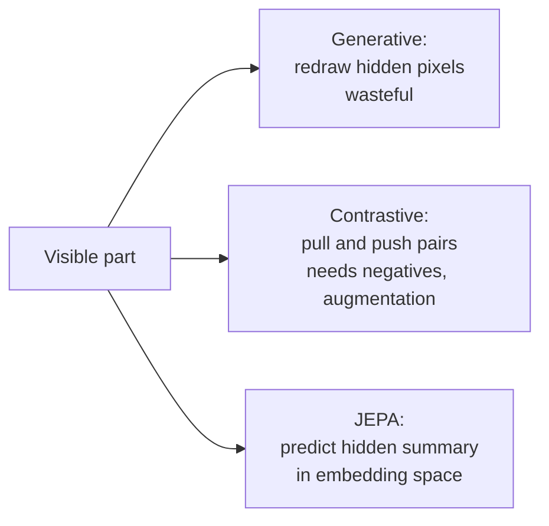
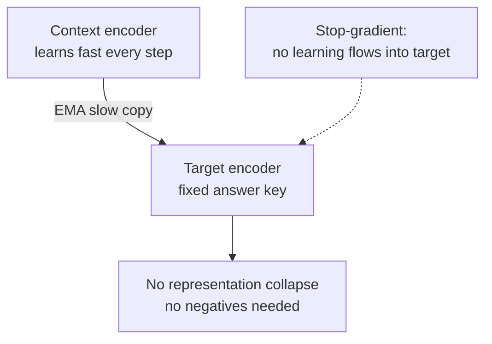

# What is Joint Embedding Predictive Architecture (JEPA)?

> **Step 17: Frontier Ideas in AI** · ⏱️ 28 min read · [Read original](https://outcomeschool.com/blog/joint-embedding-predictive-architecture-jepa)

## TL;DR
JEPA (Yann LeCun) learns by predicting the hidden part of the data from the visible part, but in embedding space (short summaries), not raw pixels. It is non-generative: it ignores unpredictable detail and learns meaning. It avoids generative waste and contrastive negatives/augmentations, and avoids collapse via a fast context encoder plus a slow EMA target encoder with stop-gradient. I-JEPA (images), V-JEPA (video) and V-JEPA 2 point toward world models.

## Key Concepts
- **JEPA** = Joint + Embedding + Predictive + Architecture: joint = two inputs handled side by side (context, target); embedding = summary; predictive = guess target summary from context summary; architecture = design.
- **Embedding / representation space** — short list of numbers capturing meaning (vs millions of pixels); similar things sit close (dog near dog, far from car).
- **Generative model** — redraws the hidden content pixel by pixel.
- **Contrastive learning** — pull same-image versions together, push different ones (negative examples) apart; often needs data augmentation (crop, flip, colour change).
- **x / y** — visible context / hidden target. **x-encoder → s_x**, **y-encoder → s_y**, **predictor → ŝ_y** (guess).
- **Latent variable z** — extra note carrying information the context can't give (e.g. is it raining in the hidden half), handles uncertainty ("could be this or that").
- **Energy-based view** — energy = wrongness score = gap between ŝ_y and s_y; low energy = good match.
- **Self-supervised learning** — hide part of the data, predict it; no manual labels.
- **Representation collapse** — encoders output the same boring summary for everything, so loss is trivially low.
- **EMA (exponential moving average)** — slow gentle following; **stop-gradient** — blocks learning signal into the target encoder.
- **World model** — internal sense of how the world behaves; lets a machine imagine outcomes before acting.

## How It Works

### Motivation
- A baby pushes a glass off a table and learns objects fall, by observation alone. LeCun's June 2022 paper "A Path Towards Autonomous Machine Intelligence" (he was Chief AI Scientist at Meta, now building world models at AMI Labs) envisions machines that learn a world model by observation, imagine action results and plan. JEPA is the core building block.
- Analogy: photo with the right half covered. You guess "more grass, a tail, some tree", the gist, not exact pixels or shadows.

### Problems with earlier approaches
| Approach | Idea | Problem |
|---|---|---|
| Generative (predict raw pixels) | Redraw masked half | Wastes effort on unpredictable detail (noise, lighting, specks of dust) |
| Contrastive | Pull positives, push negatives | Needs many negatives plus hand-made augmentations |
| JEPA | Predict summary of hidden part | Keeps relation learning of generative, clean summary space of contrastive, drops both burdens |

### JEPA building blocks
1. x-encoder turns visible x into s_x.
2. y-encoder turns hidden y into s_y.
3. Predictor takes s_x, z, and the **position** of the hidden part ("guess this window") to output ŝ_y. Same s_x, different position per target.
4. Compare ŝ_y with s_y; the gap is the error to minimise.
- Note: in real models (I-JEPA) the y-encoder sees the whole image and the target summary is picked from its output; end result is the same.

### Energy view
Energy $E = \text{distance}(\hat{s}_y, s_y)$: small gap = low energy (good pair), large = high. Training gives low energy to pairs that truly belong together. Both summaries come from the same input (two regions of one image), not image-vs-text.

### I-JEPA (Meta AI, 2023)
1. Cut the image into patches (processed by a Vision Transformer).
2. Choose one large **context block** (x) and several **target blocks** (y). Target patches are removed from the context so it can't copy.
3. Context encoder summarises the context. Target encoder runs over the whole image, then target-block summaries are selected from its output.
4. Predictor takes context summary plus each target's position and predicts target summaries (never pixels).
5. Loss compares predictions with real target summaries.
- **Avoiding collapse**: context encoder learns fast each step; target encoder follows slowly via EMA and with stop-gradient, like a fixed answer key. Both can't cheat together. No negatives, no hand-made augmentations.
- Efficiency: large I-JEPA trained on ImageNet using only raw images (no labels), 16 GPUs, under 72 hours. Representations transfer to recognising objects, counting objects, judging depth.

### V-JEPA and world models
- **V-JEPA** (Meta AI, Feb 2024): hides video regions, predicts their summaries from visible regions, in embedding space; trained on large unlabeled video.
- **V-JEPA 2** (Meta, June 2025): bigger; a version trained on a small amount of robot video controlled a real robot arm to pick and place objects in unseen labs, given only a goal image; it plans by imagining outcomes in embedding space.
- Pouring water analogy: you know the glass will overflow before it does; a world model is that inside a machine. Family extends to audio, motion and more.

### Diagram: JEPA architecture

### Diagram: three approaches

### Diagram: collapse avoidance

## Trade-offs & Pitfalls
- Collapse risk if both encoders can freely learn; needs asymmetric EMA plus stop-gradient design.
- Not a magic replacement: on hard physical and reasoning tests these models still don't match humans.
- Complementary to LLMs: text alone often misses physical sense (a glass falls off a table); JEPA adds intuitive world understanding from watching.
- Why it matters: focus on meaning, efficient (lighter than pixels), clean (no negatives/augmentations), a step toward machines that imagine, plan and act with common sense.

## FAQ
- Generative? → No, non-generative; predicts summaries only.
- Needs labels? → No, self-supervised (I-JEPA used ImageNet without labels).
- Needs negatives? → No; EMA plus stop-gradient prevents collapse.
- Replace LLMs? → No, complementary.
- Human-level physical understanding? → No, not yet.

## Key Takeaways
- JEPA predicts the summary of hidden data from visible data, not pixels.
- Parts: x-encoder, y-encoder, predictor with position and latent z; loss is the gap between predicted and real summary.
- It avoids both generative waste and contrastive negatives/augmentations.
- Collapse is avoided with an EMA target encoder and stop-gradient.
- I-JEPA is efficient (16 GPUs, under 72 h on unlabeled ImageNet); V-JEPA extends to video; V-JEPA 2 enables goal-image robot planning.
- It is a stepping stone toward world models, complementary to LLMs.
