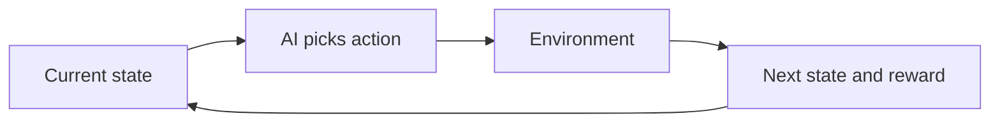
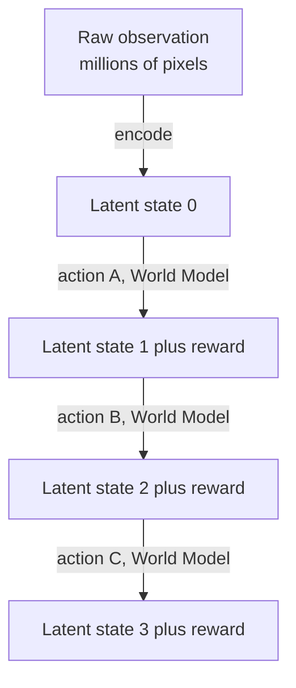
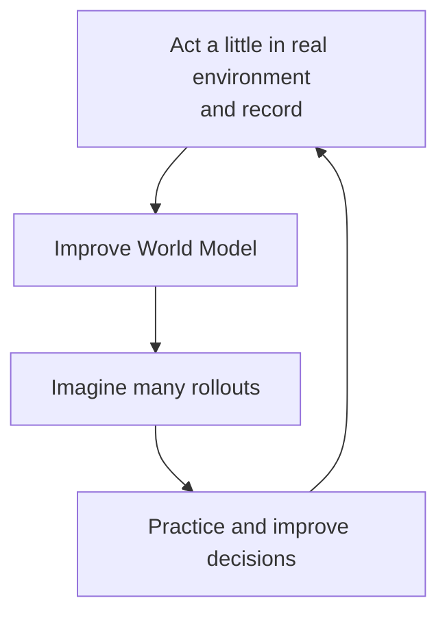

# How do World Models work?

> **Step 17: Frontier Ideas in AI** · ⏱️ 22 min read · [Read original](https://outcomeschool.com/blog/how-do-world-models-work)

## TL;DR
A World Model is an AI's learned, approximate internal simulator of an environment: given a state and an action it predicts the next state (and reward). It compresses raw observations into a small latent state, then chains predictions into rollouts so the agent can practice and plan in imagination instead of the slow, costly, risky real world. Dreamer agents, robotics, driving and action-conditioned video models use it.

## Key Concepts
- **Environment** — the world the AI interacts with (room for a robot, a game, road and traffic for a car).
- **State** — snapshot of the environment now (current screen: character position, enemies, health).
- **Action** — a choice that changes the state (jump, shoot, turn wheel, lift arm).
- **Reward** — number saying how good an outcome is (point scored = positive, pit = negative).
- **World Model** — World (environment) + Model (small internal copy). Not perfect, but useful; a little simulator in the AI's head.
- **Latent state** — compact summary of the raw observation; the model decides itself what to keep.
- **Rollout** — chain of imagined steps entirely inside the model.
- **Sample-efficient** — learns good behavior from very few real experiences.
- **Action-conditioned** — can answer "if I take this action, what happens next?".
- **Reinforcement Learning** — learning by trial, reward, and penalty.

## How It Works

### Core loop
State → AI picks action → environment returns new state (and reward) → repeat (the MDP loop).

### Intuition
Chess: imagine your knight move and the opponent's reply before touching a piece. Pouring water: you know it will overflow before tilting too much. A World Model gives an AI this ability to imagine outcomes before acting.

### Why we need it
Plain RL needs thousands to millions of real trials:
- Slow, expensive (real motors, battery, wear), and risky (robot falls, breaks things).
| Without World Model | With World Model |
|---|---|
| Practice in real environment | Practice inside internal simulator |
| Slow, expensive, risky | Fast, cheap, safe |
| Millions of real tries | Millions of imagined tries |

### How it learns
1. Let the AI interact and record stories: (state, action, next state, reward).
2. Train the model: give state+action, ask it to guess next state and reward.
3. Compare guess to what happened and nudge; repeat many times.
Result: generalises to unseen situations since it learns general rules, not memorised stories, with no hand-coded rules.

### Latent state
Raw observations (images) are millions of pixels; predicting pixel by pixel is wasteful and most pixels (sky colour) do not matter. The model compresses into a small set of numbers (character position, enemy position, health). Football analogy: a friend summarising a match in two sentences. Prediction then happens in latent space (latent state + action → next latent state + reward), faster and easier. Encoders in Variational Autoencoders do this kind of compression.

### Rollouts (imagining the future)
1. Start from the current latent state.
2. Pick an action; the model predicts next latent state and reward.
3. Feed the predicted state plus another action; repeat for many steps.
All inside the model, never touching the real world. This is the same latent-space prediction idea as JEPA. Benefit: lots of cheap practice, so sample-efficient.
Caveat: each prediction has a small error; errors accumulate, so long rollouts become unreliable. Rollouts are kept short and the AI returns to the real environment to check and correct.

### Dreamer-style agents
Cycle:
1. Interact a little with the real environment and record.
2. Use the recordings to improve the World Model.
3. Imagine many rollouts and practice/improve decisions (learn actions with high rewards).
4. Return to the real environment with better behavior, gather more, repeat.
Most learning happens in imagination, so little real interaction is needed.

### Predicting the future = planning
A World Model is fundamentally a future predictor (like predicting car positions before crossing a road). Because it can predict, the AI can compare actions by imagining where each leads and pick the best. Latent states, rollouts and Dreamer all build on this ability.

### Applications
| Area | Use |
|---|---|
| RL / games | Learn a model of the game and practice inside it; fewer real game steps (Dreamer mastered many games) |
| Robotics | Imagine movements, practice safely, execute only the good ones |
| Self-driving / planning | Imagine traffic movement over the next few seconds, plan a safe path |
| Video generation | Learning how scenes change frame to frame resembles predicting next state; related to diffusion models |

Not every video generator is a World Model: a plain one continues video plausibly without an action. A true World Model is action-conditioned; interactive video models that take actions as input are the ones that qualify.

### Diagram: the world-model loop

### Diagram: latent rollout

### Diagram: Dreamer cycle

## Trade-offs & Pitfalls
- Model is approximate: prediction errors compound in long rollouts, so keep them short and re-check with the real environment.
- Still needs some real experience (much less).
- The latent state is chosen by the model, which mostly, not always, matches what humans would keep.
- Plain video generators are not World Models (no action conditioning).
- When accurate enough: learning is faster, cheaper, safer and more sample-efficient than raw trial and error.

## FAQ
- Is every video generator a World Model? → No; need action-conditioning.
- Why short rollouts? → Errors accumulate.
- Still need the real environment? → Yes, but far less.
- Who decides the latent contents? → The model itself.
- Sample-efficient? → Good behavior from few real experiences.

## Key Takeaways
- World Model = learned simulator: (state, action) → (next state, reward).
- Learns from recorded experience by predicting what comes next.
- Latent compression makes prediction cheap.
- Rollouts let agents practice in imagination: faster, cheaper, safer, sample-efficient.
- Dreamer agents alternate between real data and imagined practice.
- Errors compound, so short rollouts plus real-world correction.
- Used in RL/games, robotics, driving and action-conditioned video.
