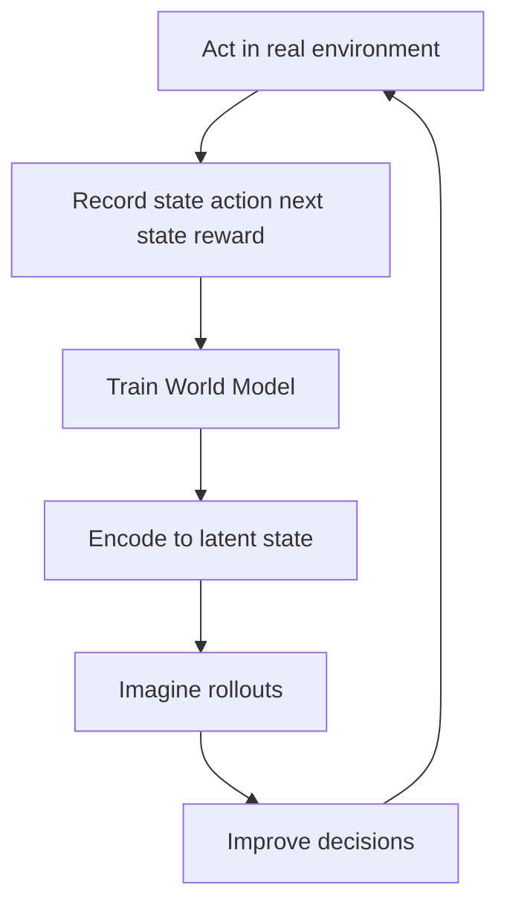

# How do World Models work?

> **Step 17: Frontier Ideas in AI** · ⏱️ 22 min read · [Read original](https://outcomeschool.com/blog/how-do-world-models-work)

## TL;DR
A World Model is an AI's learned internal simulator of an environment: given a state and an action, it predicts the next state and reward. The AI can then practice and plan by imagining futures instead of acting in the slow, costly, risky real world.

## Key Concepts
- **Environment / state / action** — the world the AI lives in; a snapshot of it; a choice that changes the state.
- **Reward** — number saying how good an outcome is.
- **World Model** — approximate internal copy of how the environment behaves.
- **Latent state** — compact summary of a raw observation, keeping what helps predict the future.
- **Rollout** — chain of imagined steps inside the model.
- **Sample-efficient** — learns good behavior from few real experiences.
- **Dreamer agents** — agents that train on imagined experience inside a World Model.

## How It Works
**Why needed:** trial-and-error Reinforcement Learning in the real world is slow, expensive (robot wear), and risky. Like imagining chess moves or pouring water mentally, the AI practices inside the model instead.

**Learning the model:** record experience as (state, action, next state, reward); train the model to predict next state and reward from state and action; compare with what happened and adjust. It learns general rules, not memorized stories.

**Latent state:** raw pixels are huge and mostly irrelevant (sky color). The model compresses an observation into a small latent state and predicts in that latent space, deciding for itself what matters. Compression is like a Variational Autoencoder encoder.

**Rollouts:** start from the current latent state, pick an action, predict next latent state and reward, feed that back in, repeat. Small prediction errors compound, so rollouts are kept short and the agent checks back with the real world.

**Dreamer cycle:**
1. Act a little in the real environment and record.
2. Improve the World Model.
3. Imagine many rollouts and learn good actions.
4. Return to reality with improved behavior and repeat.

**Real uses:** RL and games; robotics (imagine movements before doing them); self-driving (imagine traffic over the next seconds); video generation. A plain video generator is not a full World Model: a true one is action-conditioned ("if I take this action, what happens?").

## Diagram

## Key Takeaways
- A World Model is a learned simulator predicting next state and reward from state plus action.
- Predicting the future is what enables planning.
- Latent states make prediction cheap by dropping irrelevant pixel detail.
- Imagination makes learning faster, cheaper, safer, and more sample-efficient.
- Errors accumulate in long rollouts, so keep them short and verify against reality.
